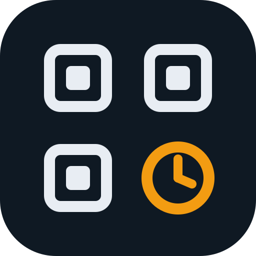
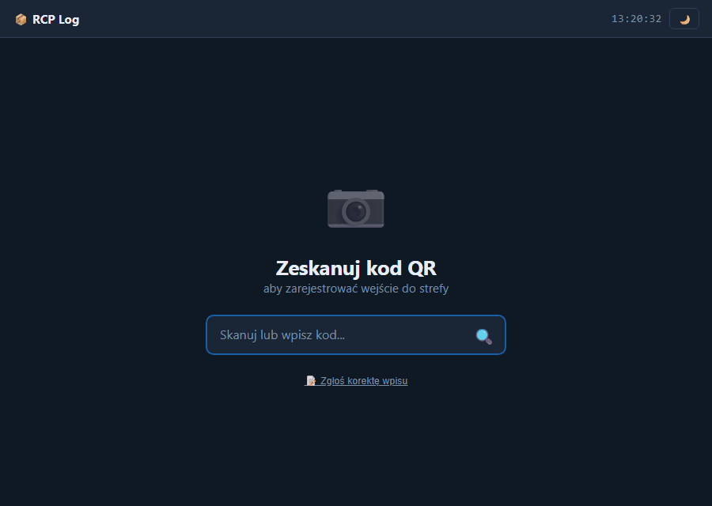
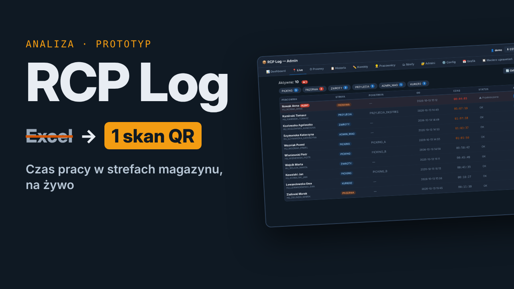
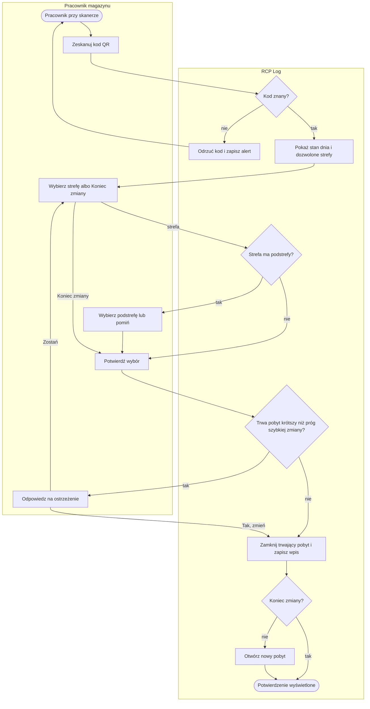

# RCP Log

[](https://github.com/TomaszWu14/rcp-log-public/actions/workflows/ci.yml)
[](LICENSE)


Rejestracja czasu pracy w strefach magazynu jednym skanem kodu QR — dla pracowników zmiany
i administratora, który do tej pory liczył ten czas ręcznie w Excelu.



📹 **Film (1:46, bez dźwięku, z napisami):** [docs/media/rcp-log-prezentacja.mp4](docs/media/rcp-log-prezentacja.mp4)

[](docs/media/rcp-log-prezentacja.mp4)

Film pokazuje pełną ścieżkę na danych fikcyjnych: pracownik skanuje kod i wybiera strefę, a administrator
widzi obsadę na żywo, alert przekroczonej przerwy, korekty i porównanie grafiku z obecnością.

| Czas | Co widać |
|---|---|
| 0:00 | problem: ręczna ewidencja w Excelu |
| 0:24 | ekran pracownika: skan kodu, wybór strefy i podstrefy, potwierdzenie |
| 0:44 | panel administratora: obsada stref, podgląd Live z alertem przerwy |
| 1:07 | nadwyżki przerw do rozliczenia i korekty zgłoszone przez pracowników |
| 1:19 | grafik z Excela porównany z pierwszym skanem dnia |
| 1:29 | zakres projektu i linki |

**Demo bez logowania:** [rcp.log.twapp.pl](https://rcp.log.twapp.pl) — dane fikcyjne, odtwarzane co 30 min. Lokalnie: [tryb demo](#tryb-demo).

🇬🇧 **English:** [README.en.md](README.en.md)

## Problem → rozwiązanie

Na zmianie pracuje około 60 osób w około 15 strefach: kompletacja, przyjęcia, wysyłka, przerwa.
Czas w strefach lider wpisuje ręcznie do Excela, więc nikt nie wie na bieżąco, kto jest gdzie,
a przekroczoną przerwę widać dopiero przy rozliczeniu.
RCP Log zastępuje arkusz jednym skanem: każdy skan zamyka poprzedni pobyt i otwiera nowy,
administrator widzi obsadę na żywo, a przerwa ponad próg wywołuje alert i trafia na listę do rozliczenia.

## Dokumentacja analityczna

Dokumentacja przedwdrożeniowa odtworzona z kodu: procesy P1–P7 z diagramami BPMN w Mermaid i torami
aktorów, reguły biznesowe BR-1–BR-58, wymagania WF-1–WF-40 z kryteriami Given/When/Then, model danych,
user flow, integracje i dziennik decyzji. Główny proces poniżej, reszta w [`docs/`](docs/00-przeglad.md).



| Dokument | Zawartość |
|---|---|
| [00. Przegląd](docs/00-przeglad.md) | cel biznesowy, zakres, aktorzy, mapa procesów, SIPOC, ustalenia potwierdzone z właścicielem projektu, lista do anonimizacji |
| [P1. Rejestracja pobytu w strefie](docs/01-procesy/P1-rejestracja-pobytu.md) | skan, wybór strefy i podstrefy, potwierdzenie, zamknięcie pobytu, koniec zmiany |
| [P2. Nadzór nad obsadą i alertowanie](docs/01-procesy/P2-nadzor-i-alerty.md) | kontrola w tle, alerty, Live, Dashboard, ręczne przesunięcia |
| [P3. Rozliczanie nadwyżek przerw](docs/01-procesy/P3-nadwyzki-przerw.md) | nadwyżka ponad próg i przypisanie strefy |
| [P4. Obsługa korekt ewidencji](docs/01-procesy/P4-korekty-ewidencji.md) | zgłoszenie pracownika i decyzja administratora |
| [P5. Planowanie grafiku i kontrola obecności](docs/01-procesy/P5-grafik-i-obecnosc.md) | szablon, import z Excela, edycja, porównanie z obecnością |
| [P6. Utrzymanie słowników i konfiguracji](docs/01-procesy/P6-slowniki-i-konfiguracja.md) | strefy, pracownicy, uprawnienia, konta, progi, dane startowe |
| [P7. Raportowanie, eksport i kopia zapasowa](docs/01-procesy/P7-eksport-i-kopie.md) | historia, eksport CSV, kopia o 02:00 |
| [02. Model danych](docs/02-dane/model-danych.md) | ERD, słownik encji z cyklem życia, słownik pojęć, spójność danych |
| [03. User flow](docs/03-user-flow/user-flow.md) | przejścia między ekranami, zakładki panelu, ślepe ścieżki |
| [04. Integracje](docs/04-integracje.md) | diagram kontekstu, interfejsy, adresy HTTP, środowisko uruchomieniowe, tryb demo |
| [05. Decyzje i ograniczenia](docs/05-decyzje-i-ograniczenia.md) | decyzje D1–D12, ograniczenia, dług techniczny, lista przed wdrożeniem produkcyjnym |
| [Archiwum](docs/archiwum/README.md) | pierwsza wersja dokumentacji (01–07); jej identyfikatory wymagań są nazwami testów |

## Proces pracy (BA / DEV / SEC)

Od 2026-10-15 repo jest prowadzone jak przez trzyosobowy zespół — analityk, developer, bezpieczeństwo —
z Product Ownerem akceptującym zakres i ryzyka. Każdy krok w dokumentach i PR-ach ma oznaczenie roli.

| Dokument | Zawartość |
|---|---|
| [Audyt stanu wyjściowego](docs/AUDYT.md) | trzy perspektywy: luki w wymaganiach, dług techniczny, top 10 ryzyk |
| [Historyjki](docs/analiza/HISTORYJKI.md) · [Śledzenie](docs/analiza/SLEDZENIE.md) · [Założenia](docs/analiza/ZALOZENIA.md) | backlog MoSCoW z Given/When/Then, macierz wymaganie → test → PR, założenia do potwierdzenia |
| [Threat model](docs/bezpieczenstwo/THREAT_MODEL.md) · [Rejestr ryzyk](docs/bezpieczenstwo/RYZYKA.md) · [RODO](docs/bezpieczenstwo/RODO.md) | STRIDE per przepływ, decyzje i właściciele, podstawy przetwarzania i retencja |
| [Architektura](docs/architektura/ARCHITEKTURA.md) · [API](docs/architektura/API.md) · [ADR](docs/architektura/adr/README.md) | C4 w Mermaid, endpointy z rolą dostępu, decyzje |
| [CONTRIBUTING](CONTRIBUTING.md) · [SECURITY](SECURITY.md) · [CHANGELOG](CHANGELOG.md) | proces, Definition of Ready/Done, zgłaszanie podatności |

CI (GitHub Actions) na każdym PR: ruff, testy, bandit, Semgrep, pip-audit, gitleaks, Trivy (repo i obraz Dockera).

### Bezpieczeństwo

CI (`.github/workflows/ci.yml`) na każdym PR i pushu do `main` blokuje merge, gdy:

- **sekrety** — gitleaks (przypięta wersja + sha256) znajdzie sekret w commitach PR-a (na `main`: cała historia),
- **SAST** — bandit (waga średnia i wyższa) albo Semgrep `p/owasp-top-ten` zgłosi ustalenie,
- **zależności** — pip-audit (`requirements*.txt`) albo Trivy (repo i obraz) znajdzie podatność HIGH/CRITICAL
  z dostępną poprawką.

Akcje GitHub są przypięte do SHA; Dependabot co tydzień proponuje aktualizacje (pip, actions, docker). Aplikacja
wysyła nagłówki CSP, `X-Frame-Options`, `X-Content-Type-Options`, `Referrer-Policy`, `Permissions-Policy`,
`Cross-Origin-Opener-Policy`, `Cache-Control: no-store` na JSON i HSTS za proxy (`RCP_PROXY=1`).
Zgłaszanie podatności: [SECURITY.md](SECURITY.md).

## Jak uruchomić

Wymagany Python 3.11 lub nowszy.

Windows (PowerShell lub cmd):

```powershell
git clone https://github.com/TomaszWu14/rcp-log-public.git
cd rcp-log-public
python -m venv .venv
.venv\Scripts\python -m pip install -r requirements.txt
$env:RCP_SECRET_KEY = .venv\Scripts\python -c "import secrets; print(secrets.token_hex(32))"
.venv\Scripts\python run.py
```

Linux / macOS:

```bash
git clone https://github.com/TomaszWu14/rcp-log-public.git
cd rcp-log-public
python3 -m venv .venv
.venv/bin/python -m pip install -r requirements.txt
export RCP_SECRET_KEY=$(.venv/bin/python -c "import secrets; print(secrets.token_hex(32))")
.venv/bin/python run.py
```

Po starcie:

| Adres | Co to jest |
|---|---|
| http://localhost:5050/ | skaner — wpisz `HU_KOWALSKI_JAN` i naciśnij Enter |
| http://localhost:5050/admin | panel administratora — login `admin`, hasło z `RCP_ADMIN_PASSWORD` albo wypisane w konsoli przy pierwszym starcie; przy pierwszym logowaniu aplikacja wymusza zmianę hasła |

Przy pierwszym uruchomieniu aplikacja sama tworzy katalog `data/` ze strefami, trzema przykładowymi
pracownikami (`HU_KOWALSKI_JAN`, `HU_NOWAK_ANNA`, `HU_WISNIEWSKI_PIOTR`) i kontem administratora.
Katalog `data/` nie jest wersjonowany.

### Tryb demo

Zmienna `RCP_DEMO=1` uruchamia aplikację do pokazu:

- panel administratora otwiera się bez logowania,
- [`demo_data.py`](demo_data.py) generuje 12 fikcyjnych pracowników, ewidencję z 10 dni roboczych, trwającą zmianę
  z przekroczoną przerwą, nadwyżki przerw, korekty do zatwierdzenia i grafik ze spóźnieniem i nieobecnością,
- dane leżą w osobnym katalogu `data_demo/` i są odtwarzane co `RCP_DEMO_RESET_MIN` minut (domyślnie 30),
- dodawanie i usuwanie stref, pracowników i adminów, zmiana konfiguracji i import grafiku są zablokowane.

```bash
RCP_DEMO=1 .venv/bin/python run.py          # Linux / macOS
```

```powershell
$env:RCP_DEMO = "1"; .venv\Scripts\python run.py   # Windows (PowerShell)
```

### Publiczna instancja: Coolify, rcp.log.twapp.pl

Demo pod adresem [rcp.log.twapp.pl](https://rcp.log.twapp.pl) działa na [Coolify](https://coolify.io)
z plików [`Dockerfile`](Dockerfile) i [`docker-compose.yaml`](docker-compose.yaml):

1. **DNS:** rekord `A` dla `rcp.log.twapp.pl` wskazujący adres IP serwera z Coolify.
2. **Coolify:** projekt → **+ New Resource → Public Repository**, adres
   `https://github.com/TomaszWu14/rcp-log-public`, gałąź `main`, **Build Pack: Docker Compose**
   (plik `/docker-compose.yaml`).
3. **Domena:** w ustawieniach zasobu wpisz `https://rcp.log.twapp.pl` — certyfikat Let's Encrypt wystawi
   proxy Coolify. Zmienne `RCP_DEMO`, `RCP_DEMO_RESET_MIN`, `TZ` i losowany `RCP_SECRET_KEY` są już
   w pliku compose.
4. **Deploy.** Obraz ma healthcheck na `/`; Coolify pokaże status *healthy*, gdy dane demo się wygenerują.
   Każdy push do `main` wdraża nową wersję, jeśli w zasobie włączysz **Auto Deploy** (webhook GitHub).

Build Pack **Dockerfile** też zadziała — wtedy port `5050` i zmienne z tabeli poniżej ustaw ręcznie
w panelu. Dane demo są odtwarzane z kodu, więc kontener nie potrzebuje woluminu; dla trybu produkcyjnego
(`RCP_DEMO=0`) odkomentuj woluminy `data` i `backup` w `docker-compose.yaml`.

Alternatywa bez własnego serwera: [`render.yaml`](render.yaml) dla [Render](https://render.com)
(**New → Blueprint**); darmowy plan usypia usługę bez ruchu, pierwsze wejście budzi ją w około minutę.

Lokalnie w Dockerze:

```bash
docker build -t rcp-log .
docker run --rm -p 5050:5050 -e RCP_DEMO=1 rcp-log
```

| Zmienna | Znaczenie |
|---|---|
| `RCP_DEMO` | `1` włącza tryb demo |
| `DEMO_VISITOR_GATE` | `1`/`0` — bramka „przedstaw się” przed skanerem i panelem; domyślnie włączona w trybie demo, poza nim wyłączona; lista gości: `/admin/goscie` |
| `VISITORS_TOKEN` | token do `/admin/goscie?token=...` i `/admin/goscie.csv?token=...` — pozwala właścicielowi zobaczyć listę gości w demo; bez zmiennej konto demo dostaje 404 |
| `NTFY_URL` | pełny adres tematu ntfy (np. `https://ntfy.sh/<tajny-temat>` albo własny serwer) — po każdym poprawnym wypełnieniu bramki gościa wysyła w tle powiadomienie push „imię nazwisko (firma) wszedł do rcp-log”; bez zmiennej brak powiadomień i ruchu sieciowego |
| `NTFY_TOKEN` | opcjonalny token dostępu do serwera ntfy (nagłówek `Authorization: Bearer …`) |
| `NTFY_WATCH_COMPANIES` | opcjonalna lista fraz rozdzielonych przecinkami (np. `firma-a, firma-b`; ustaw tylko w panelu, nie w repo) — gdy firma gościa zawiera którąś frazę (bez względu na wielkość liter i polskie znaki, fraza min. 2 znaki), powiadomienie idzie z priorytetem `urgent` i tytułem „UWAGA firma z listy” |
| `NTFY_ENGAGED_VIEWS` | po ilu obejrzanych ekranach wysłać jedno powiadomienie „Gosc oglada demo” (domyślnie 10, `0` wyłącza); liczba ekranów, czas wizyty i najczęstsze sekcje są widoczne na `/admin/goscie` |
| `RCP_DEMO_RESET_MIN` | co ile minut odtworzyć dane demo (domyślnie 30) |
| `RCP_SECRET_KEY` | klucz podpisu sesji, co najmniej 32 znaki; **wymagany** poza trybem demo (bez niego aplikacja nie startuje) |
| `RCP_ADMIN_PASSWORD` | hasło startowe konta `admin` przy pierwszym starcie; bez niej hasło jest losowane i wypisane raz w konsoli; w obu wypadkach zmiana wymuszona przy pierwszym logowaniu |
| `RCP_PROXY` | `1`, gdy aplikacja stoi za proxy z TLS (Coolify): ciasteczko sesji tylko po HTTPS, adres klienta z `X-Forwarded-For`, nagłówek HSTS |
| `RCP_BACKUP_ROOT` | katalog, pod którym musi leżeć ścieżka kopii z konfiguracji (domyślnie katalog aplikacji) |
| `PORT` | port serwera (domyślnie 5050) |

Testy akceptacyjne (47 testów, bez dodatkowych zależności; nazwy testów to identyfikatory wymagań
z [archiwalnej listy](docs/archiwum/05-wymagania.md), a mapę na WF-n ma każdy dokument procesu):

```bash
python -m unittest discover tests
```

## Struktura repozytorium

```
app.py              cała logika i API (Flask) — świadomie jeden plik, patrz D1
run.py              start produkcyjny (Waitress)
demo_data.py        generator fikcyjnych danych dla trybu demo
Dockerfile          obraz produkcyjny (Python 3.12 slim + Waitress) dla Coolify i Dockera
docker-compose.yaml konfiguracja publicznego demo na Coolify (rcp.log.twapp.pl)
render.yaml         konfiguracja demo na Render (alternatywa)
templates/          skaner (index.html), panel (admin.html), logowanie
tests/              testy akceptacyjne; nazwy testów to ID z docs/archiwum/05, mapa na WF-n w docs/01-procesy
tools/              skrypty pomocnicze (przeliczanie odwołań do linii app.py w dokumentacji)
graphify-out/       graf zależności kodu i dokumentacji (graphify) z raportem
docs/               dokumentacja przedwdrożeniowa: 00 przegląd, 01-procesy P1–P7, 02-dane, 03-user-flow,
                    04 integracje, 05 decyzje i ograniczenia; archiwum, screenshots, media (logo, film);
                    proces zespołu: AUDYT, analiza/, architektura/, bezpieczenstwo/, testy/, operacje/
data/               tworzony przy starcie: JSON i CSV z danymi (poza repozytorium)
data_demo/          dane trybu demo, odtwarzane automatycznie (poza repozytorium)
```

## Stack i dlaczego taki

| Element | Dlaczego |
|---|---|
| **Python 3.11 + Flask** | cała logika i API mieszczą się w jednym pliku (`app.py`) — przy prototypie liczy się czas od pomysłu do sprawdzenia procesu |
| **Waitress** | produkcyjny serwer WSGI, który działa także na Windowsie (`run.py`) |
| **Pliki JSON i CSV zamiast bazy** | zero infrastruktury; ewidencja zapisywana jest jako CSV z separatorem `;` i BOM, więc otwiera się wprost w Excelu, którego używano wcześniej — szczegóły i koszty tej decyzji w [D1](docs/05-decyzje-i-ograniczenia.md#d1-pliki-json-i-csv-zamiast-bazy-danych) |
| **openpyxl** | grafik zmian przychodzi w Excelu — aplikacja generuje szablon `.xlsx` i importuje wypełniony plik |
| **HTML, CSS i JavaScript bez frameworka** | skaner działa w dowolnej przeglądarce na stanowisku, bez kroku budowania frontendu |

## Zakres i ograniczenia

W zakresie: rejestracja wejść do stref i przerw, uprawnienia do stref, alerty przerw i długich dyżurów,
korekty, podgląd na żywo, grafik i porównanie z obecnością, eksport CSV, kopia zapasowa.

Poza zakresem: naliczanie wynagrodzeń i integracja z systemem kadrowym, automatyczna poprawka ewidencji
po zatwierdzeniu korekty, zmiana nocna przez północ, praca skanera offline.

To prototyp. Najważniejsze ustalenia z przeglądu bezpieczeństwa są już naprawione: klucz sesji jest wymagany
poza trybem demo, hasło startowe trzeba zmienić przy pierwszym logowaniu, jest limit prób logowania, CSRF
i nagłówki bezpieczeństwa. Otwarte pozostają m.in. przewidywalna treść kodu QR (B5) i nadpisanie hasła przy
dodaniu istniejącego loginu (B9). Pełna lista: [05. Decyzje i ograniczenia](docs/05-decyzje-i-ograniczenia.md#bezpieczeństwo).

## Kontekst projektu

Projekt powstał z problemu, który zauważyłem w swojej pracy w magazynie: czas w strefach liczono w Excelu
na podstawie ręcznych wpisów lidera zmiany. Z własnej inicjatywy przygotowałem prototyp, który ten proces zastępuje.

Odpowiadałem za całość — od analizy do działającego rozwiązania:

- **analiza procesu i wymagań** — wymagania zebrane od kierownika magazynu i lidera zmiany oraz z własnej obserwacji procesu,
- **projekt ekranów i modelu danych**,
- **implementacja**,
- **testy akceptacyjne** wymagań.

Prototyp nie był jeszcze testowany z użytkownikami na zmianie — to następny krok.

Od pomysłu do działającego prototypu minął około miesiąc. Repozytorium nie zawiera danych ani nazwy firmy —
wszystkie dane są przykładowe.

## Licencja

[MIT](LICENSE)
