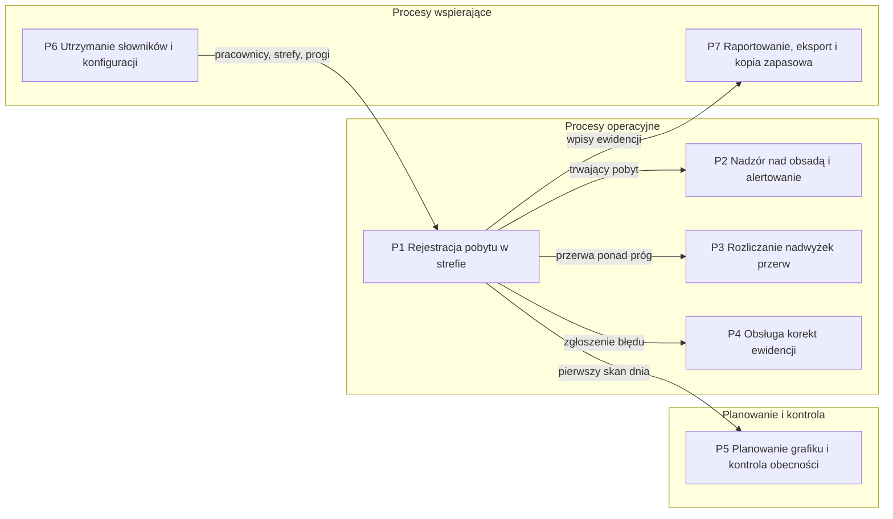

# 00. Przegląd rozwiązania

Dokumentacja przedwdrożeniowa prototypu **RCP Log** odtworzona z kodu aplikacji (`app.py`, `demo_data.py`,
szablony ekranów, testy akceptacyjne) i z README. Każda reguła i każdy krok procesu mają w tabelach
kolumnę „Źródło w kodzie”. To, czego z kodu ustalić się nie da, jest zebrane na końcu w sekcji
[Założenia wymagające potwierdzenia](#założenia-wymagające-potwierdzenia).

Stan na: październik 2026. Status rozwiązania: **prototyp**, nieprzetestowany z użytkownikami na zmianie
(wg README).

## Cel biznesowy

RCP Log rejestruje czas pracy pracowników magazynu w strefach jednym skanem kodu QR i zastępuje ręczne
wpisywanie godzin przez lidera zmiany do arkusza kalkulacyjnego. Administrator widzi na bieżąco, kto jest
w której strefie, a przekroczona przerwa i zbyt długi pobyt w jednej strefie wywołują alert w chwili, gdy
trwają, a nie dopiero przy rozliczeniu. Ewidencja powstaje automatycznie jako pliki CSV otwierane
w Excelu, a nadwyżki przerw i korekty trafiają na listy do decyzji człowieka.

## Zakres

### Co aplikacja robi

| Obszar | Zakres | Proces |
|---|---|---|
| Rejestracja pobytów | skan kodu, wybór strefy i podstrefy, potwierdzenie, koniec zmiany; każdy skan zamyka poprzedni pobyt i otwiera nowy | [P1](01-procesy/P1-rejestracja-pobytu.md) |
| Uprawnienia | pracownik widzi i wybiera tylko strefy, które ma przypisane | [P1](01-procesy/P1-rejestracja-pobytu.md), [P6](01-procesy/P6-slowniki-i-konfiguracja.md) |
| Nadzór i alerty | podgląd obsady na żywo, dashboard dnia, alerty: długa przerwa, długi dyżur, pobyt niezamknięty do końca dnia, nieznany kod; ręczne przesunięcie lub zakończenie pobytu | [P2](01-procesy/P2-nadzor-i-alerty.md) |
| Nadwyżki przerw | przerwa dłuższa niż próg daje nadwyżkę, którą administrator przypisuje do strefy | [P3](01-procesy/P3-nadwyzki-przerw.md) |
| Korekty | pracownik zgłasza błąd opisem, administrator zatwierdza lub odrzuca | [P4](01-procesy/P4-korekty-ewidencji.md) |
| Grafik | szablon do Excela, import, ręczna edycja, porównanie planu z pierwszym skanem dnia | [P5](01-procesy/P5-grafik-i-obecnosc.md) |
| Słowniki i konfiguracja | strefy, podstrefy, pracownicy, uprawnienia (pojedynczo i macierzą), konta administratorów, progi alertów | [P6](01-procesy/P6-slowniki-i-konfiguracja.md) |
| Dane na zewnątrz | historia z filtrami, eksport CSV dnia, miesiąca i alertów, nocna kopia zapasowa | [P7](01-procesy/P7-eksport-i-kopie.md) |
| Tryb demo | publiczna instancja z fikcyjnymi danymi odtwarzanymi cyklicznie, panel bez logowania, zmiany słowników zablokowane | [04. Integracje](04-integracje.md) |

### Czego aplikacja świadomie nie robi

| Poza zakresem | Jak to wynika z kodu |
|---|---|
| Naliczanie wynagrodzeń, integracja z systemem kadrowo-płacowym | jedynym wyjściem danych jest plik CSV (`app.py:1003-1016`) |
| Automatyczna poprawka ewidencji po zatwierdzeniu korekty | decyzja zmienia tylko status zgłoszenia (`app.py:798-809`) |
| Zmiana nocna przechodząca przez północ | pobyt z poprzedniego dnia jest zamykany o 23:59:59 dnia rozpoczęcia (`app.py:396-418`) |
| Uprawnienia na poziomie podstref | uprawnienia to lista stref; podstrefa nie jest sprawdzana (`app.py:501-503`) |
| Praca skanera bez połączenia z serwerem | każdy skan to zapytanie do serwera; brak bufora po stronie ekranu (`index.html:450-460`) |
| Role w panelu inne niż administrator | jeden znacznik zalogowania dla wszystkich funkcji panelu (`app.py:278`) |
| Potwierdzanie (zamykanie) alertów | kolumna „potwierdzone” ma zawsze wartość „NIE” (`app.py:252`) |
| Retencja i usuwanie danych osobowych | brak jakiegokolwiek mechanizmu kasowania wpisów, alertów i kopii |
| Baza danych | dane w plikach JSON i CSV (`app.py:18-29`) |

## Aktorzy

| Aktor | Typ | Kanał | Odpowiedzialność | Źródło w kodzie |
|---|---|---|---|---|
| Pracownik magazynu | człowiek | ekran skanera `/`, bez logowania | identyfikuje się kodem, rejestruje wejście do strefy, przerwę i koniec zmiany, zgłasza korektę | `app.py:429-645`, `index.html` |
| Administrator | człowiek | panel `/admin`, po zalogowaniu | monitoruje obsadę, reaguje na alerty, przesuwa i kończy pobyty, rozlicza nadwyżki i korekty, utrzymuje słowniki, grafik i konfigurację, eksportuje dane | `app.py:650-1187`, `admin.html` |
| Gość demo | wariant administratora | panel w trybie demo, logowanie automatyczne | ogląda i testuje wszystko poza zmianą słowników, kont, konfiguracji i importem grafiku | `app.py:1200-1251` |
| Kontrola pobytów | proces automatyczny, co 60 s | wątek serwera | wykrywa długą przerwę i długi dyżur, zamyka pobyty z poprzedniego dnia | `app.py:359-424` |
| Kopia zapasowa | proces automatyczny, raz na dobę o 02:00 | wątek serwera (nie w trybie demo) | kopiuje wszystkie pliki danych do katalogu kopii | `app.py:332-354` |
| Odtwarzanie danych demo | proces automatyczny, co N minut | wątek serwera (tylko tryb demo) | kasuje dane i generuje fikcyjny stan | `app.py:1207-1258` |
| Czytnik kodów QR | urządzenie | pole tekstowe na ekranie skanera | wpisuje kod pracownika jak z klawiatury; po wpisaniu ponad 5 znaków ekran sam wysyła kod po 0,7 s | `index.html:441-448` |
| Excel (lub inny arkusz) | system zewnętrzny | pliki `.xlsx` i `.csv` | wypełnienie szablonu grafiku; odczyt ewidencji i alertów | `app.py:117-196, 1022-1070` |
| Kierownik magazynu, lider zmiany | interesariusze poza systemem | brak własnego kanału w kodzie | odbiorcy ewidencji i podglądu; ręczne naniesienie zatwierdzonych korekt (wg README i archiwum) | — (założenie Z1) |

## Mapa procesów

| Nr | Proces | Zdarzenie inicjujące | Rezultat biznesowy | Właściciel w aplikacji | Dokument |
|---|---|---|---|---|---|
| P1 | Rejestracja pobytu w strefie | pracownik podchodzi do skanera z kodem | zamknięty pobyt w ewidencji i otwarty nowy albo zakończona zmiana | pracownik (wykonuje), administrator (nadzoruje) | [P1](01-procesy/P1-rejestracja-pobytu.md) |
| P2 | Nadzór nad obsadą i alertowanie | trwający pobyt (sprawdzany co 60 s) albo administrator otwiera panel | odchylenie wykryte, zapisane jako alert i obsłużone | administrator | [P2](01-procesy/P2-nadzor-i-alerty.md) |
| P3 | Rozliczanie nadwyżek przerw | pracownik kończy przerwę dłuższą niż próg | nadwyżka przypisana do strefy, która ponosi jej koszt | administrator | [P3](01-procesy/P3-nadwyzki-przerw.md) |
| P4 | Obsługa korekt ewidencji | pracownik zgłasza błąd w rejestracji | decyzja o korekcie; poprawka ewidencji poza aplikacją | administrator | [P4](01-procesy/P4-korekty-ewidencji.md) |
| P5 | Planowanie grafiku i kontrola obecności | nowy miesiąc do zaplanowania albo potrzeba kontroli | grafik miesiąca w aplikacji; raport: na czas, spóźnienie, nieobecność | administrator | [P5](01-procesy/P5-grafik-i-obecnosc.md) |
| P6 | Utrzymanie słowników i konfiguracji | zmiana w organizacji: nowa osoba, strefa, próg, konto | aktualne słowniki i progi obowiązujące od następnego skanu | administrator | [P6](01-procesy/P6-slowniki-i-konfiguracja.md) |
| P7 | Raportowanie, eksport i kopia zapasowa | potrzeba danych z ewidencji albo godzina 02:00 | plik CSV u odbiorcy; kopia danych w katalogu kopii | administrator, system | [P7](01-procesy/P7-eksport-i-kopie.md) |

Właściciel biznesowy procesów (kto odpowiada za proces w organizacji, nie w aplikacji) nie wynika
z kodu, patrz założenie Z1.

## SIPOC dla całości rozwiązania

| Dostawcy (S) | Wejścia (I) | Proces (P) | Wyjścia (O) | Odbiorcy (C) |
|---|---|---|---|---|
| pracownik magazynu | skan kodu, wybór strefy i podstrefy, potwierdzenie, zgłoszenie korekty | **Rejestracja** (P1): skan zamyka poprzedni pobyt i otwiera nowy | wpis ewidencji w pliku dnia i miesiąca; trwający pobyt | administrator; odbiorcy ewidencji (Z1) |
| zadanie w tle, administrator | trwające pobyty, progi z konfiguracji | **Nadzór** (P2): wykrycie długiej przerwy, długiego dyżuru, pobytu bez końca zmiany | alerty w pliku i w panelu; pobyty zamknięte automatycznie lub ręcznie | administrator |
| pracownik (przerwa), administrator | zamknięta przerwa ponad próg, wybór strefy | **Rozliczanie nadwyżek** (P3) | lista nadwyżek ze statusem „oczekuje” lub „przypisana” | administrator; rozliczenie kosztu poza systemem (Z5) |
| pracownik, administrator | opis błędu, decyzja | **Korekty** (P4) | lista zgłoszeń ze statusem; poprawka CSV poza systemem | administrator, kierownik (Z1) |
| osoba planująca zmiany (Z6), administrator | plik grafiku `.xlsx`, kody zmian, tolerancja spóźnienia | **Grafik i obecność** (P5) | grafik miesiąca; status każdego dnia: na czas, spóźnienie, nieobecność, planowane, wolne | administrator, kierownik (Z1) |
| administrator | nazwy stref i podstref, kody i nazwiska pracowników, uprawnienia, konta, progi | **Słowniki i konfiguracja** (P6) | pliki słowników i konfiguracji | wszystkie pozostałe procesy |
| administrator, zegar serwera | filtry historii, żądanie eksportu, godzina 02:00 | **Eksport i kopie** (P7) | pliki CSV (dzień, miesiąc, alerty); kopia wszystkich plików danych | administrator, odbiorcy w Excelu (Z1), administrator techniczny (Z7) |

## Pozostałe dokumenty

| Dokument | Zawartość |
|---|---|
| [01. Procesy P1–P7](01-procesy/) | po jednym pliku na proces: granice, diagram BPMN w Mermaid z torami aktorów, tabela kroków, podprocesy, wyjątki, reguły BR-n, wymagania WF-n z kryteriami Given/When/Then |
| [02. Model danych](02-dane/model-danych.md) | ERD z kardynalnościami, słownik encji z cyklem życia, słownik pojęć domenowych |
| [03. User flow](03-user-flow/user-flow.md) | przejścia między ekranami; dla każdego ekranu cel, dane wejściowe, akcje i warunki dostępu |
| [04. Integracje](04-integracje.md) | diagram kontekstu, tabela interfejsów (kierunek, format, częstotliwość, obsługa błędów), środowisko uruchomieniowe |
| [05. Decyzje i ograniczenia](05-decyzje-i-ograniczenia.md) | dziennik decyzji D1–D11, znane ograniczenia, dług techniczny i lista przed wdrożeniem produkcyjnym |
| [Archiwum](archiwum/) | pierwsza wersja dokumentacji (01–07); identyfikatory wymagań z niej są nazwami testów |

Numeracja w całej dokumentacji: procesy **P1**–**P7**, podprocesy **P1.1**, reguły biznesowe **BR-1**–**BR-58**
(numeracja ciągła przez wszystkie procesy), wymagania funkcjonalne **WF-1**–**WF-37**, decyzje **D1**–**D11**,
założenia **Z1**–**Z16**.

## Założenia wymagające potwierdzenia

Rzeczy, których nie da się ustalić z kodu. Pochodzą z README, z archiwalnej dokumentacji albo z luk,
które kod zostawia otwarte.

| Nr | Założenie | Skąd pochodzi | Co trzeba potwierdzić |
|---|---|---|---|
| Z1 | Odbiorcami ewidencji są kierownik magazynu i lider zmiany; oni nanoszą zatwierdzone korekty na pliki CSV | README, archiwum 01 i 02 | właścicieli biznesowych procesów P1–P7 i osobę odpowiedzialną za ręczne poprawki |
| Z2 | Czytnik kodów QR działa jak klawiatura (wpisuje kod i Enter) na wspólnym stanowisku dla całej zmiany | kod przyjmuje tekst w polu i wysyła po 0,7 s od wpisania ponad 5 znaków (`index.html:441-448`); archiwum D9 | model czytnika, liczba stanowisk, czy stanowisko jest wspólne |
| Z3 | Treść kodu QR to kod pracownika w formacie `HU_NAZWISKO_IMIE`; znaczenie prefiksu `HU_` | walidacja prefiksu (`app.py:943`); brak innej walidacji | kto drukuje i wydaje kody, co oznacza `HU_`, jak unieważnić zgubioną kartę |
| Z4 | Próg przerwy 30 min, szybkiej zmiany 5 min, długiego dyżuru 10 h i tolerancja spóźnienia 15 min to wartości robocze, nie wynik regulaminu | wartości domyślne w kodzie (`app.py:52-58`) | obowiązujące w organizacji normy przerw i czasu pracy |
| Z5 | Przypisanie nadwyżki do strefy służy obciążeniu tej strefy kosztem czasu w rozliczeniu poza aplikacją | archiwum D5; w kodzie przypisanie zmienia tylko status | kto i gdzie wykorzystuje przypisaną nadwyżkę |
| Z6 | Grafik przygotowuje osoba spoza aplikacji w Excelu na podstawie pobranego szablonu | kod ma import i szablon, ale nie wskazuje autora pliku | kto planuje zmiany i w jakim narzędziu |
| Z7 | Katalog kopii zapasowych jest na tym samym serwerze; nikt nie usuwa starych kopii | konfiguracja `backup_path` (`app.py:53`), brak retencji w kodzie | docelowe miejsce kopii, retencję, odpowiedzialnego |
| Z8 | W strefach objętych rejestracją nie ma zmian nocnych przez północ | archiwum D3; kod zamyka pobyty o 23:59:59, choć szablon grafiku zna kod zmiany N 21:00–05:00 (`app.py:91-96`) | czy zmiana nocna wystąpi; jeśli tak, reguła zamykania pobytów musi się zmienić |
| Z9 | Godziny zmian R 05–13, P 13–21, N 21–05 odpowiadają organizacji pracy | mapa kodów w kodzie (`app.py:91-96`) | aktualne godziny zmian |
| Z10 | Serwer pracuje w strefie czasowej Europe/Warsaw | kod używa czasu lokalnego serwera; strefa ustawiona tylko w obrazie Docker i konfiguracji Render | strefę czasową docelowego serwera i obsługę zmiany czasu |
| Z11 | Jedna rola „administrator” wystarcza wszystkim użytkownikom panelu | kod zna jedną rolę (`app.py:278`) | czy lider zmiany ma mieć ograniczony panel (np. tylko Live) |
| Z12 | Alert ma kiedyś mieć potwierdzenie przez administratora | kolumna „potwierdzone” zawsze „NIE” (`app.py:252`); dane demo wpisują „TAK” dla starych alertów | czy potwierdzanie alertów jest wymagane |
| Z13 | Zamierzony próg długiego dyżuru dla podglądu Live to 10 h, tak jak dla alertu | konfiguracja mówi 10 h (`app.py:56`), a podgląd Live przy braku wartości w konfiguracji używa 12 h (`app.py:598`) | którą wartość uznać za właściwą |
| Z14 | Typ alertu „PRZEKROCZENIE_ZMIANY” jest pozostałością po usuniętej funkcji | ekran skanera go filtruje (`index.html:617`), serwer nigdy go nie tworzy | czy funkcja ma wrócić |
| Z15 | Jedenaście domyślnych stref w kodzie odzwierciedla układ konkretnego magazynu | słownik domyślny (`app.py:38-50`) | czy nazwy mają zostać w kodzie, czy być tylko przykładem (patrz „Do anonimizacji”) |
| Z16 | Publiczna instancja demo nie będzie użyta produkcyjnie | tryb demo blokuje słowniki i odtwarza dane co 30 min (`app.py:1196-1258`) | plan wdrożenia produkcyjnego i jego środowisko |

## Do anonimizacji

Dokumentacja nie zawiera nazwisk ani nazw firmowych. Poniższe miejsca w repozytorium zawierają dane,
które wyglądają na osobowe lub firmowe. Według README wszystkie dane w repozytorium są przykładowe,
ale decyzja o ich pozostawieniu wymaga potwierdzenia.

| Miejsce | Co zawiera | Uwaga |
|---|---|---|
| `app.py:308-312` | trzech przykładowych pracowników z imieniem i nazwiskiem w danych startowych | tworzone przy pierwszym uruchomieniu w pustym katalogu |
| `demo_data.py:17-30` | dwunastu fikcyjnych pracowników z imionami i nazwiskami; kod testowy `HU_TEST_123` | dane trybu demo |
| `demo_data.py:213-217` | treści przykładowych korekt z nazwami stref i godzinami | dane trybu demo |
| `tests/test_wymagania.py` | kody i nazwisko z danych startowych, nazwisko „Nowy Jan” | testy |
| `README.md` | kody trzech przykładowych pracowników | instrukcja uruchomienia |
| `docs/screenshots/*.png`, `demo.gif`, `docs/media/*.mp4` | nazwiska z danych demo widoczne na zrzutach i filmie | materiał prezentacyjny |
| `app.py:38-50` | nazwy jedenastu stref domyślnych, w tym nazwy sugerujące konkretnych przewoźników lub układ magazynu | słownik domyślny; w dokumentacji wymieniono tylko strefę `PRZERWA`, której nazwa jest częścią logiki (patrz Z15) |
| `app.py:16`, `app.py:314`, `run.py:4` | domyślny klucz sesji i hasło startowe konta administratora w kodzie i w komunikacie startowym | dane dostępowe, nie osobowe; patrz [05. Decyzje i ograniczenia](05-decyzje-i-ograniczenia.md) |
