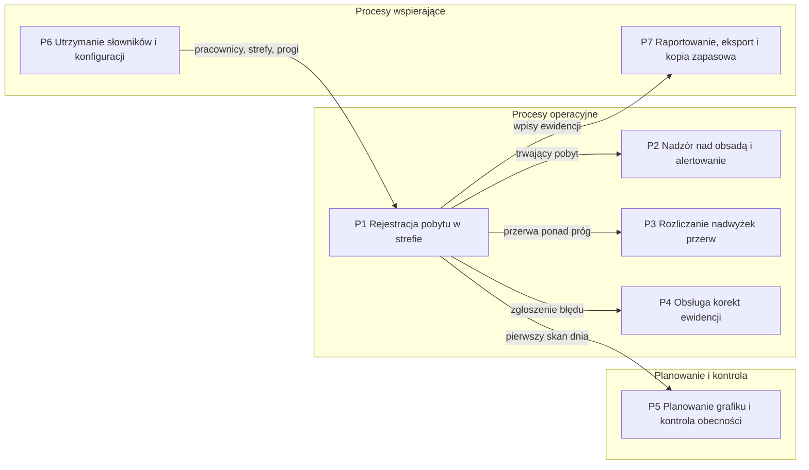

# 00. Przegląd rozwiązania

Dokumentacja przedwdrożeniowa prototypu **RCP Log** odtworzona z kodu aplikacji (`app.py`, `demo_data.py`,
szablony ekranów, testy akceptacyjne) i z README. Każda reguła i każdy krok procesu mają w tabelach
kolumnę „Źródło w kodzie”. To, czego z kodu ustalić się nie da, potwierdził właściciel projektu;
odpowiedzi są zebrane w sekcji [Ustalenia potwierdzone](#ustalenia-potwierdzone).

Stan na: październik 2026. Status rozwiązania: **prototyp**, nieprzetestowany z użytkownikami na zmianie
(wg README).

## Cel biznesowy

RCP Log rejestruje czas pracy pracowników magazynu w strefach jednym skanem kodu QR i zastępuje ręczne
wpisywanie godzin przez lidera zmiany do arkusza kalkulacyjnego. Administrator widzi na bieżąco, kto jest
w której strefie, a przekroczona przerwa i zbyt długi pobyt w jednej strefie wywołują alert w chwili, gdy
trwają, a nie dopiero przy rozliczeniu. Ewidencja powstaje automatycznie jako pliki CSV otwierane
w Excelu, a nadwyżki przerw i korekty trafiają na listy do decyzji człowieka.

## Zakres

### Co aplikacja robi

| Obszar | Zakres | Proces |
|---|---|---|
| Rejestracja pobytów | skan kodu, wybór strefy i podstrefy, potwierdzenie, koniec zmiany; każdy skan zamyka poprzedni pobyt i otwiera nowy | [P1](01-procesy/P1-rejestracja-pobytu.md) |
| Uprawnienia | pracownik widzi i wybiera tylko strefy, które ma przypisane | [P1](01-procesy/P1-rejestracja-pobytu.md), [P6](01-procesy/P6-slowniki-i-konfiguracja.md) |
| Nadzór i alerty | podgląd obsady na żywo, dashboard dnia, alerty: długa przerwa, długi dyżur, pobyt niezamknięty do końca dnia, nieznany kod; ręczne przesunięcie lub zakończenie pobytu | [P2](01-procesy/P2-nadzor-i-alerty.md) |
| Nadwyżki przerw | przerwa dłuższa niż próg daje nadwyżkę, którą administrator przypisuje do strefy | [P3](01-procesy/P3-nadwyzki-przerw.md) |
| Korekty | pracownik zgłasza błąd opisem, administrator zatwierdza lub odrzuca | [P4](01-procesy/P4-korekty-ewidencji.md) |
| Grafik | szablon do Excela, import, ręczna edycja, porównanie planu z pierwszym skanem dnia | [P5](01-procesy/P5-grafik-i-obecnosc.md) |
| Słowniki i konfiguracja | strefy, podstrefy, pracownicy, uprawnienia (pojedynczo i macierzą), konta administratorów, progi alertów | [P6](01-procesy/P6-slowniki-i-konfiguracja.md) |
| Dane na zewnątrz | historia z filtrami, eksport CSV dnia, miesiąca i alertów, nocna kopia zapasowa | [P7](01-procesy/P7-eksport-i-kopie.md) |
| Tryb demo | publiczna instancja z fikcyjnymi danymi odtwarzanymi cyklicznie, panel bez logowania, zmiany słowników zablokowane | [04. Integracje](04-integracje.md) |

### Czego aplikacja świadomie nie robi

| Poza zakresem | Jak to wynika z kodu |
|---|---|
| Naliczanie wynagrodzeń, integracja z systemem kadrowo-płacowym | jedynym wyjściem danych jest plik CSV (`app.py:1090-1103`) |
| Automatyczna poprawka ewidencji po zatwierdzeniu korekty | decyzja zmienia tylko status zgłoszenia (`app.py:908-920`) |
| Zmiana nocna przechodząca przez północ | pobyt z poprzedniego dnia jest zamykany o 23:59:59 dnia rozpoczęcia (`app.py:515-527`); potwierdzone: zmiany nocne nie występują (Z8) |
| Uprawnienia na poziomie podstref | uprawnienia to lista stref; podstrefa nie jest sprawdzana (`app.py:615-616`) |
| Praca skanera bez połączenia z serwerem | każdy skan to zapytanie do serwera; brak bufora po stronie ekranu (`index.html:450-460`) |
| Role w panelu inne niż administrator | jeden znacznik zalogowania dla wszystkich funkcji panelu (`app.py:316`); potwierdzone: pełny panel ma tylko administrator, lider zmiany nie potrzebuje dostępu (Z11) |
| Potwierdzanie (zamykanie) alertów | kolumna „potwierdzone” ma zawsze wartość „NIE” (`app.py:290`); potwierdzone: baner i plik wystarczą (Z12) |
| Retencja i usuwanie danych osobowych | brak jakiegokolwiek mechanizmu kasowania wpisów, alertów i kopii |
| Baza danych | dane w plikach JSON i CSV (`app.py:40-51`) |

## Aktorzy

| Aktor | Typ | Kanał | Odpowiedzialność | Źródło w kodzie |
|---|---|---|---|---|
| Pracownik magazynu | człowiek | ekran skanera `/`, bez logowania | identyfikuje się kodem, rejestruje wejście do strefy, przerwę i koniec zmiany, zgłasza korektę | `app.py:543-721`, `index.html` |
| Administrator | człowiek | panel `/admin`, po zalogowaniu | monitoruje obsadę, reaguje na alerty, przesuwa i kończy pobyty, rozlicza nadwyżki i korekty, utrzymuje słowniki, grafik i konfigurację, eksportuje dane; w organizacji: właściciel projektu, który też drukuje i wydaje karty z kodem i nanosi zatwierdzone korekty na pliki CSV (Z1, Z3) | `app.py:726-1274`, `admin.html` |
| Gość demo | wariant administratora | panel w trybie demo, logowanie automatyczne | ogląda i testuje wszystko poza zmianą słowników, kont, konfiguracji i importem grafiku | `app.py:1287-1338` |
| Kontrola pobytów | proces automatyczny, co 60 s | wątek serwera | wykrywa długą przerwę i długi dyżur, zamyka pobyty z poprzedniego dnia | `app.py:532-538` |
| Kopia zapasowa | proces automatyczny, raz na dobę o 02:00 | wątek serwera (nie w trybie demo) | kopiuje wszystkie pliki danych do katalogu kopii | `app.py:453-475` |
| Odtwarzanie danych demo | proces automatyczny, co N minut | wątek serwera (tylko tryb demo) | kasuje dane i generuje fikcyjny stan | `app.py:1294-1345` |
| Czytnik kodów QR | urządzenie | czytnik USB emulujący klawiaturę na jednym wspólnym komputerze zmiany (Z2) | wpisuje kod pracownika i Enter w pole skanera; po wpisaniu ponad 5 znaków ekran sam wysyła kod po 0,7 s | `index.html:441-448` |
| Excel (lub inny arkusz) | system zewnętrzny | pliki `.xlsx` i `.csv` | wypełnienie szablonu grafiku; odczyt ewidencji i alertów | `app.py:150-229, 1109-1157` |
| Lider zmiany | człowiek, poza aplikacją | brak własnego dostępu do panelu (Z11) | odpowiada za rejestrację i jej poprawność na zmianie (P1, P2) | — (Z1) |
| Kierownik magazynu | człowiek, poza aplikacją | Excel: szablon grafiku, pliki CSV | przygotowuje grafik w Excelu na podstawie szablonu; odbiorca ewidencji i porównania z grafikiem (P5, P7) | — (Z1, Z6) |

## Mapa procesów

| Nr | Proces | Zdarzenie inicjujące | Rezultat biznesowy | Właściciel (Z1) | Dokument |
|---|---|---|---|---|---|
| P1 | Rejestracja pobytu w strefie | pracownik podchodzi do skanera z kodem | zamknięty pobyt w ewidencji i otwarty nowy albo zakończona zmiana | lider zmiany; wykonuje pracownik, panel obsługuje administrator | [P1](01-procesy/P1-rejestracja-pobytu.md) |
| P2 | Nadzór nad obsadą i alertowanie | trwający pobyt (sprawdzany co 60 s) albo administrator otwiera panel | odchylenie wykryte, zapisane jako alert i obsłużone | lider zmiany (poprawność na zmianie); panel obsługuje administrator | [P2](01-procesy/P2-nadzor-i-alerty.md) |
| P3 | Rozliczanie nadwyżek przerw | pracownik kończy przerwę dłuższą niż próg | nadwyżka przypisana do strefy, która ponosi jej koszt | administrator | [P3](01-procesy/P3-nadwyzki-przerw.md) |
| P4 | Obsługa korekt ewidencji | pracownik zgłasza błąd w rejestracji | decyzja o korekcie; poprawka ewidencji poza aplikacją | administrator | [P4](01-procesy/P4-korekty-ewidencji.md) |
| P5 | Planowanie grafiku i kontrola obecności | nowy miesiąc do zaplanowania albo potrzeba kontroli | grafik miesiąca w aplikacji; raport: na czas, spóźnienie, nieobecność | kierownik magazynu (planuje grafik, odbiera raport); import wykonuje administrator | [P5](01-procesy/P5-grafik-i-obecnosc.md) |
| P6 | Utrzymanie słowników i konfiguracji | zmiana w organizacji: nowa osoba, strefa, próg, konto | aktualne słowniki i progi obowiązujące od następnego skanu | administrator | [P6](01-procesy/P6-slowniki-i-konfiguracja.md) |
| P7 | Raportowanie, eksport i kopia zapasowa | potrzeba danych z ewidencji albo godzina 02:00 | plik CSV u odbiorcy; kopia danych w katalogu kopii | administrator; odbiorca plików: kierownik magazynu | [P7](01-procesy/P7-eksport-i-kopie.md) |

Właścicieli procesów potwierdził właściciel projektu (ustalenie Z1). Lider zmiany i kierownik magazynu
nie mają własnego dostępu do panelu; pełny panel ma tylko administrator (Z11).

## SIPOC dla całości rozwiązania

| Dostawcy (S) | Wejścia (I) | Proces (P) | Wyjścia (O) | Odbiorcy (C) |
|---|---|---|---|---|
| pracownik magazynu | skan kodu, wybór strefy i podstrefy, potwierdzenie, zgłoszenie korekty | **Rejestracja** (P1): skan zamyka poprzedni pobyt i otwiera nowy | wpis ewidencji w pliku dnia i miesiąca; trwający pobyt | administrator; kierownik magazynu |
| zadanie w tle, administrator | trwające pobyty, progi z konfiguracji | **Nadzór** (P2): wykrycie długiej przerwy, długiego dyżuru, pobytu bez końca zmiany | alerty w pliku i w panelu; pobyty zamknięte automatycznie lub ręcznie | administrator |
| pracownik (przerwa), administrator | zamknięta przerwa ponad próg, wybór strefy | **Rozliczanie nadwyżek** (P3) | lista nadwyżek ze statusem „oczekuje” lub „przypisana” | administrator; rozliczenie miesięczne strefy poza aplikacją (Z5) |
| pracownik, administrator | opis błędu, decyzja | **Korekty** (P4) | lista zgłoszeń ze statusem; poprawka CSV poza systemem | administrator (poprawkę w CSV nanosi sam) |
| kierownik magazynu (grafik w Excelu, Z6), administrator | plik grafiku `.xlsx`, kody zmian, tolerancja spóźnienia | **Grafik i obecność** (P5) | grafik miesiąca; status każdego dnia: na czas, spóźnienie, nieobecność, planowane, wolne | kierownik magazynu |
| administrator | nazwy stref i podstref, kody i nazwiska pracowników, uprawnienia, konta, progi | **Słowniki i konfiguracja** (P6) | pliki słowników i konfiguracji | wszystkie pozostałe procesy |
| administrator, zegar serwera | filtry historii, żądanie eksportu, godzina 02:00 | **Eksport i kopie** (P7) | pliki CSV (dzień, miesiąc, alerty); kopia wszystkich plików danych | administrator; kierownik magazynu w Excelu; kopie: administrator (Z7) |

## Pozostałe dokumenty

| Dokument | Zawartość |
|---|---|
| [01. Procesy P1–P7](01-procesy/) | po jednym pliku na proces: granice, diagram BPMN w Mermaid z torami aktorów, tabela kroków, podprocesy, wyjątki, reguły BR-n, wymagania WF-n z kryteriami Given/When/Then |
| [02. Model danych](02-dane/model-danych.md) | ERD z kardynalnościami, słownik encji z cyklem życia, słownik pojęć domenowych |
| [03. User flow](03-user-flow/user-flow.md) | przejścia między ekranami; dla każdego ekranu cel, dane wejściowe, akcje i warunki dostępu |
| [04. Integracje](04-integracje.md) | diagram kontekstu, tabela interfejsów (kierunek, format, częstotliwość, obsługa błędów), środowisko uruchomieniowe |
| [05. Decyzje i ograniczenia](05-decyzje-i-ograniczenia.md) | dziennik decyzji D1–D11, znane ograniczenia, dług techniczny i lista przed wdrożeniem produkcyjnym |
| [Archiwum](archiwum/) | pierwsza wersja dokumentacji (01–07); identyfikatory wymagań z niej są nazwami testów |

Numeracja w całej dokumentacji: procesy **P1**–**P7**, podprocesy **P1.1**, reguły biznesowe **BR-1**–**BR-58**
(numeracja ciągła przez wszystkie procesy), wymagania funkcjonalne **WF-1**–**WF-39**, decyzje **D1**–**D11**,
ustalenia **Z1**–**Z16**.

## Ustalenia potwierdzone

Rzeczy, których nie dało się ustalić z kodu, potwierdził właściciel projektu 14 października 2026.
Numery Z1–Z16 są używane w pozostałych dokumentach jako odsyłacze.

| Nr | Pytanie | Ustalenie | Gdzie uwzględnione |
|---|---|---|---|
| Z1 | właściciele procesów | rejestracja i jej poprawność (P1, P2): lider zmiany; nadwyżki, korekty i ręczne poprawki w plikach CSV (P3, P4): administrator, czyli właściciel projektu; odbiorca ewidencji i porównania z grafikiem (P5, P7): kierownik magazynu | karty procesów P1–P7, mapa procesów, SIPOC |
| Z2 | stanowisko skanera | czytnik USB emulujący klawiaturę; jedno wspólne stanowisko na komputerze | aktorzy, P1 krok 1, [04](04-integracje.md) I1, D9 |
| Z3 | karty i prefiks `HU_` | `HU_` od „handling unit”; karty drukuje i wydaje administrator; zgubiona karta dostaje duplikat z tym samym kodem | P6 granice, [02](02-dane/model-danych.md) słownik pojęć, [05](05-decyzje-i-ograniczenia.md) B5 |
| Z4 | progi w konfiguracji | wartości robocze z prototypu, nie z regulaminu | nadal otwarte, patrz niżej |
| Z5 | przypisanie nadwyżki | nadwyżka obciąża czas pracy wskazanej strefy w rozliczeniu miesięcznym poza aplikacją | P3, D5 |
| Z6 | autor grafiku | kierownik magazynu w Excelu na podstawie pobranego szablonu | P5 |
| Z7 | kopie zapasowe | na tym samym serwerze; retencja 30 dni (do zbudowania, dziś nic nie usuwa kopii); kontrola: administrator; instancja demo bez kopii | P7, [05](05-decyzje-i-ograniczenia.md) lista przed wdrożeniem |
| Z8 | zmiany nocne | nie występują i nie są planowane | D3 potwierdzona; kod zmiany N w grafiku pozostaje nieużywany |
| Z9 | godziny zmian | R 05:00–13:00 i P 13:00–21:00 aktualne | BR-38 |
| Z10 | strefa czasowa | serwer w Europe/Warsaw; czas lokalny wystarcza, bez specjalnej obsługi zmiany czasu | [04](04-integracje.md) środowisko |
| Z11 | role w panelu | jedna rola wystarcza; pełny panel ma tylko administrator; lider zmiany bez dostępu | zakres, [05](05-decyzje-i-ograniczenia.md) ograniczenia |
| Z12 | potwierdzanie alertów | niewymagane; baner i plik wystarczą | [02](02-dane/model-danych.md) encja ALERT, [05](05-decyzje-i-ograniczenia.md) ograniczenia |
| Z13 | próg długiego dyżuru | 10 h; wartość 12 h w podglądzie Live to błąd do poprawy | P2, [05](05-decyzje-i-ograniczenia.md) T2 |
| Z14 | alert `PRZEKROCZENIE_ZMIANY` | pozostałość po usuniętej funkcji, do usunięcia z kodu | [05](05-decyzje-i-ograniczenia.md) T15 |
| Z15 | nazwy stref domyślnych | tylko przykład; można je opisywać w dokumentacji | P6.3, [02](02-dane/model-danych.md), lista do anonimizacji |
| Z16 | wdrożenie produkcyjne | osobna instancja na tym samym serwerze Coolify, bez trybu demo | [04](04-integracje.md) środowisko, [05](05-decyzje-i-ograniczenia.md) lista przed wdrożeniem |

### Nadal otwarte

| Nr | Pytanie | Kto odpowiada |
|---|---|---|
| Z4 | obowiązujące w organizacji wartości progów: dopuszczalna długość przerwy, próg szybkiej zmiany, maksymalny pobyt w jednej strefie, tolerancja spóźnienia (dziś: 30 min, 5 min, 10 h, 15 min jako wartości robocze) | kierownik magazynu z administratorem, przed wdrożeniem produkcyjnym |

## Do anonimizacji

Dokumentacja nie zawiera nazwisk z danych przykładowych. Poniższe miejsca w repozytorium zawierają dane,
które wyglądają na osobowe. Według README wszystkie dane w repozytorium są przykładowe; nazwy stref
domyślnych właściciel projektu potwierdził jako przykładowe (Z15), więc nie ma ich na tej liście.
Decyzja o pozostawieniu poniższych pozycji należy do właściciela projektu.

| Miejsce | Co zawiera | Uwaga |
|---|---|---|
| `app.py:431-435` | trzech przykładowych pracowników z imieniem i nazwiskiem w danych startowych | tworzone przy pierwszym uruchomieniu w pustym katalogu |
| `demo_data.py:17-30` | dwunastu fikcyjnych pracowników z imionami i nazwiskami; kod testowy `HU_TEST_123` | dane trybu demo |
| `demo_data.py:213-217` | treści przykładowych korekt z nazwami stref i godzinami | dane trybu demo |
| `tests/test_wymagania.py` | kody i nazwisko z danych startowych, nazwisko „Nowy Jan” | testy |
| `README.md` | kody trzech przykładowych pracowników | instrukcja uruchomienia |
| `docs/screenshots/*.png`, `demo.gif`, `docs/media/*.mp4` | nazwiska z danych demo widoczne na zrzutach i filmie | materiał prezentacyjny |
| ~~`app.py`, `run.py`~~ | ~~domyślny klucz sesji i hasło startowe w kodzie~~ — usunięte z kodu w US-001 (klucz i hasło ze zmiennych środowiskowych) | nie dotyczy |
