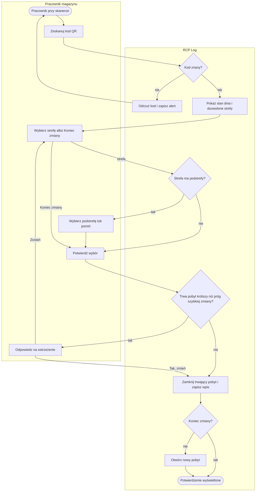
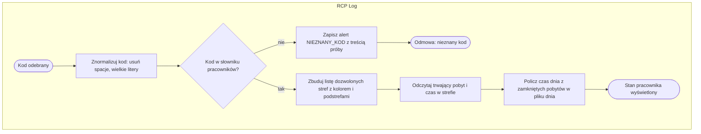
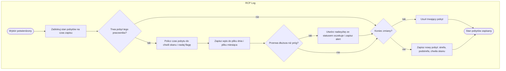
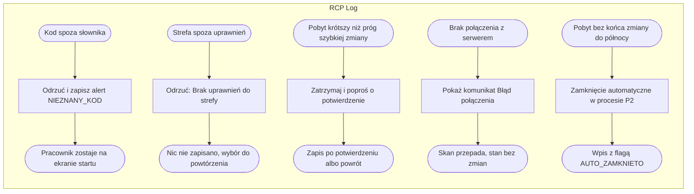

# P1. Rejestracja pobytu w strefie

| Pole | Treść |
|---|---|
| **Nazwa procesu** | Rejestracja pobytu w strefie |
| **Właściciel** | lider zmiany odpowiada za rejestrację i jej poprawność na zmianie; wykonuje pracownik magazynu; panel obsługuje administrator ([Z1](../00-przeglad.md#ustalenia-potwierdzone)) |
| **Cel biznesowy** | ciągła oś czasu dnia każdego pracownika podzielona na pobyty w strefach, powstająca bez pracy lidera zmiany i bez formularzy |
| **Zdarzenie inicjujące** | pracownik z kodem QR podchodzi do stanowiska skanera |
| **Rezultat końcowy** | poprzedni pobyt zamknięty i zapisany w ewidencji (plik dnia i plik miesiąca), nowy pobyt otwarty albo zmiana zakończona; pracownik widzi potwierdzenie z czasem przepracowanym dziś |
| **Granice** | od skanu do ekranu potwierdzenia; nie obejmuje kontroli w tle ([P2](P2-nadzor-i-alerty.md)), przypisania nadwyżki ([P3](P3-nadwyzki-przerw.md)) ani decyzji o korekcie ([P4](P4-korekty-ewidencji.md)) |
| **Częstotliwość** | kilka do kilkunastu razy na zmianę na pracownika (każda zmiana strefy, przerwa, koniec zmiany) |

## Diagram procesu

Krok „Zamknij trwający pobyt” jest pomijany, gdy pracownik nie ma otwartego pobytu (pierwszy skan dnia).
Sprawdzenie uprawnienia do strefy odbywa się w kroku 7 i kończy proces odmową, patrz
[Ścieżki alternatywne i wyjątki](#ścieżki-alternatywne-i-wyjątki).

## Tabela kroków

| Nr | Krok | Aktor | Wejście | Wyjście | Reguła biznesowa | Źródło w kodzie |
|---|---|---|---|---|---|---|
| 1 | Zeskanuj kod QR | pracownik | kod z karty odczytany czytnikiem USB na wspólnym komputerze zmiany (Z2) | kod w polu, wysłany po Enter albo samoczynnie 0,7 s po wpisaniu ponad 5 znaków | BR-1 | `index.html:441-448` |
| 2 | Sprawdź kod | system | kod | pracownik rozpoznany albo odmowa z alertem | BR-1, BR-2 | `app.py:454-462` |
| 3 | Pokaż stan dnia i dozwolone strefy | system | słownik pracownika, trwający pobyt, plik dnia | ekran: imię i nazwisko, bieżąca strefa i podstrefa, czas w strefie, czas dziś, kafelki stref | BR-3, BR-4, BR-11 | `app.py:464-501`, `index.html:462-490` |
| 4 | Wybierz strefę albo Koniec zmiany | pracownik | kafelki dozwolonych stref, przycisk „Koniec zmiany” | wybrana strefa albo koniec zmiany | BR-3, BR-10 | `index.html:493-524` |
| 5 | Wybierz podstrefę lub pomiń | pracownik | lista podstref wybranej strefy, opcja „Bez podstrefy” | podstrefa albo pusta | BR-5 | `index.html:528-546` |
| 6 | Potwierdź wybór | pracownik | okno „Potwierdź przejście do strefy…” albo „Zakończ zmianę” | żądanie rejestracji wysłane do serwera | — | `index.html:549-566, 570-596` |
| 7 | Sprawdź uprawnienie i czas trwania pobytu | system | lista uprawnień, trwający pobyt, próg szybkiej zmiany | zgoda, odmowa „Brak uprawnień do strefy” albo ostrzeżenie wymagające potwierdzenia | BR-3, BR-6 | `app.py:513-540` |
| 8 | Odpowiedz na ostrzeżenie | pracownik | komunikat „Byłeś w X tylko mm:ss. Na pewno zmieniasz strefę?” | „Zostań” (powrót do wyboru) albo „Tak, zmień strefę” | BR-6 | `index.html:584-603` |
| 9 | Zamknij trwający pobyt i zapisz wpis | system | trwający pobyt, chwila skanu, próg przerwy | wiersz ewidencji w pliku dnia i pliku miesiąca; przy długiej przerwie flaga, nadwyżka i alert | BR-7, BR-8, BR-9, BR-13 | `app.py:542-589` |
| 10 | Otwórz nowy pobyt albo zakończ zmianę | system | wybrana strefa i podstrefa | trwający pobyt od chwili skanu albo brak pobytu | BR-7, BR-10, BR-12 | `app.py:591-597` |
| 11 | Pokaż potwierdzenie | system | wynik rejestracji | ekran: nowa strefa, „Dziś przepracowano” albo „Łączny czas”, ramka z alertem przerwy; „OK — Gotowe” wraca do ekranu startu | BR-9, BR-11 | `app.py:599-609`, `index.html:606-625` |

## Podprocesy

### P1.1 Identyfikacja pracownika i prezentacja stanu

Wywoływany w kroku 2 i 3. Serwer odpowiada na skan jednym zestawem danych, z którego ekran buduje
widok pracownika.

| Krok | Opis | Źródło w kodzie |
|---|---|---|
| A1 | kod z pola jest przycinany i zamieniany na wielkie litery, więc `hu_x` i `HU_X` to ten sam pracownik | `app.py:455` |
| A2 | próba z nieznanym kodem zostaje w pliku alertów z treścią kodu | `app.py:460-462` |
| A3 | lista stref pochodzi z uprawnień pracownika; kolor i podstrefy ze słownika stref; strefa spoza słownika dostaje kolor domyślny i brak podstref | `app.py:471-478` |
| A4 | czas w strefie = teraz minus chwila wejścia trwającego pobytu | `app.py:480-481` |
| A5 | czas dnia to suma minut zamkniętych pobytów z pliku dnia; trwający pobyt nie jest wliczany | `app.py:302-312, 469` |

Serwer zwraca przy skanie także informację, czy trwający pobyt jest krótszy niż próg szybkiej zmiany,
ale ekran jej nie wyświetla; ostrzeżenie pojawia się dopiero przy potwierdzeniu (`app.py:483-486`,
`index.html:584-589`).

### P1.2 Zamknięcie pobytu i zapis ewidencji

Wywoływany w krokach 9 i 10. Cała sekwencja wykonuje się pod blokadą stanu pobytów, więc dwa skany
w tej samej chwili nie nadpiszą się nawzajem.

| Krok | Opis | Źródło w kodzie |
|---|---|---|
| A1 | blokada wspólna dla skanera, przesunięć administratora i kontroli w tle | `app.py:72, 542` |
| A2 | czas w minutach z dokładnością do setnych; flaga `DLUGA_PRZERWA` tylko dla strefy `PRZERWA` ponad próg | `app.py:549-552, 314-319` |
| A3 | wpis ma numer, kod i nazwisko, strefę, podstrefę, chwilę wejścia i wyjścia, czas, flagę i pole korekty; trafia do pliku dnia i miesiąca **według daty wejścia** | `app.py:553-567, 231-243` |
| A4 | nadwyżka = czas przerwy minus próg; alert z czasem przerwy i nadwyżką; komunikat dołączony do odpowiedzi dla ekranu | `app.py:569-589` |
| A5, A6 | koniec zmiany usuwa pobyt; inaczej nowy pobyt zaczyna się dokładnie w chwili zamknięcia poprzedniego | `app.py:591-597` |

## Ścieżki alternatywne i wyjątki

| Wyjątek | Warunek wystąpienia | Obsługa | Skutek dla procesu | Źródło w kodzie |
|---|---|---|---|---|
| Pusty kod | pole wysłane bez treści | ekran nie wysyła pustego kodu; serwer odrzuca go komunikatem „Pusty kod QR” | brak | `index.html:451`, `app.py:456-457` |
| Nieznany kod | kod spoza słownika pracowników | odmowa „Nieznany kod QR. Skontaktuj się z liderem.” i alert `NIEZNANY_KOD` | proces kończy się na kroku 2; ślad w alertach | `app.py:460-462` |
| Strefa spoza uprawnień | żądanie zapisu do strefy spoza listy pracownika (możliwe tylko poza ekranem) | odmowa „Brak uprawnień do strefy X” | nic nie zapisano | `app.py:521-523` |
| Pracownik bez uprawnienia do strefy PRZERWA | lista uprawnień bez `PRZERWA` | brak kafelka przerwy | pracownik nie zarejestruje przerwy; czas przerwy wliczy się do strefy pracy | `app.py:471-478` |
| Pracownik z pustą listą stref | nowo dodany pracownik bez uprawnień | ekran pokazuje tylko „Koniec zmiany” | rejestracja niemożliwa do czasu nadania uprawnień ([P6](P6-slowniki-i-konfiguracja.md)) | `app.py:991` |
| Strefa z uprawnień nieobecna w słowniku stref | strefa usunięta ze słownika, ale zostawiona w uprawnieniach | kafelek z domyślnym kolorem, bez podstref; zapis przechodzi | ewidencja ze strefą, której nie ma w słowniku | `app.py:473-478, 952-956` |
| Szybka zmiana | trwający pobyt krótszy niż próg (domyślnie 5 min), także przy końcu zmiany | ostrzeżenie; zapis dopiero po „Tak, zmień strefę” | pomyłkowy skan zatrzymany; prawdziwa zmiana po dodatkowym kliknięciu | `app.py:529-540`, `index.html:584-603` |
| Ponowny skan tej samej strefy | pracownik wybiera strefę, w której już jest | brak blokady | jeden pobyt rozbity na dwa wpisy | `app.py:542-597` |
| Brak połączenia | serwer nie odpowiada | komunikat „Błąd połączenia”; ekran zostaje na wyborze | skan do powtórzenia; nic nie zapisano | `index.html:459, 595` |
| Pobyt niezamknięty do końca dnia | brak skanu „Koniec zmiany” | zamknięcie automatyczne o 23:59:59 dnia wejścia ([P2](P2-nadzor-i-alerty.md), BR-17) | czas do północy liczony jako pobyt; alert dla administratora | `app.py:416-438` |
| Ekran zostawiony na widoku pracownika | pracownik odchodzi bez „OK — Gotowe” albo „✕” | brak samoczynnego powrotu do startu | kolejna osoba może zarejestrować pobyt w cudzym imieniu | `index.html:655-663` |

## Reguły biznesowe

| ID | Warunek → działanie | Źródło w kodzie |
|---|---|---|
| BR-1 | Kod odebrany ze skanera → usuń spacje z brzegów i zamień na wielkie litery przed każdym sprawdzeniem | `app.py:455, 506` |
| BR-2 | Kod spoza słownika pracowników → odmów rejestracji i zapisz alert `NIEZNANY_KOD` z treścią próby | `app.py:460-462` |
| BR-3 | Pracownik ma listę uprawnień → pokazuj tylko te strefy i odrzucaj zapis do innych; „Koniec zmiany” nie wymaga uprawnienia | `app.py:471-478, 521-523` |
| BR-4 | Strefa z listy uprawnień nie istnieje w słowniku stref → pokaż ją z kolorem domyślnym i bez podstref, zapis dozwolony | `app.py:473-478` |
| BR-5 | Strefa ma podstrefy → zaproponuj wybór podstrefy, ale pozwól pominąć; podstrefa nie jest sprawdzana ze słownikiem | `app.py:508, 596`, `index.html:528-546` |
| BR-6 | Trwający pobyt krótszy niż próg szybkiej zmiany (domyślnie 5 min) → wstrzymaj zapis do dodatkowego potwierdzenia; dotyczy też końca zmiany | `app.py:529-540` |
| BR-7 | Pracownik rejestruje nową strefę → zamknij trwający pobyt chwilą skanu i otwórz nowy w tej samej chwili; najwyżej jeden trwający pobyt na pracownika | `app.py:542-597` |
| BR-8 | Pobyt zamknięty → zapisz wiersz do pliku dnia i pliku miesiąca według daty **wejścia**; numer wpisu to kolejny numer w pliku miesiąca | `app.py:231-243, 553-567` |
| BR-9 | Zamykany pobyt w strefie `PRZERWA` trwał dłużej niż próg przerwy (domyślnie 30 min) → flaga `DLUGA_PRZERWA`, nadwyżka = czas minus próg ze statusem „oczekuje”, alert, komunikat dla pracownika | `app.py:314-319, 569-589` |
| BR-10 | Wybrano „Koniec zmiany” → zamknij pobyt bez otwierania nowego; pracownik znika z podglądu Live | `app.py:591-603` |
| BR-11 | Ekran pokazuje „Dziś” → suma zamkniętych pobytów z pliku dnia; trwający pobyt nie jest wliczony | `app.py:302-312` |
| BR-12 | Wybrano strefę, w której pracownik już jest → zamknij i otwórz pobyt w tej samej strefie (brak blokady) | `app.py:542-597` |
| BR-13 | Logika przerwy → obowiązuje wyłącznie dla strefy o nazwie `PRZERWA`; zmiana nazwy wyłącza kontrolę przerw | `app.py:314-319, 400` |

## Wymagania funkcjonalne

Każde wymaganie ma kryterium akceptacji w formie Given/When/Then. Kolumna „Test” wskazuje test
automatyczny w `tests/test_wymagania.py` (nazwy testów używają identyfikatorów z
[archiwalnej listy wymagań](../archiwum/05-wymagania.md)).

| ID | Historyjka | Kryterium akceptacji | Test |
|---|---|---|---|
| WF-1 | Jako pracownik chcę identyfikować się kodem QR, aby rejestrować pobyt bez logowania i formularzy. | **Given** pracownik o kodzie `HU_NAZWISKO_IMIE` jest w słowniku. **When** skanuje kod zapisany małymi literami ze spacjami na brzegach. **Then** ekran pokazuje jego imię i nazwisko oraz kafelki jego stref. | `test_REJ_01` |
| WF-2 | Jako administrator chcę, żeby nieznany kod był odrzucany i odnotowany, aby wychwycić obce lub uszkodzone karty. | **Given** kod nie istnieje w słowniku. **When** zostaje zeskanowany. **Then** ekran pokazuje „Nieznany kod QR. Skontaktuj się z liderem.”, zostaje na starcie, a w pliku alertów pojawia się wiersz `NIEZNANY_KOD`. | `test_REJ_02` |
| WF-3 | Jako administrator chcę, żeby pracownik widział tylko przypisane strefy, aby ograniczyć pomyłki i wejścia poza uprawnieniami. | **Given** pracownik ma uprawnienia do dwóch stref. **When** skanuje kod. **Then** widzi dokładnie dwa kafelki; próba zapisu do innej strefy kończy się odmową „Brak uprawnień do strefy X”. | `test_REJ_03` |
| WF-4 | Jako pracownik chcę doprecyzować podstrefę, aby ewidencja pokazała, gdzie dokładnie pracowałem. | **Given** wybrana strefa ma podstrefy. **When** pracownik klika kafelek. **Then** widzi listę podstref i opcję „Bez podstrefy”; strefa bez podstref przechodzi od razu do potwierdzenia. | ręcznie |
| WF-5 | Jako pracownik chcę potwierdzać każdy wybór, aby przypadkowe dotknięcie nie zapisało pobytu. | **Given** pracownik wybrał strefę. **When** pojawia się okno „Potwierdź przejście do strefy…”. **Then** „Wróć” nie zapisuje niczego, a „Potwierdź” wysyła rejestrację. | ręcznie |
| WF-6 | Jako administrator chcę, żeby zbyt szybka zmiana strefy wymagała potwierdzenia, aby pomyłkowe skany nie rozbijały ewidencji. | **Given** pracownik wszedł do strefy mniej niż 5 min temu. **When** potwierdza inną strefę. **Then** widzi „Byłeś w X tylko mm:ss. Na pewno zmieniasz strefę?”; zapis następuje dopiero po „Tak, zmień strefę”. | `test_REJ_06` |
| WF-7 | Jako pracownik chcę kończyć zmianę jednym przyciskiem, aby ostatni pobyt został zamknięty. | **Given** pracownik ma trwający pobyt. **When** wybiera „Koniec zmiany” i potwierdza. **Then** widzi „Zmiana zakończona” z łącznym czasem dnia, a podgląd Live już go nie pokazuje. | `test_REJ_07` |
| WF-8 | Jako pracownik chcę widzieć swój bieżący stan, aby wiedzieć, gdzie jestem zarejestrowany i ile przepracowałem. | **Given** pracownik ma trwający pobyt. **When** skanuje kod. **Then** ekran pokazuje strefę i podstrefę, licznik czasu w strefie odświeżany co sekundę i sumę zamkniętych pobytów dnia. | ręcznie |
| WF-9 | Jako administrator chcę, żeby pracownik miał najwyżej jeden trwający pobyt, aby wpisy nigdy na siebie nie nachodziły. | **Given** pracownik jest w strefie A. **When** rejestruje strefę B. **Then** podgląd Live pokazuje go raz, w strefie B. | `test_SES_01` |
| WF-10 | Jako administrator chcę, żeby zamknięcie pobytu tworzyło wpis ewidencji, aby ewidencja była kompletna bez ręcznego przepisywania. | **Given** pracownik jest w strefie A. **When** rejestruje strefę B. **Then** w pliku dnia i pliku miesiąca pojawia się wiersz ze strefą A, chwilą wejścia, chwilą wyjścia równą chwili skanu i czasem w minutach. | `test_SES_02` |
| WF-11 | Jako odbiorca ewidencji chcę otwierać pliki w Excelu dwuklikiem, aby nie konwertować danych. | **Given** powstał wpis ewidencji. **When** plik dnia jest otwierany w Excelu. **Then** kolumny są rozdzielone średnikiem, a polskie znaki wyświetlają się poprawnie (UTF-8 z BOM). | `test_SES_03` |
| WF-12 | Jako administrator chcę, żeby przekroczona przerwa była oznaczona i rozliczana, aby nadwyżka nie ginęła w ewidencji. | **Given** pracownik jest na przerwie od 42 min przy progu 30 min. **When** rejestruje strefę pracy. **Then** wpis przerwy ma flagę `DLUGA_PRZERWA`, na liście nadwyżek pojawia się pozycja 12 min ze statusem „oczekuje”, a ekran potwierdzenia pokazuje ramkę z czasem przerwy i nadwyżką. | `test_PRZ_02_PRZ_03` |
