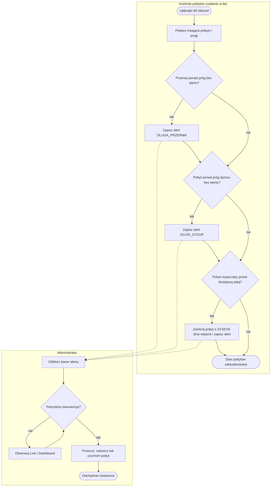
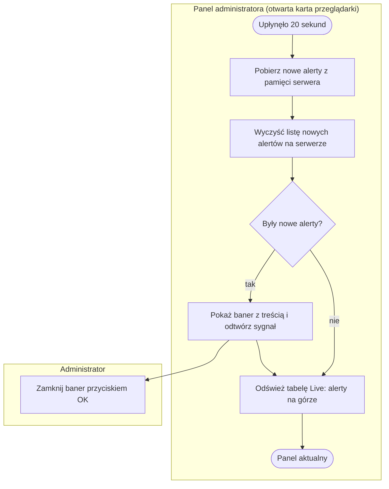
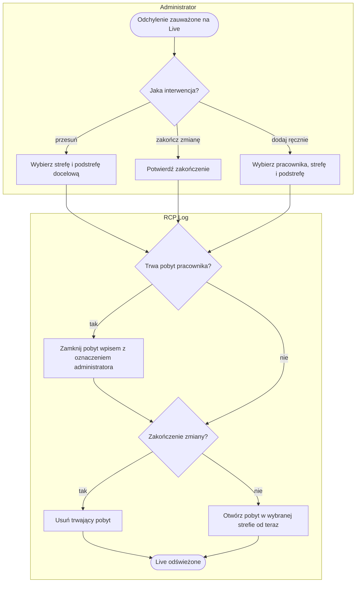

# P2. Nadzór nad obsadą i alertowanie

| Pole | Treść |
|---|---|
| **Nazwa procesu** | Nadzór nad obsadą i alertowanie |
| **Właściciel** | lider zmiany odpowiada za poprawność rejestracji na zmianie; panel obsługuje administrator, lider nie ma własnego dostępu ([Z1, Z11](../00-przeglad.md#ustalenia-potwierdzone)) |
| **Cel biznesowy** | wiedzieć na bieżąco, kto jest w której strefie, i reagować na odchylenia w chwili, gdy trwają: przekroczona przerwa, zbyt długi pobyt w jednej strefie, zapomniany koniec zmiany |
| **Zdarzenia inicjujące** | (a) upływ 60 sekund, gdy trwa co najmniej jeden pobyt; (b) administrator otwiera panel (podgląd Live i sprawdzanie alertów co 20 s) |
| **Rezultat końcowy** | odchylenie zapisane jako alert w pliku i pokazane w panelu; pobyt zamknięty automatycznie (koniec dnia) albo skorygowany ręcznie przez administratora |
| **Granice** | od wykrycia stanu pobytu do jego obsłużenia; rozliczenie nadwyżki przerwy jest w [P3](P3-nadwyzki-przerw.md), zapis samego pobytu w [P1](P1-rejestracja-pobytu.md) |
| **Częstotliwość** | kontrola w tle: co 60 s; panel: co 20 s podczas otwartej karty przeglądarki |

## Diagram procesu

Pętla kontroli w tle sprawdza każdy trwający pobyt osobno; trzy bramki są niezależne, więc jeden pobyt
może w tym samym przebiegu dostać alert dyżuru i zostać zamknięty.

## Tabela kroków

| Nr | Krok | Aktor | Wejście | Wyjście | Reguła biznesowa | Źródło w kodzie |
|---|---|---|---|---|---|---|
| 1 | Pobierz trwające pobyty i progi | kontrola w tle | plik trwających pobytów, konfiguracja | lista pobytów z czasem trwania | BR-14 | `app.py:545-562` |
| 2 | Wykryj przekroczoną przerwę | kontrola w tle | pobyt w strefie `PRZERWA`, próg przerwy | alert `DLUGA_PRZERWA` w pliku i w pamięci panelu; znacznik „alert wysłany” na pobycie | BR-15 | `app.py:564-570` |
| 3 | Wykryj długi dyżur | kontrola w tle | pobyt w dowolnej strefie, próg dyżuru | alert `DLUGI_DYZUR`; znacznik na pobycie | BR-16 | `app.py:572-578` |
| 4 | Zamknij pobyt z poprzedniego dnia | kontrola w tle | pobyt z datą wejścia wcześniejszą niż dziś | wpis ewidencji z flagą `AUTO_ZAMKNIETO`, alert, pobyt usunięty | BR-17 | `app.py:580-592` |
| 5 | Obserwuj Live i Dashboard | administrator | zakładki Live (co 20 s) i Dashboard (na żądanie) | lista osób, stref, czasów i oznaczeń alertów; wskaźniki dnia | BR-18, BR-23 | `app.py:729-755, 881-937`, `admin.html:573-626` |
| 6 | Odbierz baner alertu | administrator | nowe alerty z pamięci serwera (co 20 s) | baner z treścią i sygnał dźwiękowy; „OK” chowa baner | BR-19 | `app.py:758-763`, `admin.html:486-508` |
| 7 | Zdecyduj o interwencji | administrator | stan z Live, treść alertu | decyzja: przesuń, zakończ zmianę, dodaj ręcznie albo nic | — | — |
| 8 | Przesuń, zakończ lub uruchom pobyt | administrator, system | wybrany pracownik, strefa, podstrefa | pobyt zamknięty wpisem z oznaczeniem administratora i/lub nowy pobyt | BR-20, BR-21, BR-22 | `app.py:1069-1124`, `admin.html:629-742` |

## Podprocesy

### P2.1 Powiadomienie administratora o alercie

| Krok | Opis | Źródło w kodzie |
|---|---|---|
| A1, A2 | lista nowych alertów jest trzymana w pamięci serwera i kasowana przy pobraniu; pobiera ją pierwsza otwarta karta panelu | `app.py:543, 758-763` |
| A3 | baner z treścią wszystkich nowych alertów i krótki sygnał dźwiękowy | `admin.html:486-508` |
| A4 | tabela Live sortuje wiersze: najpierw z alertem, potem najdłużej trwające; wiersz z długim dyżurem ma własne oznaczenie | `app.py:754`, `admin.html:596-611` |
| A5 | baner nie zamyka się sam | `admin.html:507` |

### P2.2 Ręczna zmiana pobytu przez administratora

| Krok | Opis | Źródło w kodzie |
|---|---|---|
| A1 | „Przesuń” z wiersza Live: lista wszystkich stref ze słownika, podstrefa opcjonalna | `admin.html:629-650` |
| A2 | „Zakończ zmianę” z okna przesunięcia albo przycisk 🏁 w wierszu; wymaga potwierdzenia w przeglądarce | `admin.html:670-690` |
| A3 | „Dodaj ręcznie”: pobyt bez skanu dla pracownika, który np. zgubił kartę | `admin.html:694-742` |
| A4 | wpis ma pole korekty `ADMIN:<login>`; przy „Dodaj ręcznie” `ADMIN:<login>:start_override`; przerwa ponad próg daje flagę **i nadwyżkę** tak samo jak przy zamknięciu przez pracownika (US-005) | `app.py:431-470, 1090, 1120` |
| A5, A6 | serwer sprawdza, że strefa istnieje w słowniku (400 „Nieznana strefa X”) i że pracownik ma do niej uprawnienie (403 „Brak uprawnień do strefy X”); „Zakończ zmianę” bez sprawdzania (US-005) | `app.py:472-479, 1082-1083, 1112-1113` |

## Ścieżki alternatywne i wyjątki

| Wyjątek | Warunek wystąpienia | Obsługa | Skutek dla procesu | Źródło w kodzie |
|---|---|---|---|---|
| Pobyt starszy niż jeden dzień | serwer nie działał przez dobę lub dłużej | zamknięcie o 23:59:59 dnia **wejścia**, bez względu na liczbę dni | czas po północy dnia wejścia przepada z ewidencji | `app.py:580-592` |
| Przerwa zamknięta przez administratora lub automatycznie | „Przesuń”, „Zakończ zmianę” lub auto-zamknięcie przerwy ponad próg | wpis dostaje flagę (`DLUGA_PRZERWA`, przy auto-zamknięciu `AUTO_ZAMKNIETO`) i powstaje nadwyżka — jedno miejsce zamykania pobytu | nadwyżka do rozliczenia niezależnie od tego, kto zamknął ([P3](P3-nadwyzki-przerw.md)) | `app.py:431-470` |
| Alert utracony | restart serwera przed pobraniem banera; dwie otwarte karty panelu; drugi alert tego samego pracownika przed pobraniem pierwszego | alerty w pamięci giną przy restarcie; pobiera je pierwsza karta; nowszy alert nadpisuje starszy | baner może nie dotrzeć; pełna lista zostaje w pliku alertów | `app.py:543, 568, 576, 590, 761-762` |
| Zatrzymanie kontroli w tle | nieoczekiwany błąd inny niż błąd pliku, klucza lub wartości | wątek kończy się bez komunikatu | alerty i auto-zamykanie nie działają do restartu serwera | `app.py:601` |
| Przesunięcie do strefy spoza uprawnień lub spoza słownika | administrator wpisuje dowolną nazwę (poza listą w oknie) | serwer przyjmuje | ewidencja z nazwą spoza słownika | `app.py:1069-1124` |
| Podgląd obecności bez logowania | wywołanie adresu stanu bez sesji administratora | odmowa 401 z pustym ciałem (od US-002) | nikt spoza panelu nie widzi, kto jest w pracy | `app.py:729-731` |
| Dashboard z błędną datą | data w adresie w złym formacie | brak walidacji, błąd serwera | zakładka nie ładuje się | `app.py:884-885` |
| Dwa progi długiego dyżuru | brak wartości progu w konfiguracji | alert używa 10 h, oznaczenie w Live 12 h | Live może nie pokazać dyżuru, o którym był alert; właściwa wartość to 10 h, 12 h jest błędem do poprawy ([Z13](../00-przeglad.md#ustalenia-potwierdzone)) | `app.py:551, 737` |

## Reguły biznesowe

| ID | Warunek → działanie | Źródło w kodzie |
|---|---|---|
| BR-14 | Upłynęło 60 s → sprawdź każdy trwający pobyt pod blokadą stanu | `app.py:545-553` |
| BR-15 | Pobyt w strefie `PRZERWA` trwa dłużej niż próg i nie miał jeszcze alertu → zapisz alert `DLUGA_PRZERWA` (raz na pobyt) i oznacz pobyt | `app.py:564-570` |
| BR-16 | Pobyt w dowolnej strefie trwa dłużej niż próg dyżuru (domyślnie 10 h) i nie miał jeszcze alertu → zapisz alert `DLUGI_DYZUR` (raz na pobyt) | `app.py:572-578` |
| BR-17 | Pobyt ma datę wejścia wcześniejszą niż dzisiejsza → zamknij go o 23:59:59 dnia wejścia, zapisz wpis z flagą `AUTO_ZAMKNIETO` (z numerem i formatem czasu jak każdy wpis) i alert; przerwa ponad próg daje nadwyżkę | `app.py:580-592, 431-470` |
| BR-18 | Podgląd Live → oznacz wiersz alertem, gdy przerwa przekracza próg albo pobyt przekracza próg dyżuru; sortuj alerty na górę, potem według czasu; odświeżaj co 20 s | `app.py:729-755`, `admin.html:626` |
| BR-19 | Co 20 s w otwartym panelu → pobierz nowe alerty, pokaż baner z sygnałem, każdy alert pokazuj tylko raz | `app.py:758-763`, `admin.html:486-508` |
| BR-20 | Administrator przesuwa pracownika → strefa musi istnieć w słowniku i być na liście uprawnień pracownika; zamknij trwający pobyt wpisem z oznaczeniem `ADMIN:<login>` i otwórz nowy od teraz | `app.py:1069-1099` |
| BR-21 | Administrator uruchamia pobyt ręcznie → ta sama kontrola strefy co w BR-20; otwórz pobyt od teraz; jeśli pobyt trwał, zamknij go wpisem `ADMIN:<login>:start_override` | `app.py:1101-1124` |
| BR-22 | Administrator kończy zmianę → zamknij pobyt wpisem z oznaczeniem administratora i usuń pobyt, jak przy końcu zmiany ze skanera | `app.py:1091-1095` |
| BR-23 | Dashboard → wskaźniki „aktywne”, „na przerwie” i „alerty przerw” zawsze z bieżącej chwili; liczba wpisów i czas per strefa dla wybranej daty z pliku dnia | `app.py:881-937` |

## Wymagania funkcjonalne

| ID | Historyjka | Kryterium akceptacji | Test |
|---|---|---|---|
| WF-13 | Jako administrator chcę dowiedzieć się o przekroczonej przerwie, gdy ona trwa, aby zareagować od razu. | **Given** pracownik jest w strefie `PRZERWA` dłużej niż 30 min. **When** mija kolejna minuta kontroli. **Then** w pliku alertów jest `DLUGA_PRZERWA`, a w otwartym panelu w ciągu 20 s pojawia się baner i sygnał. | ręcznie (czas) |
| WF-14 | Jako administrator chcę alert o zbyt długim pobycie w jednej strefie, aby wychwycić zapomniany koniec zmiany jeszcze tego dnia. | **Given** pobyt trwa ponad 10 h. **When** mija kolejna minuta kontroli. **Then** powstaje jeden alert `DLUGI_DYZUR`, a wiersz w Live ma oznaczenie „DŁUGI DYŻUR”. | ręcznie (czas) |
| WF-15 | Jako administrator chcę, żeby pobyt nie przechodził na następny dzień, aby każdy wpis należał do jednego dnia. | **Given** pobyt otwarty wczoraj nie został zamknięty. **When** mija pierwsza minuta po północy. **Then** wpis kończy się o 23:59:59 dnia wejścia z flagą `AUTO_ZAMKNIETO`, a administrator dostaje alert. | ręcznie (czas) |
| WF-16 | Jako administrator chcę widzieć stan dnia na jednym ekranie, aby ocenić obsadę bez przeglądania ewidencji. | **Given** w wybranym dniu są wpisy. **When** administrator wybiera datę i klika „Pokaż”. **Then** widzi aktywne pobyty, osoby na przerwie, przekroczone przerwy, liczbę wpisów oraz kafelki stref z liczbą osób teraz i czasem dnia. | ręcznie |
| WF-17 | Jako administrator chcę widzieć na żywo, kto jest gdzie i od kiedy, aby zarządzać obsadą stref. | **Given** trwają pobyty. **When** zakładka Live jest otwarta. **Then** tabela odświeża się co 20 s, wiersze z alertem są na górze, a liczniki per strefa pokazują obsadę. | ręcznie |
| WF-18 | Jako administrator chcę przesunąć pracownika lub zakończyć mu zmianę, aby poprawić stan, gdy skan nie został wykonany. | **Given** pracownik ma trwający pobyt. **When** administrator wybiera „Przesuń” i strefę. **Then** poprzedni pobyt jest zamknięty wpisem z oznaczeniem `ADMIN:<login>`, a nowy trwa od chwili przesunięcia. | ręcznie |
| WF-19 | Jako administrator chcę uruchomić pobyt bez skanu, aby obsłużyć pracownika bez karty. | **Given** pracownik jest w słowniku. **When** administrator używa „Dodaj ręcznie” i wybiera strefę. **Then** pobyt pojawia się w Live; ewentualny wcześniejszy pobyt jest zamknięty wpisem `ADMIN:<login>:start_override`. | ręcznie |
