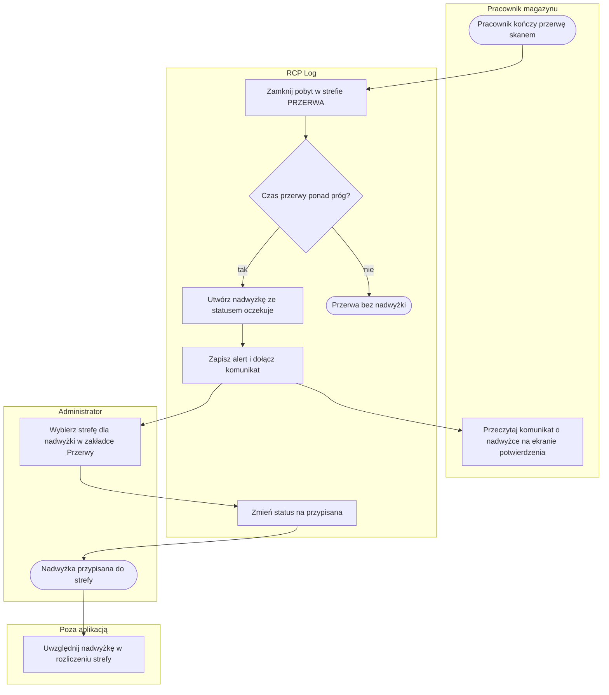
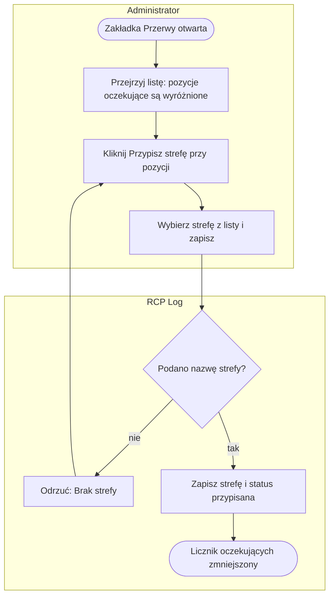

# P3. Rozliczanie nadwyżek przerw

| Pole | Treść |
|---|---|
| **Nazwa procesu** | Rozliczanie nadwyżek przerw |
| **Właściciel** | administrator ([Z1](../00-przeglad.md#ustalenia-potwierdzone)) |
| **Cel biznesowy** | każda przerwa dłuższa niż dopuszczalny próg ma wskazaną strefę, która ponosi koszt nadwyżki czasu; żadna nadwyżka nie ginie w ewidencji |
| **Zdarzenie inicjujące** | pracownik kończy skanem przerwę dłuższą niż próg (domyślnie 30 min) |
| **Rezultat końcowy** | nadwyżka ze statusem „przypisana” i nazwą strefy; nadwyżka obciąża czas pracy wskazanej strefy w rozliczeniu miesięcznym prowadzonym poza aplikacją ([Z5](../00-przeglad.md#ustalenia-potwierdzone)) |
| **Granice** | od zamknięcia przerwy do przypisania strefy; sam zapis pobytu przerwy należy do [P1](P1-rejestracja-pobytu.md), alert w trakcie przerwy do [P2](P2-nadzor-i-alerty.md) |
| **Częstotliwość** | zależna od liczby przekroczonych przerw; w danych demo kilka na dziesięć dni roboczych |

## Diagram procesu

## Tabela kroków

| Nr | Krok | Aktor | Wejście | Wyjście | Reguła biznesowa | Źródło w kodzie |
|---|---|---|---|---|---|---|
| 1 | Zamknij pobyt w strefie PRZERWA | system | trwający pobyt w `PRZERWA`, chwila skanu | wpis ewidencji przerwy; flaga `DLUGA_PRZERWA`, gdy czas przekracza próg | BR-9, BR-13 | `app.py:529-547` |
| 2 | Policz nadwyżkę | system | czas przerwy, próg z konfiguracji | nadwyżka w minutach = czas minus próg | BR-25 | `app.py:549-552` |
| 3 | Utwórz nadwyżkę ze statusem oczekuje | system | nadwyżka, pracownik, chwila rozpoczęcia przerwy | pozycja na liście nadwyżek bez przypisanej strefy | BR-24, BR-26 | `app.py:553-565` |
| 4 | Zapisz alert i dołącz komunikat | system | czas przerwy, nadwyżka | wiersz `DLUGA_PRZERWA` w pliku alertów; ramka „Przerwa trwała … (nadwyżka: …)” na ekranie potwierdzenia | BR-9 | `app.py:566-569`, `index.html:616-621` |
| 5 | Przeczytaj komunikat o nadwyżce | pracownik | ekran potwierdzenia | pracownik wie, że przerwa została przekroczona | — | `index.html:616-621` |
| 6 | Przejrzyj nadwyżki | administrator | zakładka Przerwy z licznikiem oczekujących | lista: pracownik, czas przerwy, nadwyżka, data, przypisana strefa | BR-28 | `admin.html:745-770` |
| 7 | Wybierz strefę dla nadwyżki | administrator | okno „Przypisz strefę do nadwyżki” z listą stref ze słownika | wybrana strefa | BR-26 | `admin.html:772-792` |
| 8 | Zmień status na przypisana | system | numer nadwyżki, nazwa strefy | nadwyżka ze strefą i statusem „przypisana”; licznik oczekujących maleje | BR-26, BR-27 | `app.py:778-790` |
| 9 | Uwzględnij nadwyżkę w rozliczeniu strefy | administrator, poza aplikacją | lista nadwyżek | czas pracy strefy obciążony nadwyżką w rozliczeniu miesięcznym (Z5) | — | — |

## Podprocesy

### P3.1 Przypisanie strefy do nadwyżki

| Krok | Opis | Źródło w kodzie |
|---|---|---|
| A1 | lista w kolejności powstania; pozycje „oczekuje” wyróżnione kolorem; przy zakładce licznik oczekujących | `admin.html:745-770` |
| A2, A3 | okno pokazuje nazwisko i wielkość nadwyżki; lista stref to cały słownik stref, nie tylko uprawnienia pracownika | `admin.html:772-792` |
| A5 | zapis wpisuje nazwę strefy (wielkimi literami) i status; pozycja przypisana nie ma już przycisku | `app.py:778-790`, `admin.html:755-760` |

## Ścieżki alternatywne i wyjątki

| Wyjątek | Warunek wystąpienia | Obsługa | Skutek dla procesu | Źródło w kodzie |
|---|---|---|---|---|
| Przerwa zamknięta nie przez pracownika | administrator przesuwa lub kończy zmianę osobie na przerwie; automatyczne zamknięcie o północy | wpis ma flagę `DLUGA_PRZERWA`, nadwyżka nie powstaje | nadwyżka do rozliczenia tylko z ewidencji, ręcznie | `app.py:843, 412` wobec `549-565` |
| Zmiana progu po fakcie | administrator zmienia próg przerwy w konfiguracji | istniejące nadwyżki nie są przeliczane | nadwyżki sprzed zmiany liczone starym progiem | `app.py:551-552` |
| Nieistniejący numer nadwyżki | żądanie z numerem spoza listy (możliwe tylko poza ekranem) | serwer odpowiada sukcesem, nic nie zmienia | brak | `app.py:783-790` |
| Strefa spoza słownika | nazwa wpisana poza listą w oknie | serwer przyjmuje dowolny tekst | nadwyżka przypisana do nieistniejącej strefy | `app.py:781-786` |
| Dwóch administratorów rozlicza tę samą nadwyżkę | równoczesny zapis | wygrywa ostatni zapis, bez ostrzeżenia | możliwa nadpisana decyzja | `app.py:783-789` |
| Cofnięcie przypisania | administrator chce zmienić strefę | brak takiej funkcji | zmiana tylko przez edycję pliku poza aplikacją | `app.py:778-790` |
| Pracownik usunięty ze słownika | usunięcie po powstaniu nadwyżki | nadwyżka zostaje z kopią nazwiska | lista zawiera pozycje osób spoza słownika | `app.py:947-955` |

## Reguły biznesowe

| ID | Warunek → działanie | Źródło w kodzie |
|---|---|---|
| BR-24 | Przerwę ponad próg zamyka **pracownik na skanerze** → utwórz nadwyżkę; zamknięcie przez administratora lub automatyczne → tylko flaga we wpisie | `app.py:549-565` wobec `843, 412` |
| BR-25 | Nadwyżka powstaje → jej wielkość to czas przerwy minus próg obowiązujący w chwili zamknięcia; późniejsza zmiana progu niczego nie przelicza | `app.py:551-552` |
| BR-26 | Administrator przypisuje strefę → wymagana niepusta nazwa; status zmienia się z „oczekuje” na „przypisana” i nie wraca; nazwa strefy nie jest sprawdzana ze słownikiem | `app.py:778-790` |
| BR-27 | Nadwyżka przypisana → ewidencja i wpis przerwy pozostają bez zmian | `app.py:778-790` |
| BR-28 | Zakładka Przerwy → licznik przy nazwie zakładki pokazuje liczbę nadwyżek „oczekuje” | `admin.html:748-749` |

## Wymagania funkcjonalne

| ID | Historyjka | Kryterium akceptacji | Test |
|---|---|---|---|
| WF-20 | Jako administrator chcę przypisać nadwyżkę przerwy do strefy, aby wskazać, która strefa ponosi jej koszt. | **Given** na liście jest nadwyżka ze statusem „oczekuje”. **When** administrator klika „Przypisz strefę”, wybiera strefę i zapisuje. **Then** pozycja pokazuje nazwę strefy zamiast „oczekuje”, przycisk znika, a licznik przy zakładce maleje o jeden. | ręcznie |

Powstawanie nadwyżki (flaga, wielkość, status „oczekuje”, komunikat dla pracownika) jest objęte
wymaganiem [WF-12](P1-rejestracja-pobytu.md#wymagania-funkcjonalne) i testem `test_PRZ_02_PRZ_03`.
