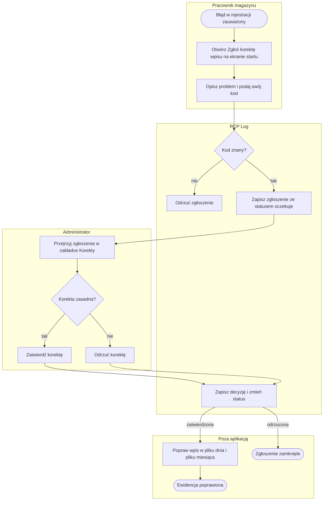
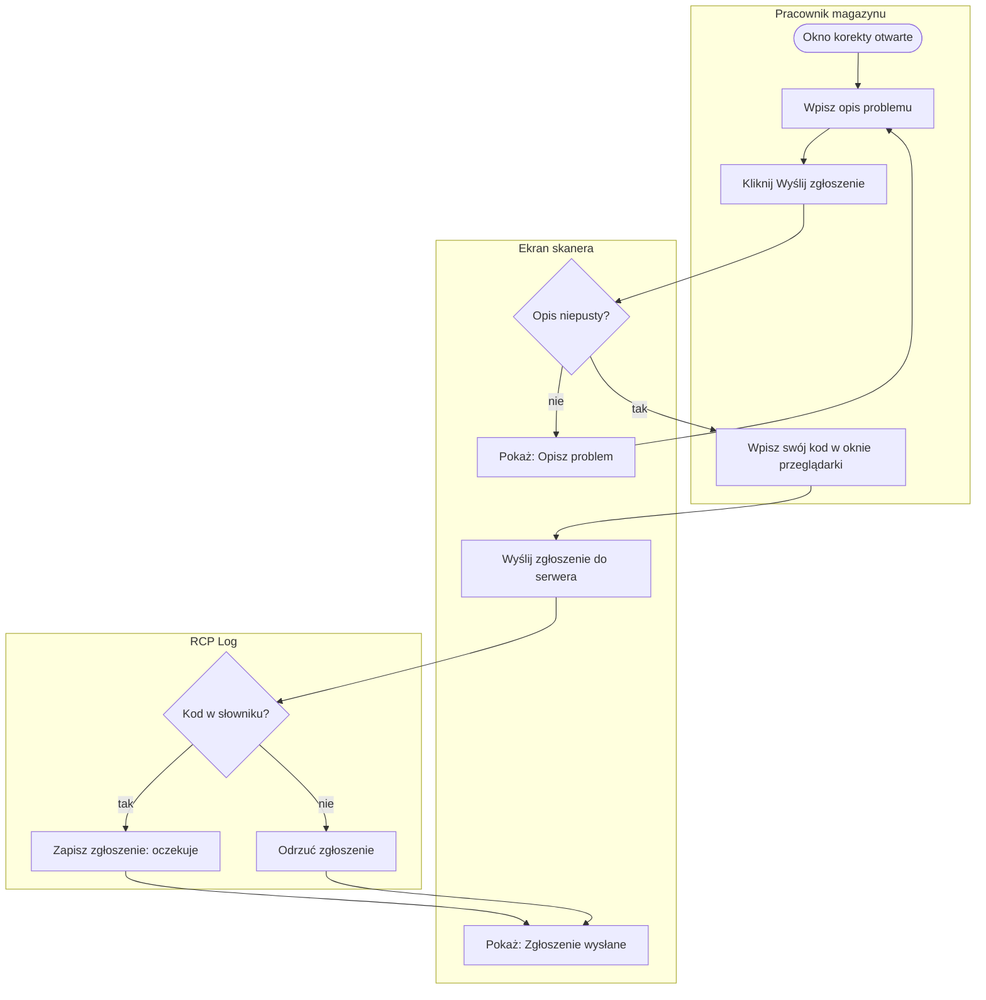
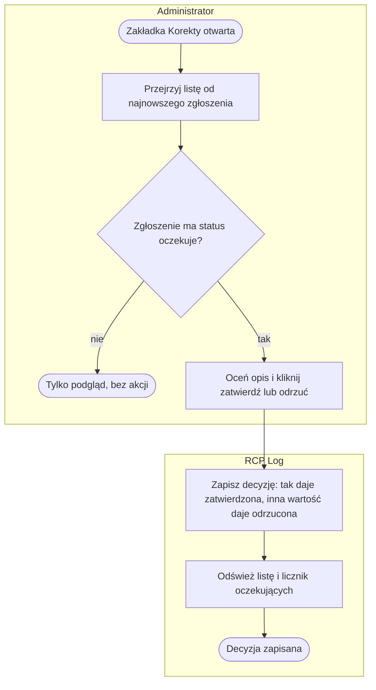

# P4. Obsługa korekt ewidencji

| Pole | Treść |
|---|---|
| **Nazwa procesu** | Obsługa korekt ewidencji |
| **Właściciel** | administrator; on też nanosi zatwierdzone poprawki na pliki ewidencji poza aplikacją ([Z1](../00-przeglad.md#ustalenia-potwierdzone)) |
| **Cel biznesowy** | błędy rejestracji (zapomniany skan, zła strefa, zły czas) są zgłaszane przez pracownika i oceniane przez człowieka, a ewidencja nie zmienia się bez decyzji |
| **Zdarzenie inicjujące** | pracownik zauważa błąd w swojej rejestracji |
| **Rezultat końcowy** | zgłoszenie ze statusem „zatwierdzona” albo „odrzucona”; po zatwierdzeniu poprawka wpisu w plikach ewidencji wykonana ręcznie poza aplikacją |
| **Granice** | od zgłoszenia do decyzji; aplikacja nie zmienia wpisów ewidencji na podstawie decyzji |
| **Częstotliwość** | sporadycznie; w danych demo trzy zgłoszenia na dziesięć dni |

## Diagram procesu

## Tabela kroków

| Nr | Krok | Aktor | Wejście | Wyjście | Reguła biznesowa | Źródło w kodzie |
|---|---|---|---|---|---|---|
| 1 | Otwórz „Zgłoś korektę wpisu” | pracownik | ekran startu skanera | okno z polem opisu | — | `index.html:306, 627-632` |
| 2 | Opisz problem i podaj swój kod | pracownik | opis słowny; kod wpisany w oknie przeglądarki | zgłoszenie wysłane | BR-29 | `index.html:634-646` |
| 3 | Sprawdź kod | system | kod | zgłoszenie przyjęte albo odrzucone | BR-29 | `app.py:831-835` |
| 4 | Zapisz zgłoszenie ze statusem oczekuje | system | kod, opis, chwila zgłoszenia | pozycja na liście korekt z kolejnym numerem i kopią nazwiska | BR-30, BR-33 | `app.py:830-848` |
| 5 | Przejrzyj zgłoszenia | administrator | zakładka Korekty z licznikiem oczekujących | lista od najnowszych: data, pracownik, opis, status | BR-34 | `admin.html:842-862` |
| 6 | Zatwierdź albo odrzuć | administrator | opis zgłoszenia; wiedza spoza systemu (ewidencja, rozmowa z pracownikiem) | decyzja ✓ lub ✕ | BR-31 | `admin.html:853-856, 863-867` |
| 7 | Zapisz decyzję i zmień status | system | numer zgłoszenia, decyzja | status „zatwierdzona” albo „odrzucona”; przyciski znikają | BR-31, BR-32 | `app.py:1043-1056` |
| 8 | Popraw wpis w pliku dnia i pliku miesiąca | administrator, poza aplikacją | zatwierdzone zgłoszenie, pliki CSV | poprawiony wpis w **obu** plikach | BR-32 | `app.py:315-321` (dwa pliki) |

## Podprocesy

### P4.1 Zgłoszenie korekty ze skanera

| Krok | Opis | Źródło w kodzie |
|---|---|---|
| A1–A3 | pusty opis zatrzymuje wysyłkę komunikatem „Opisz problem”; kontrola tylko na ekranie | `index.html:637` |
| A4 | okno jest dostępne tylko z ekranu startu, więc kod trzeba wpisać ręcznie w oknie przeglądarki „Wpisz swój kod (HU_...)”; kod zamieniany na wielkie litery | `index.html:306, 638-642` |
| A6 | ekran zawsze pokazuje „Zgłoszenie wysłane — admin zatwierdzi korektę”, także gdy serwer odrzucił nieznany kod | `index.html:640-645` |
| A7, A8 | serwer przyjmuje zgłoszenie tylko dla kodu ze słownika; nie wymaga niepustego opisu | `app.py:831-848` |

### P4.2 Decyzja administratora

| Krok | Opis | Źródło w kodzie |
|---|---|---|
| A1 | lista od najnowszych; licznik oczekujących przy nazwie zakładki | `admin.html:842-847` |
| A2 | przyciski ✓ i ✕ tylko przy statusie „oczekuje”; brak okna potwierdzenia | `admin.html:853-856` |
| A3 | wartość „tak” daje „zatwierdzona”, każda inna „odrzucona”; ekran nie sprawdza odpowiedzi serwera | `app.py:1047-1054`, `admin.html:863-867` |

## Ścieżki alternatywne i wyjątki

| Wyjątek | Warunek wystąpienia | Obsługa | Skutek dla procesu | Źródło w kodzie |
|---|---|---|---|---|
| Kod spoza słownika w zgłoszeniu | pracownik pomylił kod albo wpisał cudzy | serwer odrzuca, ekran pokazuje sukces | pracownik myśli, że zgłosił; zgłoszenia nie ma na liście | `app.py:833-835`, `index.html:640-645` |
| Zgłoszenie w cudzym imieniu | kod innej osoby wpisany w oknie | brak weryfikacji tożsamości | zgłoszenie z cudzym nazwiskiem | `index.html:638` |
| Zgłoszenie bez opisu wysłane poza ekranem | żądanie z pustym opisem | serwer przyjmuje | pozycja bez treści | `app.py:843` |
| Nieistniejący numer zgłoszenia | decyzja dla numeru spoza listy | serwer odpowiada sukcesem, nic nie zmienia | brak | `app.py:1047-1054` |
| Dwie decyzje w tej samej chwili | dwóch administratorów ocenia to samo zgłoszenie | decyzja pod blokadą; druga dostaje 409 „Zgłoszenie już rozpatrzone” i komunikat w panelu (US-006) | pierwsza decyzja zostaje | `app.py:1047-1054`, `admin.html:863-868` |
| Zmiana decyzji | administrator chce cofnąć zatwierdzenie | brak funkcji; przyciski znikają po decyzji | zmiana tylko w pliku poza aplikacją | `admin.html:853-856` |
| Zgłoszenie bez wskazania wpisu | opis nie pozwala zidentyfikować pobytu | brak powiązania zgłoszenia z wpisem | administrator szuka wpisu w Historii po dacie i nazwisku | `app.py:830-847` |
| Poprawka tylko w jednym pliku | osoba poprawiająca zmienia plik dnia, ale nie miesiąca (lub odwrotnie) | brak kontroli spójności | plik dnia i plik miesiąca różnią się | `app.py:315-321` |

## Reguły biznesowe

| ID | Warunek → działanie | Źródło w kodzie |
|---|---|---|
| BR-29 | Zgłoszenie korekty → przyjmij tylko dla kodu ze słownika pracowników; opis to dowolny tekst, którego serwer nie wymaga | `app.py:831-848` |
| BR-30 | Zgłoszenie przyjęte → nadaj kolejny numer, zapisz chwilę zgłoszenia, kopię nazwiska i status „oczekuje” | `app.py:830-847` |
| BR-31 | Administrator podejmuje decyzję → „tak” daje status „zatwierdzona”, każda inna wartość „odrzucona”; decyzja jest jednorazowa | `app.py:1047-1054`, `admin.html:853-856` |
| BR-32 | Korekta zatwierdzona → administrator wybiera wpis pracownika z danego dnia i nanosi nowe godziny i strefę; aplikacja zmienia plik dnia i plik miesiąca razem, oznacza wpis `KOREKTA#<nr>`, zapisuje starą i nową wartość w audycie; korekta odrzucona lub już naniesiona → 409 (US-014, D12) | `app.py:1059-1131` |
| BR-33 | Zgłoszenie → nie wskazuje konkretnego wpisu; wpis wybiera administrator przy nanoszeniu (D12) | `app.py:830-847, 1076-1084` |
| BR-34 | Zakładka Korekty → lista od najnowszych, licznik przy zakładce pokazuje liczbę zgłoszeń „oczekuje” | `admin.html:842-847` |

## Wymagania funkcjonalne

| ID | Historyjka | Kryterium akceptacji | Test |
|---|---|---|---|
| WF-21 | Jako pracownik chcę zgłosić błąd w rejestracji opisem, aby administrator mógł go poprawić. | **Given** pracownik jest na ekranie startu. **When** otwiera „Zgłoś korektę wpisu”, wpisuje opis i swój kod. **Then** zgłoszenie pojawia się w zakładce Korekty ze statusem „oczekuje”; pusty opis jest zatrzymany komunikatem „Opisz problem”. | ręcznie |
| WF-22 | Jako administrator chcę, żeby zgłoszenia przyjmowano tylko od znanych pracowników, aby lista nie zawierała obcych wpisów. | **Given** kod nie istnieje w słowniku. **When** zgłoszenie z tym kodem dociera do serwera. **Then** serwer je odrzuca i lista korekt pozostaje bez zmian. | `test_KOR_02` |
| WF-23 | Jako administrator chcę zatwierdzać lub odrzucać korekty, aby każda zmiana ewidencji miała decyzję i ślad. | **Given** zgłoszenie ma status „oczekuje”. **When** administrator klika ✓ albo ✕. **Then** status zmienia się na „zatwierdzona” albo „odrzucona”, a przyciski znikają. | ręcznie |
| WF-40 | Jako administrator chcę nanieść zatwierdzoną korektę na konkretny wpis w aplikacji, aby oba pliki ewidencji zostały poprawione jednocześnie i ze śladem. | **Given** korekta pracownika i jego wpis PICKING 08:00–09:00. **When** administrator wybiera ten wpis i ustawia PRZYJECIA 08:00–10:00. **Then** plik dnia i miesiąca mają poprawiony wpis (120 min, `KOREKTA#<nr>`), korekta jest zatwierdzona i naniesiona, audyt ma starą i nową wartość; drugie naniesienie → 409. | `test_KOR_06` |
