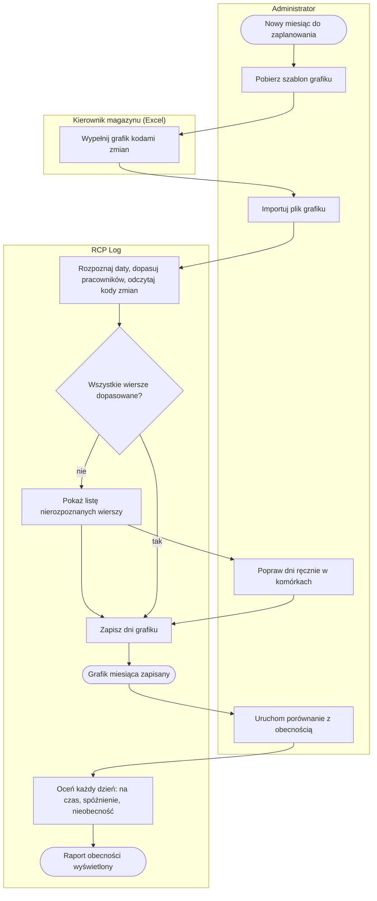
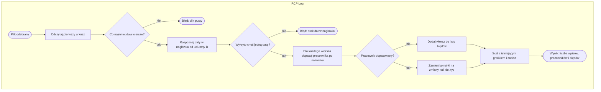
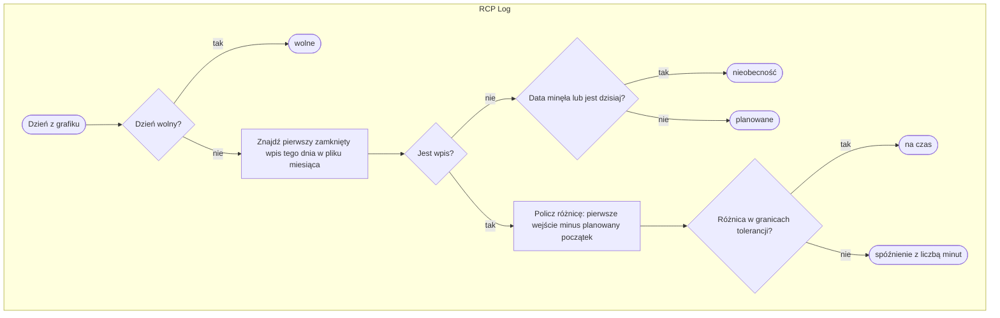

# P5. Planowanie grafiku i kontrola obecności

| Pole | Treść |
|---|---|
| **Nazwa procesu** | Planowanie grafiku i kontrola obecności |
| **Właściciel** | kierownik magazynu: planuje zmiany w Excelu na podstawie szablonu i odbiera porównanie z obecnością; import i edycję wykonuje administrator ([Z1, Z6](../00-przeglad.md#ustalenia-potwierdzone)) |
| **Cel biznesowy** | plan zmian jest w aplikacji obok ewidencji, a porównanie planu z pierwszym skanem dnia pokazuje bez ręcznego liczenia, kto przyszedł na czas, kto się spóźnił, a kogo nie było |
| **Zdarzenie inicjujące** | nowy miesiąc do zaplanowania albo potrzeba sprawdzenia obecności za miesiąc |
| **Rezultat końcowy** | grafik miesiąca zapisany w aplikacji; raport: dla każdego pracownika i dnia status „na czas”, „spóźnienie” z liczbą minut, „nieobecność”, „planowane” lub „wolne” z podsumowaniem |
| **Granice** | od pobrania szablonu do raportu; nie obejmuje konsekwencji spóźnień i nieobecności (poza aplikacją) ani zapisu skanów ([P1](P1-rejestracja-pobytu.md)) |
| **Częstotliwość** | import raz na miesiąc; porównanie na żądanie |

## Diagram procesu

Wiersze rozpoznane są zapisywane nawet wtedy, gdy część wierszy ma błędy; nierozpoznane wiersze
administrator uzupełnia ręcznie w komórkach tabeli.

## Tabela kroków

| Nr | Krok | Aktor | Wejście | Wyjście | Reguła biznesowa | Źródło w kodzie |
|---|---|---|---|---|---|---|
| 1 | Pobierz szablon grafiku | administrator | słownik pracowników, bieżący miesiąc | plik `.xlsx`: kolumna „Pracownik”, kolumny dni miesiąca, wiersz legendy, wiersz na każdego pracownika | BR-35 | `app.py:1198-1246` |
| 2 | Wypełnij grafik kodami zmian | kierownik magazynu, poza aplikacją | szablon | plik z kodami R, P, W lub zakresami godzin; godziny zmian R 05–13 i P 13–21 aktualne (Z9) | BR-38 | — |
| 3 | Importuj plik grafiku | administrator | plik `.xlsx` | plik przesłany do serwera | — | `admin.html:388, 1177-1194` |
| 4 | Rozpoznaj daty, dopasuj pracowników, odczytaj kody zmian | system | arkusz | dni grafiku per pracownik; lista błędów | BR-36, BR-37, BR-38 | `app.py:215-276` |
| 5 | Pokaż listę nierozpoznanych wierszy | system | lista błędów | komunikat z liczbą wpisów i pracowników; okno z listą błędów | BR-37 | `app.py:1271-1272`, `admin.html:1180-1187` |
| 6 | Popraw dni ręcznie w komórkach | administrator | tabela grafiku, okno „Zmiana dla data” | dzień zapisany | BR-40 | `app.py:1293-1308`, `admin.html:1165-1175` |
| 7 | Zapisz dni grafiku | system | rozpoznane dni | grafik scalony z istniejącym | BR-39 | `app.py:1257-1268` |
| 8 | Uruchom porównanie z obecnością | administrator | wybrany miesiąc | żądanie raportu | — | `admin.html:383-388` |
| 9 | Oceń każdy dzień | system | grafik miesiąca, plik miesiąca ewidencji, tolerancja spóźnienia | status każdego dnia i liczba minut spóźnienia; podsumowanie | BR-41, BR-42, BR-43 | `app.py:1311-1372`, `admin.html:1099-1113` |

## Podprocesy

### P5.1 Import pliku grafiku

| Krok | Opis | Źródło w kodzie |
|---|---|---|
| A1 | czytany jest tylko pierwszy (aktywny) arkusz, z wartościami, nie formułami | `app.py:221-222` |
| A2 | akceptowane formaty nagłówka: RRRR-MM-DD, DD.MM.RRRR, DD.MM (rok bieżący), sam numer dnia (bieżący miesiąc i rok); inne komórki są pomijane | `app.py:202-213, 235-244` |
| A3 | kolumna A porównywana z nazwiskami ze słownika bez spacji i wielkości liter; gdy brak, pierwszy pracownik, którego zapis zawiera dowolny fragment tekstu | `app.py:225-229, 250-265` |
| A4 | wiersz z nierozpoznanym pracownikiem trafia na listę błędów z numerem wiersza i treścią; import pozostałych wierszy trwa | `app.py:266-268` |
| A5 | każda komórka dnia zamieniana na zmianę: godzina od, godzina do, typ praca lub wolne | `app.py:182-200, 272-274` |
| A6 | dni z pliku nadpisują te same dni w grafiku, pozostałe dni zostają | `app.py:1257-1268` |

### P5.2 Ocena dnia w porównaniu z obecnością

| Krok | Opis | Źródło w kodzie |
|---|---|---|
| A1 | brany jest najwcześniejszy **zamknięty** wpis z datą wejścia tego dnia; trwający pobyt nie liczy się | `app.py:1326-1340` |
| G3 | dzień bez wpisu: „nieobecność”, gdy data jest dzisiejsza lub wcześniejsza; „planowane”, gdy przyszła | `app.py:1353-1357` |
| A2, G4 | różnica w minutach między pierwszym wejściem a planowaną godziną rozpoczęcia; tolerancja z konfiguracji (domyślnie 15 min); wcześniejsze przyjście daje wartość ujemną i status „na czas” | `app.py:1359-1371` |

## Ścieżki alternatywne i wyjątki

| Wyjątek | Warunek wystąpienia | Obsługa | Skutek dla procesu | Źródło w kodzie |
|---|---|---|---|---|
| Wiersz legendy w szablonie | import pobranego szablonu bez usunięcia wiersza 2 | wiersz legendy zgłaszany jako nieznany pracownik; reszta importuje się | zawsze jeden błąd przy imporcie szablonu (pilnuje tego test `test_P13`) | `app.py:1231, 252-268` |
| Podobne nazwiska | kilka osób o nazwisku zawierającym ten sam fragment, a zapis w pliku nie jest dokładny | dopasowanie do pierwszego pasującego, bez ostrzeżenia | grafik może trafić do innej osoby | `app.py:260-265` |
| Literówka w kodzie zmiany | np. „RR” zamiast „R” | kod traktowany jak dzień wolny | ukryta nieobecność albo brak kontroli spóźnienia tego dnia | `app.py:200` |
| Nagłówek z samym numerem dnia | plik na kolejny miesiąc importowany przed jego początkiem | dni przypisane do **bieżącego** miesiąca | nadpisany grafik bieżącego miesiąca | `app.py:202-213` |
| Pracownik jeszcze w pierwszej strefie dnia | porównanie uruchomione w trakcie zmiany | tylko zamknięte wpisy są brane pod uwagę | status „nieobecność” mimo obecności | `app.py:1326-1340` |
| Dzień, który jeszcze się nie zaczął | porównanie o 08:00 przy zmianie od 13:00 | dzisiejsza data liczy się jako miniona | status „nieobecność” do pierwszego zamkniętego wpisu | `app.py:1355` |
| Obecność w dniu wolnym, wcześniejsze wyjście | skan w dniu „W” albo wyjście przed końcem zmiany | nieoceniane | raport tego nie pokazuje | `app.py:1349-1352` |
| Zmiana nocna | kod N (21:00–05:00) | porównanie liczy tylko godzinę rozpoczęcia tego samego dnia | pobyt po północy należy do następnego dnia; zmiany nocne nie występują, więc przypadek jest teoretyczny ([Z8](../00-przeglad.md#ustalenia-potwierdzone)) | `app.py:1361-1366` |
| Plik w starym formacie `.xls` lub uszkodzony | pole wyboru i serwer przyjmują tylko `.xlsx` (US-011) | komunikat „Wymagany plik .xlsx” albo „Nieprawidłowy plik .xlsx — nie udało się go odczytać” (400); powyżej 2 MB — 413 | import nie wykonany, użytkownik wie dlaczego | `admin.html:388`, `app.py:1255-1262` |
| Wpis ręczny dla nieistniejącego pracownika lub złej daty | żądanie poza ekranem | brak sprawdzenia | wpis w grafiku bez pracownika w słowniku; kod nie jest zamieniany na wielkie litery | `app.py:1297-1306` |
| Import w trybie demo | gość demo wybiera plik | odmowa „Niedostępne w trybie demo”; edycja komórek działa | — | `app.py:1385-1390` |
| Pracownik usunięty ze słownika | grafik istnieje po usunięciu | porównanie pokazuje kod zamiast nazwiska | wiersz z kodem w raporcie | `app.py:1346` |

## Reguły biznesowe

| ID | Warunek → działanie | Źródło w kodzie |
|---|---|---|
| BR-35 | Administrator pobiera szablon → plik `.xlsx` z kolumną „Pracownik”, kolumnami wszystkich dni bieżącego miesiąca (DD.MM.RRRR), wierszem legendy R/P/N/W i wierszem na każdego pracownika ze słownika | `app.py:1198-1246` |
| BR-36 | Import pliku → czytaj pierwszy arkusz; daty z nagłówka od kolumny B w formatach RRRR-MM-DD, DD.MM.RRRR, DD.MM (rok bieżący) lub sam numer dnia (bieżący miesiąc); brak dat lub mniej niż dwa wiersze → błąd bez zapisu | `app.py:215-246` |
| BR-37 | Wiersz z nazwiskiem → dopasuj do pracownika po nazwisku i imieniu bez spacji i wielkości liter, a gdy brak, po fragmencie; brak dopasowania → wiersz do listy błędów, pozostałe wiersze importowane | `app.py:225-229, 250-268` |
| BR-38 | Komórka dnia → R/ranna = 05:00–13:00, P/popoł = 13:00–21:00, N/noc = 21:00–05:00, zakres HH-HH lub HH:MM-HH:MM = podane godziny; puste, „-”, W, wolne, x i każdy nierozpoznany tekst = dzień wolny | `app.py:176-200` |
| BR-39 | Import zakończony → dni z pliku nadpisują te same dni w grafiku, pozostałe zostają bez zmian | `app.py:1257-1268` |
| BR-40 | Administrator edytuje komórkę → ten sam słownik kodów co przy imporcie; puste pole = dzień wolny; pracownik i data nie są sprawdzane | `app.py:1293-1308` |
| BR-41 | Porównanie dnia z planem → pierwszy zamknięty wpis dnia; „na czas”, gdy wejście nie później niż tolerancja (domyślnie 15 min) po planowanym początku; inaczej „spóźnienie” z minutami; brak wpisu: „nieobecność” dla dnia dzisiejszego i minionych, „planowane” dla przyszłych; dzień wolny: „wolne” | `app.py:1311-1372` |
| BR-42 | Widok grafiku → wszyscy pracownicy ze słownika, także bez dni w miesiącu; porównanie → tylko pracownicy z dniami w grafiku tego miesiąca | `app.py:1275-1290, 1345-1348` |
| BR-43 | Raport porównania → nad tabelą liczba dni „na czas”, „spóźnienie” i „nieobecność” w miesiącu | `admin.html:1099-1113` |

## Wymagania funkcjonalne

| ID | Historyjka | Kryterium akceptacji | Test |
|---|---|---|---|
| WF-24 | Jako administrator chcę pobrać szablon grafiku, aby osoba planująca wypełniła go w Excelu bez tworzenia układu od zera. | **Given** słownik zawiera pracowników. **When** administrator klika „Pobierz szablon”. **Then** otrzymuje plik `.xlsx` z kolumną „Pracownik”, dniami bieżącego miesiąca, legendą R/P/N/W i wierszem na każdego pracownika. | ręcznie |
| WF-25 | Jako administrator chcę zaimportować grafik z Excela, aby nie przepisywać planu ręcznie. | **Given** wypełniony plik z datami w nagłówku. **When** administrator importuje plik. **Then** widzi liczbę wpisów i pracowników, wiersze z nieznanym nazwiskiem są wylistowane jako błędy, a kody R, P, N i zakresy `05-13` lub `05:00-13:00` są rozpoznane. | `test_GRF_02` |
| WF-26 | Jako administrator chcę poprawiać pojedyncze dni w tabeli, aby nie importować całego pliku po drobnej zmianie. | **Given** tabela grafiku jest załadowana. **When** administrator klika komórkę i wpisuje „P”. **Then** dzień pokazuje zmianę 13:00–21:00. | ręcznie |
| WF-27 | Jako administrator chcę porównać plan z obecnością, aby zobaczyć spóźnienia i nieobecności bez ręcznego zestawiania. | **Given** pracownik ma zaplanowane trzy dni zmiany od 05:00, przyszedł o 05:10 i 05:30, a trzeciego dnia nie zeskanował. **When** administrator uruchamia porównanie. **Then** dni mają statusy „na czas”, „spóźnienie 30 min” i „nieobecność”, a nad tabelą jest podsumowanie. | `test_GRF_04` |
