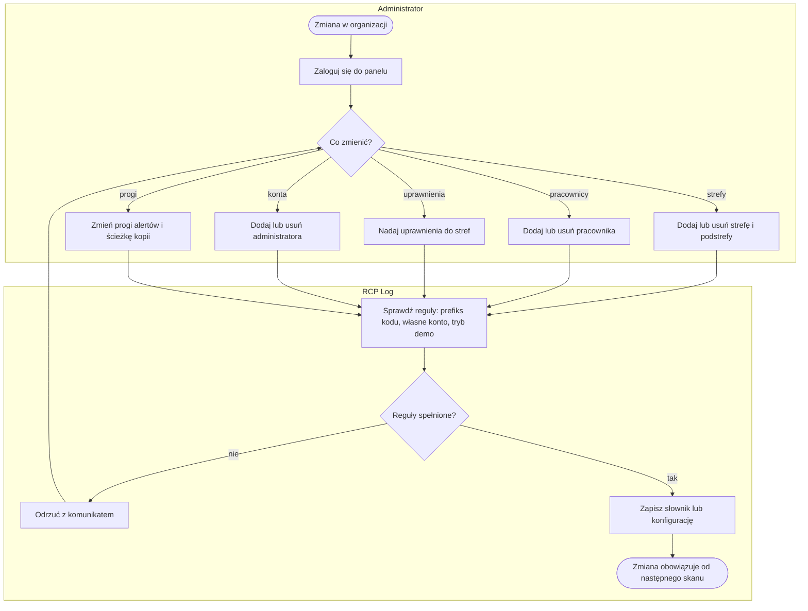
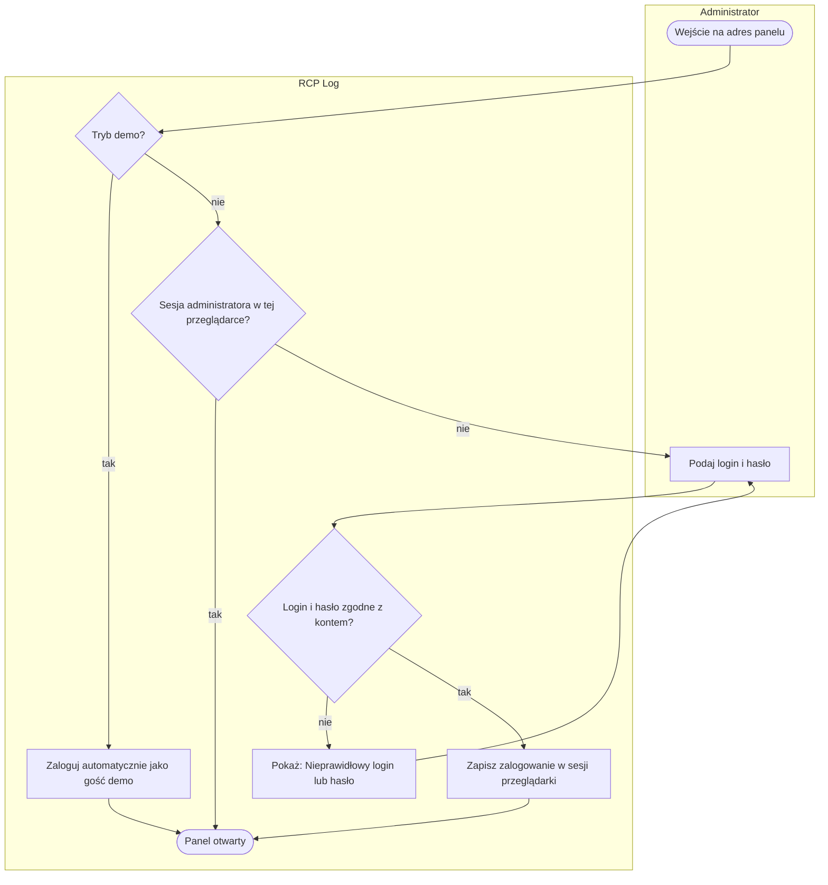
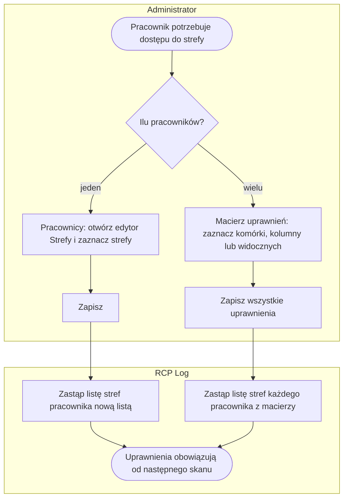
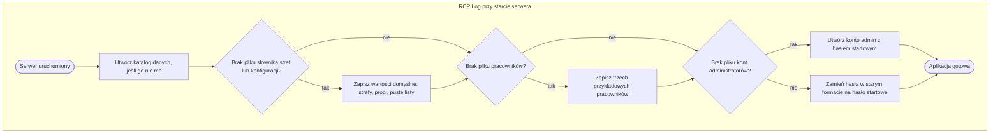

# P6. Utrzymanie słowników i konfiguracji

| Pole | Treść |
|---|---|
| **Nazwa procesu** | Utrzymanie słowników i konfiguracji |
| **Właściciel** | administrator |
| **Cel biznesowy** | rejestracja działa na aktualnych danych organizacji: lista stref i podstref odpowiada układowi magazynu, każdy pracownik ma kod i uprawnienia, progi alertów odpowiadają obowiązującym normom, a dostęp do panelu mają właściwe osoby |
| **Zdarzenie inicjujące** | zmiana w organizacji: nowa osoba, odejście, nowa strefa, zmiana normy przerwy, nowe konto administratora |
| **Rezultat końcowy** | zapisany słownik lub konfiguracja; zmiana obowiązuje od następnego skanu lub odświeżenia panelu |
| **Granice** | od decyzji o zmianie do zapisu; nie obejmuje wydawania kart z kodem QR (poza aplikacją, [Z3](../00-przeglad.md#założenia-wymagające-potwierdzenia)) |
| **Częstotliwość** | sporadycznie; pierwsze uruchomienie tworzy komplet danych startowych |

## Diagram procesu

## Tabela kroków

| Nr | Krok | Aktor | Wejście | Wyjście | Reguła biznesowa | Źródło w kodzie |
|---|---|---|---|---|---|---|
| 1 | Zaloguj się do panelu | administrator | login, hasło | sesja administratora w przeglądarce | BR-44, BR-45, BR-46 | `app.py:650-672` |
| 2 | Dodaj lub usuń strefę i podstrefy | administrator | nazwa, kolor; nazwy podstref | słownik stref | BR-48, BR-50 | `app.py:891-930`, `admin.html:329-345` |
| 3 | Dodaj lub usuń pracownika | administrator | kod `HU_…`, nazwisko i imię | słownik pracowników | BR-47, BR-48, BR-49 | `app.py:932-955`, `admin.html:306-327` |
| 4 | Nadaj uprawnienia do stref | administrator | lista stref per pracownik (edytor albo macierz) | lista uprawnień | BR-3 | `app.py:957-964`, `admin.html:409-425` |
| 5 | Dodaj lub usuń administratora | administrator | login, hasło | konta administratorów | BR-45, BR-51 | `app.py:967-987`, `admin.html:347-356` |
| 6 | Zmień progi alertów i ścieżkę kopii | administrator | próg przerwy, próg szybkiej zmiany, próg długiego dyżuru, tolerancja grafiku, ścieżka kopii | konfiguracja | BR-52 | `app.py:990-1000`, `admin.html:358-377` |
| 7 | Sprawdź reguły | system | dane z formularza | zgoda albo odmowa z komunikatem | BR-46, BR-47, BR-51 | `app.py:937-945, 981-987, 1240-1251` |
| 8 | Zapisz słownik lub konfigurację | system | zatwierdzone dane | plik słownika lub konfiguracji nadpisany | — | `app.py:73-84` |

## Podprocesy

### P6.1 Logowanie administratora

| Krok | Opis | Źródło w kodzie |
|---|---|---|
| A0 | w trybie demo każdy odwiedzający dostaje sesję „demo”; strona logowania przekierowuje do panelu; wylogowanie jest ukryte | `app.py:1240-1246`, `admin.html:178-180` |
| G1 | sesja to podpisane ciasteczko przeglądarki; bez sesji ekran panelu przekierowuje do logowania, a dane panelu odpowiadają odmową | `app.py:278, 669-676` |
| G2, A3 | hasło porównywane ze skrótem zapisanym w pliku kont; po zalogowaniu zapamiętany jest login, którym podpisywane są ręczne zmiany pobytów | `app.py:655-660` |
| wylogowanie | „Wyloguj” kasuje sesję | `app.py:664-667` |

### P6.2 Nadawanie uprawnień do stref

| Krok | Opis | Źródło w kodzie |
|---|---|---|
| A1 | edytor w zakładce Pracownicy: przełączniki wszystkich stref ze słownika | `admin.html:905-926` |
| A2 | macierz pracownik × strefa z wyszukiwarką; „Zaznacz / Odznacz widocznych” działa na przefiltrowanych wierszach; przycisk w nagłówku kolumny przełącza całą kolumnę | `admin.html:1197-1300` |
| A4, A6 | zapis macierzy wysyła listę stref **każdego** pracownika z macierzy, także niezmienionych, po kolei | `admin.html:1304-1334` |
| A5, A6 | serwer zastępuje listę w całości; nazwy stref zamieniane na wielkie litery, nie sprawdzane ze słownikiem | `app.py:957-964` |
| odświeżenie | macierz nie odświeża się po dodaniu pracownika lub strefy w innej zakładce; trzeba przeładować stronę | `admin.html:1197` |

### P6.3 Pierwsze uruchomienie i dane startowe

| Krok | Opis | Źródło w kodzie |
|---|---|---|
| A1 | katalog `data/` (albo `data_demo/` w trybie demo) obok kodu aplikacji | `app.py:18-20` |
| A2 | jedenaście stref domyślnych z kolorami i podstrefami, w tym `PRZERWA`; progi: przerwa 30 min, szybka zmiana 5 min, długi dyżur 10 h, tolerancja grafiku 15 min; ścieżka kopii `backup/` obok kodu | `app.py:38-58, 300-305` |
| A3 | trzech przykładowych pracowników z uprawnieniami (patrz [Do anonimizacji](../00-przeglad.md#do-anonimizacji)) | `app.py:308-312` |
| A4 | konto `admin` z hasłem startowym `admin123`, wypisywane też w komunikacie startowym | `app.py:311-314`, `run.py:17` |
| A5 | konta z hasłem w starym formacie (64 znaki szesnastkowe) dostają hasło startowe i komunikat w konsoli o konieczności zmiany | `app.py:316-325` |
| tryb demo | przy starcie i co N minut dane są kasowane i generowane na nowo; konto demo ma losowe hasło | `app.py:1207-1231` |

## Ścieżki alternatywne i wyjątki

| Wyjątek | Warunek wystąpienia | Obsługa | Skutek dla procesu | Źródło w kodzie |
|---|---|---|---|---|
| Kod pracownika bez prefiksu | kod nie zaczyna się od `HU_` | odmowa „Kod musi zaczynać się od HU_” | pracownik niedodany | `app.py:943` |
| Istniejący kod lub nazwa strefy | ponowne dodanie tej samej pozycji | rekord nadpisany bez ostrzeżenia | pracownik traci uprawnienia, strefa traci podstrefy | `app.py:902, 944` |
| Usunięcie pracownika z trwającym pobytem | pracownik jest w strefie w chwili usunięcia | pobyt skasowany bez wpisu ewidencji | czas od ostatniego skanu przepada; grafik, nadwyżki i korekty zostają | `app.py:947-955` |
| Usunięcie strefy w użyciu | strefa jest w uprawnieniach lub trwających pobytach | słownik zmieniony, reszta nie | kafelek z kolorem domyślnym na skanerze; ewidencja z nazwą spoza słownika | `app.py:905-909` |
| Zmiana nazwy strefy lub nazwiska | brak funkcji edycji | usunięcie i ponowne dodanie | stare nazwy zostają we wpisach, nadwyżkach i korektach | `app.py:896-909, 937-945` |
| Strefa o nazwie zarezerwowanej | nazwa `KONIEC_ZMIANY` | brak blokady | kafelek, który zamyka pobyt zamiast go otwierać | `app.py:900, 501` |
| Pracownik bez uprawnień | nowo dodany pracownik przed nadaniem stref | ekran pokazuje tylko „Koniec zmiany” | rejestracja niemożliwa do czasu nadania uprawnień | `app.py:944` |
| Usunięcie własnego konta | administrator usuwa konto, na którym pracuje | odmowa „Nie możesz usunąć własnego konta” | zawsze zostaje co najmniej jedno konto | `app.py:984-985` |
| Istniejący login administratora | dodanie konta o zajętym loginie | hasło tego konta zmienione bez ostrzeżenia | przejęcie konta przez innego administratora | `app.py:978` |
| Konfiguracja poza zakresem | wartości spoza ograniczeń ekranu wysłane poza ekranem | serwer zapisuje dowolne klucze i wartości | ścieżka kopii może wskazać dowolny katalog serwera | `app.py:995-1000` |
| Próby logowania | wielokrotne błędne hasła | brak limitu prób | podatność na zgadywanie hasła | `app.py:650-662` |
| Tryb demo | gość demo zmienia słowniki, konta, konfigurację lub importuje grafik | odmowa „Niedostępne w trybie demo” i komunikat na ekranie | — | `app.py:1200-1251`, `admin.html:470-478` |

## Reguły biznesowe

| ID | Warunek → działanie | Źródło w kodzie |
|---|---|---|
| BR-44 | Wejście do panelu lub jego danych → wymagana sesja administratora; bez niej ekran przekierowuje do logowania, a dane odpowiadają odmową | `app.py:278, 669-676` i każdy adres `/admin/api/*` |
| BR-45 | Logowanie → login i hasło porównane z zapisanym skrótem hasła; hasła nigdy nie są przechowywane jawnie | `app.py:276-277, 655-660, 978` |
| BR-46 | Tryb demo włączony → każdy odwiedzający jest zalogowany jako „demo”; zmiany stref, pracowników, kont, konfiguracji i import grafiku są odrzucane | `app.py:1200-1251` |
| BR-47 | Nowy pracownik → kod musi zaczynać się od `HU_` i jest zapisywany wielkimi literami; nazwisko wymagane; lista uprawnień początkowo pusta | `app.py:937-945` |
| BR-48 | Dodanie pracownika lub strefy o istniejącej nazwie → nadpisz rekord (uprawnienia lub podstrefy znikają) | `app.py:902, 944` |
| BR-49 | Usunięcie pracownika → skasuj jego trwający pobyt bez wpisu ewidencji; grafik, nadwyżki, korekty i wpisy ewidencji zostają | `app.py:947-955` |
| BR-50 | Usunięcie strefy lub podstrefy → nie zmieniaj uprawnień, trwających pobytów ani ewidencji | `app.py:905-930` |
| BR-51 | Konta administratorów → nie można usunąć konta, na którym się pracuje; dodanie istniejącego loginu zmienia jego hasło | `app.py:972-987` |
| BR-52 | Zapis konfiguracji → serwer scala przysłane klucze bez sprawdzania zakresów; ekran ogranicza wartości i podstawia domyślne przy pustych polach | `app.py:995-1000`, `admin.html:1009-1021` |
| BR-53 | Pierwsze uruchomienie w pustym katalogu → utwórz słownik stref, konfigurację, puste listy, trzech przykładowych pracowników i konto `admin` z hasłem startowym; stare skróty haseł zastąp hasłem startowym | `app.py:300-327` |

## Wymagania funkcjonalne

| ID | Historyjka | Kryterium akceptacji | Test |
|---|---|---|---|
| WF-28 | Jako administrator chcę, żeby panel był dostępny tylko po zalogowaniu, aby osoby postronne nie widziały ewidencji. | **Given** przeglądarka bez sesji. **When** otwiera adres panelu albo jego dane. **Then** ekran przekierowuje do logowania, dane odpowiadają odmową, a złe hasło pokazuje „Nieprawidłowy login lub hasło”. | `test_ADM_01` |
| WF-29 | Jako administrator chcę zarządzać strefami i pracownikami, aby skaner odpowiadał aktualnej organizacji. | **Given** zakładka Pracownicy. **When** administrator dodaje kod bez prefiksu `HU_`. **Then** widzi „Kod musi zaczynać się od HU_”; po dodaniu poprawnego pracownika i nadaniu mu strefy kafelek pojawia się przy jego następnym skanie. | `test_ADM_07` |
| WF-30 | Jako administrator chcę nadawać uprawnienia hurtowo, aby obsłużyć całą zmianę naraz. | **Given** Macierz uprawnień. **When** administrator zaznacza kolumnę strefy i klika „Zapisz wszystkie uprawnienia”. **Then** wszyscy widoczni pracownicy mają tę strefę, a zapis obejmuje wszystkich z macierzy. | ręcznie |
| WF-31 | Jako administrator chcę zarządzać kontami administratorów, aby dostęp do panelu miały właściwe osoby. | **Given** zalogowany administrator. **When** dodaje nowe konto i próbuje usunąć własne. **Then** nowe konto działa, a usunięcie własnego kończy się komunikatem „Nie możesz usunąć własnego konta”. | `test_ADM_09` |
| WF-32 | Jako administrator chcę zmieniać progi alertów, aby dostosować kontrolę do norm organizacji. | **Given** próg przerwy zmieniony na 20 min. **When** pracownik kończy przerwę 25 min. **Then** wpis ma flagę `DLUGA_PRZERWA`, a nadwyżka wynosi 5 min. | ręcznie |
| WF-33 | Jako administrator chcę, żeby hasła nie były przechowywane jawnie, aby wyciek pliku nie ujawnił haseł. | **Given** konto z hasłem. **When** otwieramy plik kont. **Then** zawiera skrót, nie hasło. | `test_SYS_02` |
| WF-34 | Jako administrator chcę uruchomić aplikację bez przygotowania danych, aby sprawdzić proces od razu. | **Given** pusty katalog danych. **When** serwer startuje. **Then** istnieją słownik stref ze strefą `PRZERWA`, trzech przykładowych pracowników i konto administratora. | `test_SYS_03` |
