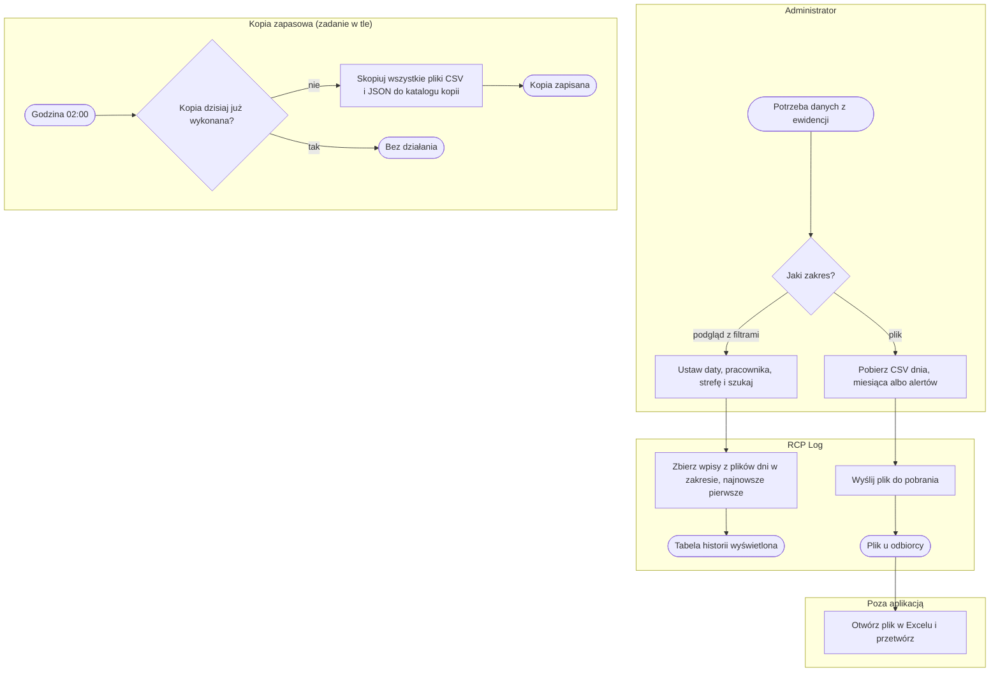
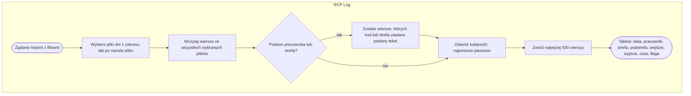
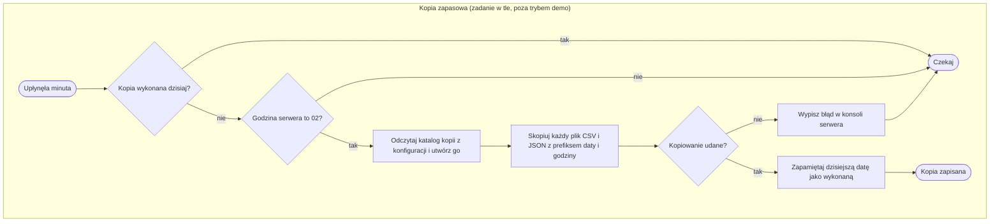

# P7. Raportowanie, eksport i kopia zapasowa

| Pole | Treść |
|---|---|
| **Nazwa procesu** | Raportowanie, eksport i kopia zapasowa |
| **Właściciel** | administrator (historia, eksport, kontrola kopii); odbiorca plików: kierownik magazynu ([Z1, Z7](../00-przeglad.md#ustalenia-potwierdzone)) |
| **Cel biznesowy** | ewidencja i alerty są dostępne poza aplikacją w formie, której odbiorcy używali dotąd (plik otwierany w Excelu), a dane przeżyją awarię serwera |
| **Zdarzenia inicjujące** | administrator potrzebuje danych (podgląd lub plik) albo zegar serwera wskazuje godzinę 02:00 |
| **Rezultat końcowy** | tabela historii na ekranie; plik CSV pobrany przez administratora; kopia wszystkich plików danych w katalogu kopii |
| **Granice** | od żądania do pliku lub kopii; przetwarzanie danych w Excelu i przywracanie z kopii są poza aplikacją |
| **Częstotliwość** | historia i eksport na żądanie; kopia raz na dobę |

## Diagram procesu

## Tabela kroków

| Nr | Krok | Aktor | Wejście | Wyjście | Reguła biznesowa | Źródło w kodzie |
|---|---|---|---|---|---|---|
| 1 | Ustaw filtry historii i szukaj | administrator | data od, data do (domyślnie ostatnie 7 dni), pracownik, strefa | żądanie historii | BR-55 | `admin.html:282-294, 813-839` |
| 2 | Zbierz wpisy z plików dni | system | pliki dni z zakresu | lista wpisów: najnowsze pierwsze, maks. 500 | BR-55 | `app.py:829-850` |
| 3 | Pobierz plik CSV | administrator | przycisk „CSV dziś”, „CSV mies.” albo „Alerty” | żądanie pliku | BR-54 | `admin.html:174-177` |
| 4 | Wyślij plik do pobrania | system | plik dnia dzisiejszego, miesiąca bieżącego albo alertów | plik z oryginalną nazwą | BR-54, BR-58 | `app.py:1151-1164` |
| 5 | Otwórz plik w Excelu i przetwórz | kierownik magazynu, poza aplikacją | plik CSV | dalsze rozliczenia (poza zakresem) | BR-58 | — |
| 6 | Wykonaj kopię zapasową | kopia w tle | wszystkie pliki CSV i JSON w katalogu danych, ścieżka z konfiguracji | kopie z prefiksem daty i godziny | BR-56, BR-57 | `app.py:438-460` |

## Podprocesy

### P7.1 Historia z filtrami

| Krok | Opis | Źródło w kodzie |
|---|---|---|
| A1 | zakres dat porównywany z datą w nazwie pliku dnia; pliki miesięczne nie są używane | `app.py:838-844` |
| A3 | filtr „zawiera” bez wielkości liter; pracownik po kodzie, nie po nazwisku | `app.py:846-847` |
| A5 | ucięcie do 500 wierszy bez informacji, że było ich więcej; ekran pokazuje „Wyniki: N (max 500)” | `app.py:849-850`, `admin.html:838` |

### P7.2 Kopia zapasowa

| Krok | Opis | Źródło w kodzie |
|---|---|---|
| G1, G2 | kopia tylko raz na dobę i tylko wtedy, gdy serwer działa między 02:00 a 02:59; znacznik „wykonano dzisiaj” jest w pamięci, więc restart serwera w tej godzinie może dać drugą kopię | `app.py:436-445` |
| A1 | katalog z konfiguracji (domyślnie `backup/` obok kodu), tworzony razem z katalogami nadrzędnymi | `app.py:447-449` |
| A2 | każdy plik kopiowany z zachowaniem daty modyfikacji; nazwa kopii: `RRRRMMDD_GGMM_` + nazwa oryginału; stare kopie nie są usuwane | `app.py:450-454` |
| A4 | błąd widoczny tylko w konsoli serwera; próba ponawiana co minutę do końca godziny 02 | `app.py:455-458` |
| tryb demo | zadanie nie startuje; zgodnie z ustaleniem instancja demo nie potrzebuje kopii (Z7) | `app.py:460` |

## Ścieżki alternatywne i wyjątki

| Wyjątek | Warunek wystąpienia | Obsługa | Skutek dla procesu | Źródło w kodzie |
|---|---|---|---|---|
| Eksport innego dnia lub miesiąca | odbiorca potrzebuje danych z przeszłości | brak wyboru daty w eksporcie | dane z przeszłości tylko przez Historię (podgląd) albo kopię pliku z serwera | `app.py:1154-1160` |
| Brak pliku do eksportu | dziś nie było jeszcze wpisów | strona z samym tekstem „Brak pliku”, bez nawigacji | administrator wraca przyciskiem przeglądarki | `app.py:1162-1163` |
| Więcej niż 500 wpisów w zakresie | szeroki zakres dat przy dużej obsadzie | lista ucięta do 500 najnowszych | starsze wpisy niewidoczne; trzeba zawęzić zakres | `app.py:850` |
| Serwer wyłączony o 02:00 | przerwa serwisowa, awaria zasilania | brak kopii tego dnia; zadanie nie nadrabia | luka w kopiach | `app.py:445` |
| Katalog kopii niedostępny | zła ścieżka, brak uprawnień, pełny dysk | błąd w konsoli; ponowne próby co minutę do 03:00 | brak kopii; nikt nie jest powiadomiony | `app.py:455-458` |
| Rosnący katalog kopii | codzienne kopie wszystkich plików | brak retencji | dysk zapełnia się z czasem; ustalona retencja to 30 dni na tym samym serwerze, mechanizm do zbudowania ([Z7](../00-przeglad.md#ustalenia-potwierdzone)) | `app.py:450-454` |
| Formuła w pliku alertów | nieznany kod zaczynający się od „=” zapisany w alercie | od US-003 pole zaczynające się od „=”, „+”, „-”, „@” dostaje apostrof i Excel pokazuje je jako tekst | po otwarciu eksportu alertów w Excelu komórka działa jak formuła | `app.py:557, 280-284` |
| Eksport w trybie demo | gość demo pobiera plik | działa; dane fikcyjne | — | `app.py:1348-1353` (brak na liście blokad) |

## Reguły biznesowe

| ID | Warunek → działanie | Źródło w kodzie |
|---|---|---|
| BR-54 | Administrator eksportuje → dostępne tylko plik dnia dzisiejszego, plik bieżącego miesiąca i plik alertów; brak pliku → komunikat „Brak pliku” | `app.py:1151-1164` |
| BR-55 | Administrator przegląda historię → pliki dni z zakresu dat wybierane po nazwie pliku; pracownik i strefa filtrowane jako „zawiera”; najnowsze pierwsze; najwyżej 500 wierszy | `app.py:829-850` |
| BR-56 | Zegar serwera wskazuje godzinę 02 i kopia nie była dziś wykonana → skopiuj wszystkie pliki CSV i JSON z katalogu danych do katalogu z konfiguracji z prefiksem daty i godziny; nie w trybie demo | `app.py:438-460` |
| BR-57 | Kopia się nie udała → wpis w konsoli serwera, ponowna próba co minutę do końca godziny 02 | `app.py:455-458` |
| BR-58 | Każdy plik ewidencji i alertów → separator średnik, kodowanie UTF-8 z BOM, stały nagłówek kolumn; otwiera się w Excelu dwuklikiem | `app.py:52-55, 234-254, 273-284` |

## Wymagania funkcjonalne

| ID | Historyjka | Kryterium akceptacji | Test |
|---|---|---|---|
| WF-35 | Jako administrator chcę przeglądać historię wpisów z filtrami, aby znaleźć konkretny pobyt bez otwierania plików. | **Given** istnieją wpisy z kilku dni. **When** administrator ustawia zakres dat, pracownika i strefę i klika „Szukaj”. **Then** widzi pasujące wpisy od najnowszego, najwyżej 500. | ręcznie |
| WF-36 | Jako administrator chcę pobrać ewidencję i alerty jako pliki, aby przekazać je odbiorcom pracującym w Excelu. | **Given** dziś są wpisy. **When** administrator klika „CSV dziś”, „CSV mies.” albo „Alerty”. **Then** przeglądarka pobiera odpowiedni plik z oryginalną nazwą. | ręcznie |
| WF-37 | Jako administrator techniczny chcę codziennej kopii danych, aby odtworzyć ewidencję po awarii. | **Given** serwer działa między 02:00 a 02:59, a katalog kopii jest dostępny. **When** mija minuta kontroli. **Then** w katalogu kopii pojawia się jedna na dobę kopia każdego pliku CSV i JSON z prefiksem daty i godziny. | ręcznie (czas) |
