# 02. Model danych

Aplikacja nie używa bazy danych. Stan jest zapisany w plikach JSON i CSV w katalogu danych
(`app.py:63-74`), tworzonych automatycznie przy pierwszym uruchomieniu (`app.py:466-491`).
Poniższy model jest **modelem logicznym**: relacje są w plikach zapisane jako listy i powtórzone
nazwy, bez kluczy obcych pilnowanych przez silnik bazy. Linia ciągła na diagramie oznacza relację
zapisaną wprost (klucz słownika albo kod pracownika w rekordzie), linia przerywana powiązanie wyłącznie
przez powtórzoną nazwę, którego kod nie sprawdza.

## Diagram ERD

```mermaid
erDiagram
    PRACOWNIK ||--o{ UPRAWNIENIE : "ma"
    STREFA ||--o{ UPRAWNIENIE : "obejmuje"
    STREFA ||--o{ PODSTREFA : "dzieli się na"
    PRACOWNIK ||--o| POBYT_TRWAJACY : "ma najwyżej jeden"
    PRACOWNIK ||--o{ WPIS_EWIDENCJI : "ma"
    STREFA ||..o{ POBYT_TRWAJACY : "nazwa, bez kontroli"
    STREFA ||..o{ WPIS_EWIDENCJI : "nazwa, bez kontroli"
    WPIS_EWIDENCJI ||..o| NADWYZKA_PRZERWY : "przerwa ponad próg daje"
    PRACOWNIK ||..o{ NADWYZKA_PRZERWY : "kod, zostaje po usunięciu"
    PRACOWNIK ||..o{ KOREKTA : "kod, zostaje po usunięciu"
    PRACOWNIK |o..o{ DZIEN_GRAFIKU : "kod, bez kontroli"
    PRACOWNIK |o..o{ ALERT : "kod lub treść próby"
    STREFA |o..o| NADWYZKA_PRZERWY : "przypisana strefa ze słownika"
    ADMINISTRATOR |o..o{ WPIS_EWIDENCJI : "oznacza ręczne zmiany"

    PRACOWNIK {
        string kod PK "HU_NAZWISKO_IMIE"
        string imie "nazwisko i imię"
    }
    UPRAWNIENIE {
        string kod_pracownika FK
        string nazwa_strefy FK "lista w rekordzie pracownika"
    }
    STREFA {
        string nazwa PK
        string kolor "kolor kafelka"
    }
    PODSTREFA {
        string nazwa_strefy FK
        string nazwa "lista w rekordzie strefy"
    }
    POBYT_TRWAJACY {
        string kod_pracownika PK
        string strefa
        string podstrefa
        datetime ts_wejscia
        bool alert_wyslany "alert długiej przerwy już był"
        bool alert_dlugi_dyzur "alert długiego dyżuru już był"
    }
    WPIS_EWIDENCJI {
        int id "kolejny numer w pliku miesiąca"
        string pracownik FK
        string imie_nazwisko "kopia nazwiska"
        string strefa
        string podstrefa
        datetime ts_wejscia
        datetime ts_wyjscia
        float czas_min
        string czas_fmt "gg:mm:ss"
        string flaga "pusta, DLUGA_PRZERWA, AUTO_ZAMKNIETO"
        string korekta_info "pusta, ADMIN:login, ADMIN:login:start_override"
    }
    NADWYZKA_PRZERWY {
        int id PK
        string pracownik FK
        string imie "kopia nazwiska"
        datetime ts_przerwy "chwila wejścia na przerwę"
        float czas_przerwy_min
        float nadwyzka_min "czas minus próg"
        string przypisana_strefa
        string status "oczekuje, przypisana"
    }
    KOREKTA {
        int id PK
        string pracownik FK
        string imie "kopia nazwiska"
        datetime ts_zgloszenia
        string opis
        string status "oczekuje, zatwierdzona, odrzucona"
        string decyzja "tak, nie lub brak"
    }
    DZIEN_GRAFIKU {
        string pracownik PK
        date data PK
        string od "gg:mm lub brak"
        string do "gg:mm lub brak"
        string typ "P praca, W wolne"
    }
    ALERT {
        datetime ts
        string pracownik
        string imie
        string typ "DLUGA_PRZERWA, DLUGI_DYZUR, AUTO_ZAMKNIETO, NIEZNANY_KOD"
        string opis
        string potwierdzone "zawsze NIE"
    }
    ADMINISTRATOR {
        string login PK
        string skrot_hasla
    }
    KONFIGURACJA {
        string backup_path
        int prog_przerwa_min "domyślnie 30"
        int ostrzezenie_szybka_zmiana_min "domyślnie 5"
        int alert_dlugi_dyzur_h "domyślnie 10"
        int grafik_tolerancja_min "domyślnie 15"
    }
```

## Słownik encji

| Encja | Znaczenie biznesowe | Kluczowe atrybuty | Cykl życia | Plik | Źródło w kodzie |
|---|---|---|---|---|---|
| PRACOWNIK | osoba z kartą QR, która rejestruje pobyty | kod (treść kodu QR, prefiks `HU_`), nazwisko i imię | tworzony przez administratora ([P6](../01-procesy/P6-slowniki-i-konfiguracja.md)); nie ma edycji, tylko usunięcie; usunięcie kasuje trwający pobyt, zostawia ewidencję, grafik, nadwyżki i korekty | `pracownicy.json` | `app.py:1070-1088` |
| UPRAWNIENIE | prawo pracownika do wejścia do strefy | kod pracownika, nazwa strefy | lista w rekordzie pracownika; zastępowana w całości przy każdym zapisie (edytor lub macierz); nie czyszczona przy usunięciu strefy | `pracownicy.json` | `app.py:1090-1097` |
| STREFA | obszar magazynu, w którym mierzony jest czas; `PRZERWA` to też strefa, ze specjalną logiką | nazwa (wielkie litery), kolor kafelka | tworzona przez administratora albo z domyślnego słownika jedenastu przykładowych stref (Z15); usunięcie nie czyści uprawnień, pobytów ani ewidencji; brak zmiany nazwy | `strefy.json` | `app.py:84-96, 1029-1042` |
| PODSTREFA | doprecyzowanie miejsca w strefie, bez wpływu na uprawnienia | nazwa | lista w rekordzie strefy; dodawana i usuwana przez administratora | `strefy.json` | `app.py:1044-1063` |
| POBYT_TRWAJĄCY | pobyt pracownika w strefie, który jeszcze trwa („aktywna sesja”) | kod pracownika (klucz, więc najwyżej jeden pobyt na osobę), strefa, podstrefa, chwila wejścia, znaczniki wysłanych alertów | powstaje przy skanie lub ręcznym starcie; kończy się skanem, końcem zmiany, przesunięciem, usunięciem pracownika albo automatycznie o 23:59:59 dnia wejścia; po zakończeniu staje się wpisem ewidencji (poza usunięciem pracownika) | `aktywne_sesje.json` | `app.py:683-699, 564-576, 1086-1088` |
| WPIS_EWIDENCJI | zamknięty pobyt, podstawowa jednostka ewidencji czasu | numer, pracownik, nazwisko, strefa, podstrefa, wejście, wyjście, czas, flaga, pole korekty | tworzony przy zamknięciu pobytu; zapisywany w dwóch plikach: dnia i miesiąca według daty wejścia; nigdy nie zmieniany ani nie usuwany przez aplikację | `ewidencja_RRRR-MM-DD.csv`, `ewidencja_RRRR-MM.csv` | `app.py:79-82, 285-314, 423-435` |
| ALERT | zdarzenie wymagające uwagi administratora | chwila, pracownik, nazwisko, typ, opis, potwierdzone | dopisywany przez kontrolę w tle i przy skanie; tylko do odczytu; pole „potwierdzone” zawsze „NIE” i wg ustalenia Z12 zbędne (alerty nie wymagają potwierdzania) | `alerty.csv` | `app.py:327-343` |
| NADWYŻKA_PRZERWY | czas przerwy ponad próg, do przypisania strefie ponoszącej koszt | numer, pracownik, nazwisko, chwila wejścia na przerwę, czas przerwy, nadwyżka, przypisana strefa, status | powstaje przy zamknięciu przerwy ponad próg przez pracownika ([P1](../01-procesy/P1-rejestracja-pobytu.md), [P3](../01-procesy/P3-nadwyzki-przerw.md)); status „oczekuje” → „przypisana” jednorazowo; nie jest usuwana | `nadwyzki_przerw.json` | `app.py:439-451, 932-946` |
| KOREKTA | zgłoszenie pracownika o błędzie w rejestracji i decyzja administratora | numer, pracownik, nazwisko, chwila zgłoszenia, opis, status, decyzja | powstaje ze skanera ([P4](../01-procesy/P4-korekty-ewidencji.md)); status „oczekuje” → „zatwierdzona” albo „odrzucona” jednorazowo; nie jest usuwana; nie wskazuje wpisu ewidencji | `korekty.json` | `app.py:751-769, 954-966` |
| DZIEŃ_GRAFIKU | planowana zmiana albo dzień wolny pracownika | pracownik, data, godzina od, godzina do, typ | powstaje z importu lub edycji komórki ([P5](../01-procesy/P5-grafik-i-obecnosc.md)); nadpisywany przy kolejnym imporcie tego samego dnia; nie jest usuwany | `grafik.json` | `app.py:182-200, 1216-1227, 1251-1265` |
| ADMINISTRATOR | konto dostępu do panelu | login, skrót hasła, znacznik wymuszonej zmiany hasła | tworzone przy pierwszym uruchomieniu (`admin`, hasło startowe) i przez administratora; usuwane przez innego administratora; zmiana własnego hasła na `/admin/haslo` (wymuszona po haśle startowym); stary format pliku (sam skrót) czytany w locie | `admins.json` | `app.py:159-162, 397-404, 479-489, 807-824, 1105-1120` |
| KONFIGURACJA | progi alertów i ścieżka kopii zapasowej | próg przerwy, próg szybkiej zmiany, próg długiego dyżuru, tolerancja grafiku, ścieżka kopii | tworzona z wartości domyślnych; nadpisywana przez zakładkę Config; brak historii zmian | `config.json` | `app.py:98-104, 1123-1135` |

## Słownik pojęć domenowych

| Termin biznesowy | Odpowiednik w kodzie i plikach | Uwagi |
|---|---|---|
| Pracownik, kod pracownika | `workers`, klucz w `pracownicy.json`; pole `pracownik` w CSV | kod jest treścią kodu QR; prefiks `HU_` (od „handling unit”) wymuszany przy dodawaniu; karty drukuje administrator ([Z3](../00-przeglad.md#ustalenia-potwierdzone)) |
| Strefa, podstrefa | `strefy.json`: nazwa → `{kolor, podstrefy[]}` | nazwa zawsze wielkimi literami |
| Przerwa | strefa o nazwie `PRZERWA` | jedyna strefa z logiką: próg, flaga, nadwyżka, alert |
| Koniec zmiany | pseudo-strefa `KONIEC_ZMIANY` w żądaniu rejestracji | zamyka pobyt bez otwierania nowego; nie istnieje w słowniku stref |
| Pobyt trwający, aktywna sesja | `state`, `aktywne_sesje.json`, pole `sesja` | w interfejsie „Aktywne sesje”, „Live” |
| Wpis ewidencji, pobyt zamknięty | wiersz CSV, `append_csv_row` | zapisywany do pliku dnia i miesiąca |
| Ewidencja dnia, ewidencja miesiąca | `ewidencja_RRRR-MM-DD.csv`, `ewidencja_RRRR-MM.csv` | ten sam wiersz w obu plikach; numer `id` liczony w pliku miesiąca |
| Czas w strefie | `aktywna_min`, `aktywna_fmt`, `czas_min`, `czas_fmt` | minuty z dokładnością do setnych; format gg:mm:ss |
| Czas dziś | `dzien_min`, `dzien_fmt`, `get_dzien_min` | suma zamkniętych pobytów z pliku dnia |
| Próg przerwy | `prog_przerwa_min` (domyślnie 30), stała `PROG_PRZERWA` | w interfejsie „Próg alertu przerwy” |
| Szybka zmiana | `ostrzezenie_szybka_zmiana_min` (domyślnie 5), odpowiedź `wymaga_potwierdzenia` | ostrzeżenie, nie blokada |
| Długi dyżur | `alert_dlugi_dyżur_h` (domyślnie 10), alert `DLUGI_DYZUR`, pole `alert_dyzur` | podgląd Live przy braku wartości używa 12 h, co jest błędem: właściwa wartość to 10 h ([Z13](../00-przeglad.md#ustalenia-potwierdzone)) |
| Długa przerwa | flaga `DLUGA_PRZERWA`, alert `DLUGA_PRZERWA` | alert w trakcie (kontrola w tle) i przy zamknięciu (skaner) |
| Zamknięcie automatyczne | flaga i alert `AUTO_ZAMKNIETO` | pobyt z poprzedniego dnia zamknięty o 23:59:59 dnia wejścia |
| Nieznany kod | alert `NIEZNANY_KOD` | próba skanu kodem spoza słownika |
| Nadwyżka przerwy | `nadwyzki_przerw.json`, pola `nadwyzka_min`, `przypisana_strefa`, `status` | w interfejsie zakładka „Przerwy” |
| Korekta | `korekty.json`, pola `opis`, `status`, `decyzja` | w interfejsie „Zgłoś korektę wpisu” i zakładka „Korekty” |
| Ręczna zmiana przez administratora | `korekta_info` = `ADMIN:<login>` lub `ADMIN:<login>:start_override` | przesunięcie, zakończenie zmiany, ręczny start |
| Grafik, dzień grafiku | `grafik.json`: kod → data → `{od, do, typ}` | typ `P` praca, `W` wolne |
| Kod zmiany | `R`, `P`, `N`, `W`, zakres godzin; `parse_shift` | R 05–13, P 13–21, N 21–05 |
| Tolerancja spóźnienia | `grafik_tolerancja_min` (domyślnie 15) | w interfejsie „Tolerancja spóźnienia grafiku” |
| Statusy obecności | `na_czas`, `spoznienie`, `nieobecnosc`, `planowane`, `wolne`, `obecny` | `obecny` tylko dla dnia pracy bez godziny rozpoczęcia (w praktyce nie występuje) |
| Macierz uprawnień | zakładka „Macierz uprawnień”, zapis przez listę stref każdego pracownika | ten sam zapis co edytor pojedynczego pracownika |
| Kopia zapasowa | `backup_job`, `backup_path` | raz na dobę o 02:00 |
| Tryb demo | `RCP_DEMO=1`, `DEMO_BLOCKED`, `demo_reset` | dane w `data_demo/`, odtwarzane co `RCP_DEMO_RESET_MIN` minut |
| Gość demo | login `demo` w sesji | konto z losowym hasłem, logowanie automatyczne |

## Słowniki wartości

| Pole | Wartości | Źródło w kodzie |
|---|---|---|
| `WPIS_EWIDENCJI.flaga` | pusta, `DLUGA_PRZERWA`, `AUTO_ZAMKNIETO` | `app.py:422, 571` |
| `WPIS_EWIDENCJI.korekta_info` | pusta, `ADMIN:<login>`, `ADMIN:<login>:start_override`; przy skanie wartość z żądania (ekran wysyła pustą) | `app.py:651, 990, 1018` |
| `ALERT.typ` | `DLUGA_PRZERWA`, `DLUGI_DYZUR`, `AUTO_ZAMKNIETO`, `NIEZNANY_KOD` | `app.py:551, 559, 573, 603` |
| `ALERT.potwierdzone` | zawsze `NIE` | `app.py:339` |
| `NADWYZKA_PRZERWY.status` | `oczekuje`, `przypisana` | `app.py:450, 944` |
| `KOREKTA.status` | `oczekuje`, `zatwierdzona`, `odrzucona` | `app.py:765, 963` |
| `KOREKTA.decyzja` | `tak` → zatwierdzona; każda inna wartość (ekran wysyła `nie`) → odrzucona | `app.py:958-965` |
| `DZIEN_GRAFIKU.typ` | `P` praca, `W` wolne | `app.py:182-200` |
| status dnia w porównaniu | `na_czas`, `spoznienie`, `nieobecnosc`, `planowane`, `wolne`, `obecny` | `app.py:1306-1328` |
| strefy specjalne | `PRZERWA` (logika przerw), `KONIEC_ZMIANY` (pseudo-strefa zamykająca pobyt) | `app.py:421, 663` |

## Spójność danych

Pilnowana przez kod:

| Reguła | Mechanizm | Źródło w kodzie |
|---|---|---|
| najwyżej jeden trwający pobyt na pracownika | kod pracownika jest kluczem pliku pobytów | `app.py:698` |
| nowy pobyt zawsze zamyka poprzedni | zamknięcie i otwarcie w jednej sekwencji pod blokadą | `app.py:683-699` |
| dwa równoczesne skany nie nadpiszą się | wspólna blokada dla skanera, panelu i kontroli w tle | `app.py:133, 536, 683, 984, 1014` |
| kod pracownika zaczyna się od `HU_` | walidacja przy dodawaniu | `app.py:1076` |
| pracownik rejestruje tylko dozwolone strefy | walidacja przy rejestracji ze skanera | `app.py:663-664` |
| usunięcie pracownika usuwa jego trwający pobyt | kasowanie wpisu w pliku pobytów | `app.py:1086-1088` |

Niepilnowana (znane niespójności, każda opisana w wyjątkach odpowiedniego procesu):

| Obserwacja | Skutek | Źródło w kodzie |
|---|---|---|
| nazwa strefy w pobycie i wpisie to wolny tekst (uprawnienia pracownika zamiast słownika na skanerze) | strefa usunięta ze słownika może zostać w uprawnieniach; przy przesunięciach, ręcznym starcie i nadwyżkach serwer sprawdza słownik (US-005) | `app.py:663-664, 456-463, 937` |
| podstrefa nie jest sprawdzana | dowolna wartość w ewidencji | `app.py:650, 698` |
| nazwisko kopiowane do wpisów, nadwyżek i korekt | zmiana nazwiska nie aktualizuje historii | `app.py:426, 443, 762` |
| korekta nie wskazuje wpisu | powiązanie tylko przez opis | `app.py:751-768` |
| numer wpisu to liczba linii w pliku miesiąca; wpisy automatyczne nie mają numeru, czasu w formacie gg:mm:ss ani pola korekty | luki i powtórzenia numerów możliwe po ręcznej edycji pliku | `app.py:309-314, 571` |
| numery nadwyżek i korekt to długość listy plus jeden, zapis bez blokady | powtórzony numer przy równoczesnym zapisie | `app.py:441, 760` |
| wpis trafia do pliku dnia wejścia | pobyt przez północ (po przesunięciu przez administratora po północy) liczy się do dnia poprzedniego | `app.py:435` |
| pracownik, strefa, konto o istniejącej nazwie nadpisują rekord | utrata uprawnień, podstref lub hasła | `app.py:1035, 1077, 1064` |
| wpis grafiku bez sprawdzenia pracownika i daty; kod nie jest zamieniany na wielkie litery | wiersz grafiku bez pracownika | `app.py:1255-1264` |
| uszkodzony plik JSON czytany jak pusty | wpis ERROR w logu, aplikacja działa na wartości domyślnej (US-010); zapis atomowy od US-006 | `app.py:135-153` |
