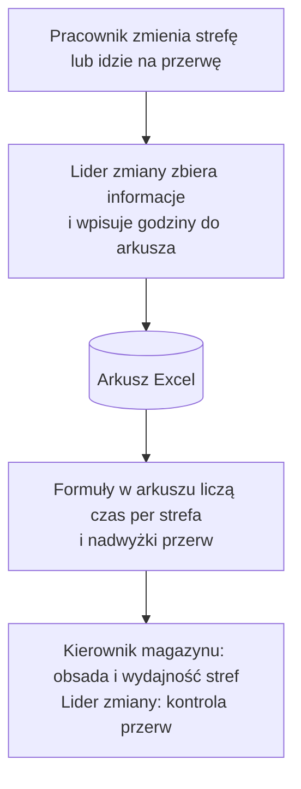
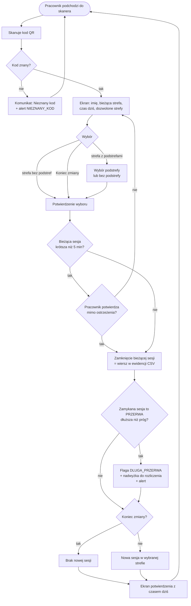
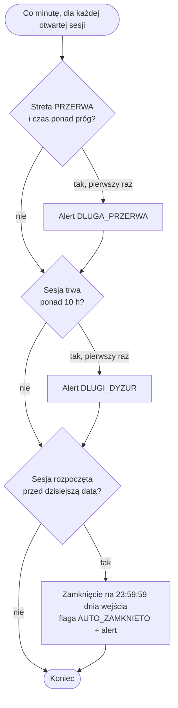
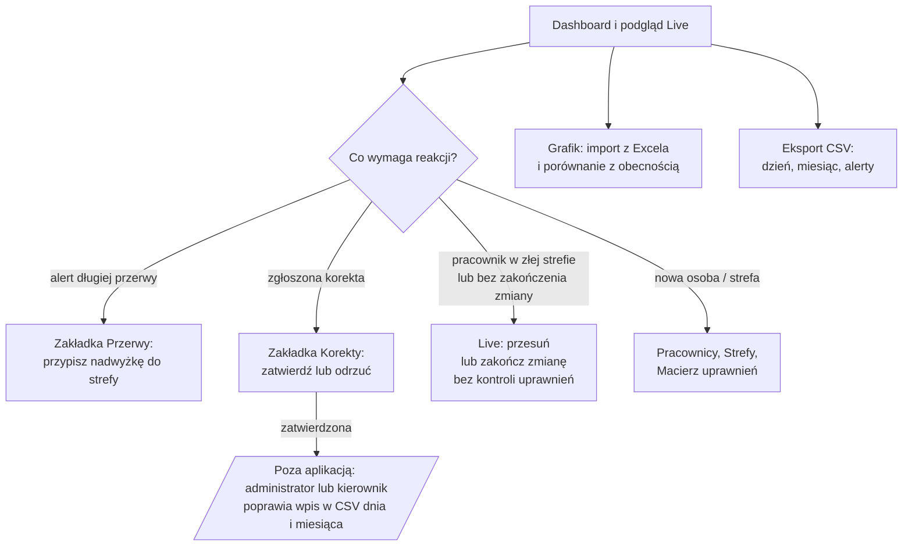

# 02. Proces biznesowy

## Aktorzy

| Aktor | Kanał | Co robi |
|---|---|---|
| Pracownik magazynu | ekran skanera `/` | rejestruje wejście do strefy, przerwę, koniec zmiany; zgłasza korektę |
| Administrator | panel `/admin` | monitoruje obsadę, reaguje na alerty, rozlicza nadwyżki i korekty, zarządza słownikami i grafikiem, eksportuje dane |
| System | zadania w tle (`app.py:332-424`) | co minutę sprawdza alerty i zamyka sesje z poprzedniego dnia; o 02:00 robi kopię danych |

## Proces PRZED — ewidencja w Excelu

Słabe punkty procesu PRZED:
- brak informacji na bieżąco, kto jest w której strefie,
- przekroczenie przerwy widoczne dopiero przy rozliczeniu,
- każda zmiana strefy wymaga przekazania informacji liderowi i ręcznego wpisu — dodatkowa praca lidera na każdej zmianie,
- dane w arkuszu są tak aktualne, jak ostatni wpis lidera.

## Proces PO — rejestracja w RCP Log

### Zadania systemu w tle (co 60 sekund)

### Proces administratora

## Punkty decyzyjne

| Punkt | Kto decyduje | Reguła | Kod |
|---|---|---|---|
| Czy kod jest znany | system | kod musi istnieć w słowniku pracowników | `app.py:440-442` |
| Czy strefa jest dozwolona | system | strefa musi być na liście uprawnień pracownika | `app.py:501-503` |
| Czy zmiana nie jest zbyt szybka | pracownik (po ostrzeżeniu) | ostrzeżenie, gdy bieżąca sesja trwa krócej niż próg (domyślnie 5 min) | `app.py:509-520` |
| Czy przerwa jest za długa | system | przerwa dłuższa niż próg (domyślnie 30 min) dostaje flagę i nadwyżkę | `app.py:292-297, 549-569` |
| Do jakiej strefy przypisać nadwyżkę | administrator | wybór z listy stref | `app.py:778-790` |
| Czy uznać korektę | administrator | zatwierdzenie lub odrzucenie | `app.py:798-809` |
| Jak nanieść zatwierdzoną korektę | administrator lub kierownik, poza aplikacją | ręczna poprawka wpisu w obu plikach: dziennym i miesięcznym | `app.py:217-222` (zapis do dwóch plików) |
| Do jakiej strefy przesunąć pracownika | administrator | dowolna nazwa — serwer nie sprawdza uprawnień ani istnienia strefy | `app.py:812-852, 854-888` |
| Co przy zgubionym identyfikatorze | lider / administrator, poza aplikacją | drukowany jest duplikat z tym samym kodem — zgubiona karta nadal działa (patrz [07](07-ograniczenia.md) B5) | — |

## Wejścia i wyjścia

| Wejścia | Wyjścia |
|---|---|
| skan kodu QR, wybór strefy i podstrefy | ewidencja CSV dzienna i miesięczna |
| słowniki: pracownicy, strefy, uprawnienia | alerty (CSV + baner w panelu) |
| grafik zmian w Excelu | lista nadwyżek przerw do rozliczenia |
| konfiguracja progów | lista zgłoszeń korekt i decyzji |
| | porównanie grafik–obecność |
| | kopia zapasowa danych |
