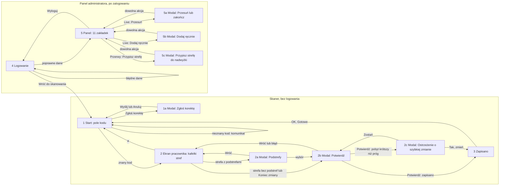

# 03. User flow: ekrany i przejścia

Aplikacja ma dwie części:

- **skaner** (`/`, `templates/index.html`): jedna strona z trzema ekranami przełączanymi bez zmiany adresu
  i czterema oknami modalnymi; dostępna bez logowania;
- **panel administratora** (`/admin`, `templates/admin.html`): ekran logowania, a po nim jedna strona
  z 11 zakładkami i trzema oknami modalnymi.

Zrzuty ekranów (dane fikcyjne) są w katalogu [`docs/screenshots`](../screenshots/README.md).

## Diagram przejść między ekranami

W trybie demo ekran 4 jest pomijany: wejście na adres panelu od razu otwiera ekran 5 jako gość demo,
a ekran 1 ma dodatkowo przyciski z przykładowymi kodami i link do panelu (`app.py:1287-1293`,
`index.html:307-319`).

## Ekrany skanera

| Nr | Ekran | Cel | Dane wejściowe | Dostępne akcje | Warunki dostępu | Źródło |
|---|---|---|---|---|---|---|
| 1 | Start | identyfikacja pracownika | kod z czytnika albo z klawiatury | skan lub Enter; wysyłka samoczynna 0,7 s po wpisaniu ponad 5 znaków; „Zgłoś korektę wpisu”; przełącznik motywu jasny/ciemny (zapamiętany w przeglądarce) | brak logowania | `index.html:295-320, 439-460` |
| 1a | Modal: Zgłoś korektę | zgłoszenie błędu rejestracji | opis problemu; kod wpisany w natywnym oknie przeglądarki po kliknięciu „Wyślij” | „Wyślij zgłoszenie” (pusty opis zatrzymany komunikatem „Opisz problem”); „Anuluj”; klik w tło | tylko z ekranu 1 | `index.html:373-383, 627-646` |
| 2 | Ekran pracownika | wybór strefy docelowej | odpowiedź serwera na skan: imię i nazwisko, bieżąca strefa i podstrefa, czas w strefie (licznik co 1 s), czas dziś, lista dozwolonych stref z kolorami | kafelek strefy (bieżąca obwiedziona); „Koniec zmiany”; „✕” powrót do startu | po rozpoznaniu kodu | `index.html:322-339, 462-526` |
| 2a | Modal: Podstrefy | doprecyzowanie miejsca | podstrefy wybranej strefy | przycisk podstrefy; „Bez podstrefy”; „↩ Wróć”; klik w tło | strefa ma co najmniej jedną podstrefę | `index.html:351-359, 528-546` |
| 2b | Modal: Potwierdź | zabezpieczenie przed przypadkowym zapisem | wybrana strefa i podstrefa albo „Zakończ zmianę” | „✅ Potwierdź”; „↩ Wróć”; klik w tło | po wyborze strefy, podstrefy lub końca zmiany | `index.html:385-395, 549-566` |
| 2c | Modal: Ostrzeżenie | potwierdzenie szybkiej zmiany | komunikat z czasem w bieżącej strefie | „Tak, zmień strefę”; „↩ Zostań” | serwer odpowiedział, że trwający pobyt jest krótszy niż próg | `index.html:361-371, 584-602` |
| 3 | Zapisano | potwierdzenie rejestracji | wynik: nowa strefa i podstrefa albo „Zmiana zakończona”; czas dziś; ramka alertu po długiej przerwie | „OK — Gotowe” (powrót do 1) | po udanym zapisie | `index.html:342-348, 605-625` |

## Ekrany panelu

| Nr | Ekran | Cel | Dane wejściowe | Dostępne akcje | Warunki dostępu | Źródło |
|---|---|---|---|---|---|---|
| 4 | Logowanie | dostęp do panelu | login, hasło | „Zaloguj się”; „← Wróć do skanowania”; komunikat „Nieprawidłowy login lub hasło” | brak sesji administratora; w trybie demo przekierowanie do 5 | `admin_login.html`, `app.py:670-683` |
| 4a | Zmiana hasła | zastąpienie hasła startowego własnym | nowe hasło (≥ 12 znaków), powtórzenie | „Zapisz hasło”; „Wyloguj”; komunikaty „Hasło musi mieć co najmniej 12 znaków”, „Hasła różnią się” | sesja administratora; po zalogowaniu hasłem startowym każdy adres `/admin*` przekierowuje tutaj, aż hasło zostanie zmienione | `admin_haslo.html`, `app.py:690-714` |
| 5 | Panel | praca administratora | sesja administratora | nagłówek: nazwa zalogowanego, „CSV dziś”, „CSV mies.”, „Alerty”, „Wyloguj” (ukryty w demo); baner nowego alertu z sygnałem (sprawdzany co 20 s, „OK” chowa); 11 zakładek | sesja administratora, inaczej przekierowanie do 4; dane zakładek bez sesji odpowiadają odmową | `admin.html:161-197, 487-508` |
| 5a | Modal: Przesuń lub zakończ | ręczna zmiana pobytu | pracownik z wiersza Live; lista wszystkich stref; podstrefy wybranej strefy | „→ Przesuń”; „🏁 Zakończ zmianę” (potwierdzenie w przeglądarce); „Anuluj” | z zakładki Live | `admin.html:237-253, 629-692` |
| 5b | Modal: Dodaj ręcznie | pobyt bez skanu | lista pracowników, stref i podstref | „▶ Uruchom sesję”; „Anuluj” | z zakładki Live | `admin.html:255-271, 694-742` |
| 5c | Modal: Przypisz strefę do nadwyżki | rozliczenie nadwyżki | nazwisko i wielkość nadwyżki; lista wszystkich stref | „💾 Zapisz”; „Anuluj” | z zakładki Przerwy, tylko dla pozycji „oczekuje” | `admin.html:429-439, 772-792` |

### Zakładki panelu (ekran 5)

| Nr | Zakładka | Cel | Dane wejściowe | Dostępne akcje | Odświeżanie i warunki | Źródło |
|---|---|---|---|---|---|---|
| 5.1 | Dashboard | stan dnia na jednym ekranie | data (domyślnie dziś) | „Pokaż” | wskaźniki „teraz” zawsze bieżące; czas per strefa dla wybranej daty; ładowana przy otwarciu panelu | `admin.html:199-216, 529-570` |
| 5.2 | Live | kto jest gdzie i od kiedy | trwające pobyty | „🔄 Odśwież”; „➕ Dodaj ręcznie” (5b); „→ Przesuń” (5a); „🏁” zakończ zmianę (potwierdzenie) | co 20 s; wiersze z alertem na górze; liczniki per strefa | `admin.html:218-233, 573-626` |
| 5.3 | Przerwy | rozliczenie nadwyżek | lista nadwyżek | „Przypisz strefę” (5c) tylko przy „oczekuje” | licznik oczekujących przy nazwie zakładki | `admin.html:273-279, 745-792` |
| 5.4 | Historia | wyszukiwanie wpisów | data od i do (domyślnie ostatnie 7 dni), pracownik z listy, fragment nazwy strefy | „Szukaj” | najwyżej 500 wierszy, najnowsze pierwsze | `admin.html:282-295, 813-839` |
| 5.5 | Korekty | decyzje o zgłoszeniach | lista zgłoszeń od najnowszego | „✓” zatwierdź, „✕” odrzuć (tylko przy „oczekuje”), bez okna potwierdzenia | licznik oczekujących przy nazwie zakładki | `admin.html:298-303, 842-867` |
| 5.6 | Pracownicy | słownik pracowników i uprawnienia pojedynczej osoby | kod `HU_…`, nazwisko i imię | „+” dodaj; „Strefy” otwiera edytor przełączników; „✕” usuń (potwierdzenie); w edytorze „💾 Zapisz”, „Anuluj” | w trybie demo dodawanie i usuwanie zablokowane | `admin.html:306-327, 875-926` |
| 5.7 | Strefy | słownik stref i podstref | nazwa, kolor; nazwa podstrefy | „+” dodaj strefę; „Podstrefy” otwiera edytor; „✕” usuń (potwierdzenie); w edytorze „+” i „✕” podstrefy | w trybie demo zablokowane | `admin.html:329-345, 928-975` |
| 5.8 | Admini | konta panelu | login, hasło | „+” dodaj; „✕” usuń (potwierdzenie; własnego konta nie można) | w trybie demo zablokowane | `admin.html:347-356, 977-999` |
| 5.9 | Config | progi i ścieżka kopii | próg przerwy (5–120 min), szybka zmiana (1–60 min), długi dyżur (1–24 h), tolerancja grafiku (0–60 min), ścieżka kopii | „💾 Zapisz ustawienia” | informacja o zamykaniu pobytów o 23:59:59; w trybie demo zapis zablokowany | `admin.html:358-377, 1001-1021` |
| 5.10 | Grafik | plan zmian i porównanie z obecnością | miesiąc; plik `.xlsx` | „🔄 Załaduj”; „📊 Porównanie z obecnością”; „⬆ Importuj Excel”; „⬇ Pobierz szablon”; klik w komórkę otwiera natywne okno z kodem zmiany | lista błędów importu w natywnym oknie; w trybie demo import zablokowany, edycja działa | `admin.html:379-406, 1074-1194` |
| 5.11 | Macierz uprawnień | uprawnienia hurtowo | wyszukiwarka pracownika | zaznaczanie komórek; „▼” cała kolumna; „✓ Zaznacz widocznych”; „✕ Odznacz widocznych”; „💾 Zapisz wszystkie uprawnienia” | budowana raz; nie odświeża się po zmianach w innych zakładkach | `admin.html:409-427, 1196-1334` |

## Ścieżki alternatywne

| Ścieżka | Zachowanie | Źródło |
|---|---|---|
| Gość a zalogowany | ekrany 1–3 działają bez logowania; adres panelu bez sesji przekierowuje do 4; dane panelu bez sesji odpowiadają odmową; podgląd obecności (`/api/status`) jest dostępny bez logowania | `app.py:611, 716-723` |
| Tryb demo | logowanie automatyczne; „Wyloguj” ukryty; pasek z informacją o odtwarzaniu danych; akcje zablokowane kończą się komunikatem „Niedostępne w trybie demo” | `app.py:1287-1298`, `admin.html:163-165, 471-479` |
| Modal a pełny ekran | skaner: trzy ekrany pełne i cztery modale na jednej stronie; panel: zakładki, trzy modale i natywne okna przeglądarki (potwierdzenie, wpisanie wartości, lista błędów importu) | `index.html:295-397`, `admin.html:670-690, 1165-1187` |
| Błąd walidacji | skaner: czerwony komunikat u dołu, użytkownik zostaje na ekranie; logowanie: komunikat w formularzu; panel: komunikat tam, gdzie ekran sprawdza odpowiedź serwera | `index.html:666-670`, `admin.html:480-485` |
| Przerwanie procesu | „✕” na ekranie 2, „Wróć” i klik w tło w modalach; przerwanie przed „Potwierdź” niczego nie zapisuje | `index.html:546, 560-566` |
| Brak połączenia | skaner pokazuje „Błąd połączenia” i zostaje na bieżącym ekranie; panel nie pokazuje komunikatu | `index.html:459, 595`, `admin.html:529-532` |

## Ślepe ścieżki i akcje bez informacji zwrotnej

| # | Obserwacja | Skutek | Źródło |
|---|---|---|---|
| U1 | ekrany 2 i 3 nie wracają same do ekranu startu po bezczynności | gdy pracownik odejdzie, kolejna osoba może wybrać strefę w jego imieniu | `index.html:656-664` |
| U2 | zgłoszenie korekty zawsze kończy się komunikatem sukcesu, także gdy serwer odrzucił nieznany kod | pracownik myśli, że zgłosił | `index.html:640-645` |
| U3 | korektę można zgłosić tylko z ekranu startu, z ręcznym wpisaniem kodu w natywnym oknie | zgłoszenie w cudzym imieniu jest możliwe; zgłoszenie z ekranu pracownika niemożliwe | `index.html:306, 627-642` |
| U4 | decyzja o korekcie, usunięcie podstrefy i edycja komórki grafiku nie sprawdzają odpowiedzi serwera | komunikat sukcesu mimo błędu | `admin.html:863-867, 972-975, 1165-1173` |
| U5 | po wygaśnięciu sesji administratora zakładki przestają się ładować bez komunikatu | administrator nie wie, że trzeba się zalogować ponownie | `admin.html:529-532` i pozostałe funkcje ładujące |
| U6 | eksport nieistniejącego pliku otwiera stronę z samym tekstem błędu, bez nawigacji | powrót przyciskiem przeglądarki | `app.py:1061-1062` |
| U7 | poza trybem demo nie ma linku z panelu do skanera ani ze skanera do panelu | adresy trzeba wpisać ręcznie | `index.html:307-319`, `admin.html:163-165` |
| U8 | przy ostrzeżeniu o szybkiej zmianie ekran otwiera jednocześnie modal ostrzeżenia i modal potwierdzenia | dwa nakładające się okna | `index.html:584-589` |
| U9 | macierz uprawnień nie odświeża się po dodaniu pracownika lub strefy w innej zakładce | trzeba przeładować stronę | `admin.html:1197` |
| U10 | pole wyboru pliku grafiku dopuszcza `.xls`, którego serwer nie czyta | import kończy się błędem bez komunikatu na ekranie | `admin.html:388`, `app.py:137` |
