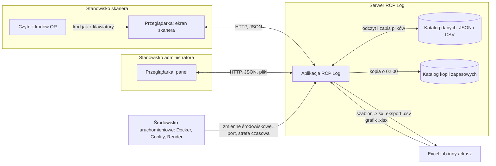

# 04. Integracje i otoczenie systemowe

Aplikacja nie wywołuje żadnych usług zewnętrznych przez sieć (w kodzie nie ma klienta HTTP ani
połączenia z bazą danych; jedyne importy to Flask, Werkzeug, openpyxl i biblioteka standardowa,
`app.py:3-19`). Wymiana danych z otoczeniem odbywa się przez przeglądarkę, pliki w katalogu danych
i pliki przekazywane ręcznie do Excela i z Excela.

## Diagram kontekstu systemowego

## Tabela interfejsów

| Nr | Interfejs | Kierunek | Format | Częstotliwość | Obsługa błędów | Źródło w kodzie |
|---|---|---|---|---|---|---|
| I1 | Czytnik kodów QR → ekran skanera | do aplikacji | czytnik USB emulujący klawiaturę na jednym wspólnym komputerze zmiany (Z2): tekst kodu (`HU_…`) wpisany w pole, zakończony Enter albo wysłany samoczynnie 0,7 s po wpisaniu ponad 5 znaków | każdy skan | nieznany kod: komunikat na ekranie i alert; pusty kod ignorowany | `index.html:439-460`, `app.py:548-556` |
| I2 | Ekran skanera ↔ serwer | dwukierunkowy | HTTP, JSON: skan (`/api/scan`), rejestracja (`/api/rejestruj`), korekta (`/api/korekta`) | na żądanie, przy każdej akcji pracownika | odpowiedzi z komunikatem i kodem 400, 403 lub 409; brak połączenia: „Błąd połączenia”; treść żądania niebędąca JSON daje błąd serwera | `app.py:547-721`, `index.html:450-459, 570-596` |
| I3 | Panel administratora ↔ serwer | dwukierunkowy | HTTP, JSON (`/admin/api/*`); pliki do pobrania (`/admin/export/*`, szablon grafiku); plik wysyłany (`/admin/api/grafik/import`, multipart) | Live i nowe alerty co 20 s; reszta na żądanie | bez sesji: odmowa 401 lub 403, której ekran nie obsługuje; komunikat tam, gdzie ekran sprawdza odpowiedź | `app.py:726-1274`, `admin.html:458-468, 487-508, 626` |
| I4 | Serwer ↔ katalog danych | dwukierunkowy | JSON (słowniki, pobyty, nadwyżki, korekty, grafik, konta, konfiguracja); CSV ze średnikiem i UTF-8 BOM (ewidencja dnia i miesiąca, alerty) | przy każdej zmianie stanu; odczyt przy każdym żądaniu (bez pamięci podręcznej) | uszkodzony JSON czytany jak pusty bez alarmu; zapis atomowy (US-006); błędy odczytu CSV pomijane | `app.py:40-51, 86-101, 238-298` |
| I5 | Serwer → katalog kopii zapasowych | z aplikacji | kopie wszystkich plików CSV i JSON z prefiksem `RRRRMMDD_GGMM_` | raz na dobę, gdy serwer działa w godzinie 02 (nie w trybie demo) | błąd tylko w konsoli serwera; ponawianie co minutę do 03:00; brak retencji | `app.py:453-475` |
| I6 | Serwer → Excel | z aplikacji | szablon grafiku `.xlsx` (bieżący miesiąc, legenda, lista pracowników); eksport CSV dnia, miesiąca, alertów | na żądanie administratora | brak pliku do eksportu: strona „Brak pliku” (404); od US-003 pole zaczynające się od „=”, „+”, „-”, „@” dostaje apostrof (tekst, nie formuła) | `app.py:1090-1103, 1109-1157` |
| I7 | Excel → serwer | do aplikacji | grafik `.xlsx`: wiersz 1 daty, kolumna A nazwiska, komórki z kodami zmian | raz na miesiąc albo po zmianie planu | nierozpoznane wiersze na liście błędów, reszta importowana; brak dat lub pusty plik: błąd bez zapisu; plik `.xls` lub uszkodzony: błąd serwera | `app.py:150-229, 1160-1176` |
| I8 | Środowisko uruchomieniowe → serwer | do aplikacji | zmienne środowiskowe (tabela niżej), port, strefa czasowa | przy starcie | brak `RCP_SECRET_KEY` poza demo: start kończy się błędem; brak `RCP_ADMIN_PASSWORD`: hasło losowe wypisane raz; brak `PORT`: 5050 | `app.py:23-35, 352-359, 1283`, `run.py:15` |
| I9 | Przeglądarka (lokalnie) | po stronie klienta | pamięć przeglądarki: motyw skanera; generator dźwięku dla banera alertu; natywne okna potwierdzeń i wpisywania | przy użyciu | brak zgody przeglądarki na dźwięk: sygnał pomijany bez komunikatu | `index.html:402-411`, `admin.html:495-505` |

## Adresy aplikacji (interfejs HTTP)

Pełna lista punktów, przez które ekrany rozmawiają z serwerem. Kolumna „Dostęp” mówi, czy wymagana
jest sesja administratora.

| Metoda i adres | Przeznaczenie | Dostęp | Proces |
|---|---|---|---|
| GET `/` | ekran skanera | otwarty | P1 |
| POST `/api/scan` | identyfikacja pracownika i stan dnia | otwarty | P1 |
| POST `/api/rejestruj` | rejestracja strefy lub końca zmiany | otwarty | P1 |
| POST `/api/korekta` | zgłoszenie korekty | otwarty | P4 |
| GET `/api/status` | trwające pobyty z oznaczeniem alertów (ten sam wynik co `/admin/api/status`) | sesja; bez niej 401 z pustym ciałem | P2 |
| GET `/api/alerts/new` | nowe alerty dla banera; bez sesji pusta lista | sesja | P2 |
| GET, POST `/admin/login`; GET `/admin/logout`; GET `/admin` | logowanie, wylogowanie, panel | ekran | P6 |
| GET, POST `/admin/haslo` | zmiana hasła; wymuszona po zalogowaniu hasłem startowym — do tego czasu każdy adres `/admin*` przekierowuje tutaj | sesja | P6 |
| GET `/admin/api/status`, `/admin/api/dashboard`, `/admin/api/historia`, `/admin/api/alerty` | Live, Dashboard, Historia, lista alertów (nieużywana przez ekran) | sesja | P2, P7 |
| GET `/admin/api/nadwyzki`; POST `/admin/api/nadwyzki/<nr>/przypisz` | lista nadwyżek, przypisanie strefy | sesja | P3 |
| GET `/admin/api/korekty`; POST `/admin/api/korekty/<nr>` | lista zgłoszeń, decyzja | sesja | P4 |
| POST `/admin/api/move`, `/admin/api/start` | przesunięcie lub zakończenie, ręczny start | sesja | P2 |
| GET, POST `/admin/api/strefy`; DELETE `/admin/api/strefy/<nazwa>`; POST, DELETE `…/podstrefy[/<nazwa>]` | słownik stref i podstref | sesja; w demo zmiany zablokowane | P6 |
| GET, POST `/admin/api/workers`; DELETE `/admin/api/workers/<kod>`; PUT `/admin/api/workers/<kod>/strefy` | słownik pracowników, uprawnienia | sesja; w demo dodawanie i usuwanie zablokowane | P6 |
| GET, POST `/admin/api/admins`; DELETE `/admin/api/admins/<login>` | konta administratorów | sesja; w demo zablokowane | P6 |
| GET, POST `/admin/api/config` | konfiguracja | sesja; w demo zapis zablokowany | P6 |
| GET `/admin/export/<dzien\|miesiac\|alerty>` | eksport CSV | sesja | P7 |
| GET `/admin/api/grafik/template`; POST `/admin/api/grafik/import`; GET `/admin/api/grafik`; POST `/admin/api/grafik/entry`; GET `/admin/api/grafik/porownanie` | szablon, import, widok, edycja, porównanie grafiku | sesja; w demo import zablokowany | P5 |

Dane dashboardu zawierają także czas per strefa i per pracownik, których ekran nie wyświetla
(pozostałość po usuniętych wykresach, `app.py:865-866`).

## Środowisko uruchomieniowe

| Element | Opis | Źródło |
|---|---|---|
| Serwer aplikacji | Waitress, 4 wątki, port z `PORT` (domyślnie 5050), nasłuch na wszystkich interfejsach | `run.py` |
| Obraz kontenera | Python 3.12 slim, użytkownik bez uprawnień administratora, strefa czasowa Europe/Warsaw, kontrola zdrowia przez stronę skanera | `Dockerfile` |
| Publiczna instancja demo | Coolify z pliku compose: tryb demo, reset co 30 min, losowany klucz sesji, domena ustawiana w panelu Coolify | `docker-compose.yaml`, README |
| Alternatywne wdrożenie demo | Render (plan darmowy, dysk ulotny) | `render.yaml` |
| Trwałość danych | katalog danych obok kodu; w kontenerze bez woluminu dane giną przy ponownym wdrożeniu; wolumin na `data/` i `backup/` jest w compose zakomentowany dla trybu produkcyjnego | `app.py:40-42`, `docker-compose.yaml` |
| Instancja produkcyjna (plan) | osobna instancja na tym samym serwerze Coolify bez trybu demo, z woluminami na dane i kopie; kopie na tym samym serwerze z retencją 30 dni (do zbudowania); strefa czasowa Europe/Warsaw (Z7, Z10, Z16) | ustalenia w [00](00-przeglad.md#ustalenia-potwierdzone) |

### Zmienne środowiskowe

| Zmienna | Znaczenie | Domyślnie | Źródło |
|---|---|---|---|
| `RCP_DEMO` | `1` włącza tryb demo | wyłączony | `app.py:23` |
| `RCP_DEMO_RESET_MIN` | co ile minut odtworzyć dane demo | 30 | `app.py:1283` |
| `RCP_SECRET_KEY` | klucz podpisu sesji przeglądarki, co najmniej 32 znaki; **wymagany** poza trybem demo | brak — start kończy się błędem; w demo losowany | `app.py:25-35` |
| `RCP_ADMIN_PASSWORD` | hasło startowe konta `admin` tworzonego przy pierwszym starcie; zmiana wymuszona przy pierwszym logowaniu | losowe, wypisane raz w konsoli | `app.py:352-359` |
| `RCP_PROXY` | `1` za proxy TLS (Coolify): ciasteczko sesji tylko po HTTPS, adres klienta do limitu logowań z `X-Forwarded-For` | wyłączony | `app.py:38-40, 322-325` |
| `PORT` | port serwera | 5050 | `run.py:15` |
| `TZ` | strefa czasowa serwera (czas lokalny w ewidencji); docelowo Europe/Warsaw, czas lokalny wystarcza (Z10) | strefa systemu; w obrazie Docker Europe/Warsaw | `Dockerfile`, `render.yaml` |

### Tryb demo

| Co się zmienia | Jak | Źródło |
|---|---|---|
| Dane | osobny katalog `data_demo/`, kasowany i generowany na nowo przy starcie i co `RCP_DEMO_RESET_MIN` minut: 12 fikcyjnych pracowników, 10 dni ewidencji, trwająca zmiana z przekroczoną przerwą, nadwyżki, korekty, grafik miesiąca | `app.py:1294-1324`, `demo_data.py` |
| Logowanie | każdy odwiedzający jest administratorem „demo”; strona logowania przekierowuje do panelu; „Wyloguj” ukryty | `app.py:1327-1333`, `admin.html:178-180` |
| Blokady | dodawanie i usuwanie stref, podstref, pracowników i kont, zapis konfiguracji, import grafiku: odmowa „Niedostępne w trybie demo” | `app.py:1287-1292, 1334-1338` |
| Działa nadal | skaner, przesunięcia i ręczny start, nadwyżki, korekty, edycja komórek grafiku, eksport | `app.py:1287-1292` (brak na liście) |
| Kopia zapasowa | nie uruchamia się; instancja demo nie potrzebuje kopii (Z7) | `app.py:475` |
| Ekrany | pasek informacyjny w panelu; przyciski z przykładowymi kodami i link do panelu na skanerze | `admin.html:163-165`, `index.html:307-319` |
