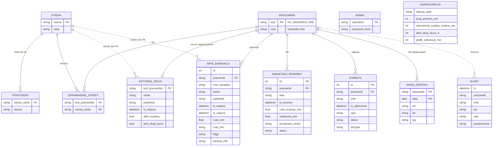

# 04. Model danych

Aplikacja nie używa bazy danych. Stan jest zapisany w plikach JSON i CSV w katalogu `data/`
(`app.py:18-29`), tworzonych automatycznie przy pierwszym uruchomieniu (`app.py:300-314`).
Poniższy model jest **modelem logicznym**: relacje są w plikach zapisane jako listy i powtórzone
nazwy, bez kluczy obcych pilnowanych przez silnik bazy.

## Diagram ERD

Linia ciągła — relacja zapisana wprost (klucz słownika lub kod pracownika w rekordzie).
Linia przerywana — powiązanie tylko przez nazwę, bez kontroli spójności.

## Encje

| Encja | Plik | Struktura | Znaczenie |
|---|---|---|---|
| PRACOWNIK + UPRAWNIENIE_STREFY | `pracownicy.json` | `{kod: {imie, strefy[]}}` | osoba z kodem QR i listą stref, do których może wejść |
| STREFA + PODSTREFA | `strefy.json` | `{nazwa: {kolor, podstrefy[]}}` | obszar magazynu; `PRZERWA` to też strefa |
| AKTYWNA_SESJA | `aktywne_sesje.json` | `{kod: {strefa, podstrefa, ts_wejscia, …}}` | trwający pobyt; klucz = kod pracownika, więc najwyżej jedna sesja na osobę |
| WPIS_EWIDENCJI | `ewidencja_RRRR-MM-DD.csv` i `ewidencja_RRRR-MM.csv` | wiersz CSV, separator `;`, UTF-8 z BOM | zamknięty pobyt; każdy wiersz zapisywany do pliku dnia i miesiąca |
| ALERT | `alerty.csv` | wiersz CSV | zdarzenie do uwagi administratora |
| NADWYZKA_PRZERWY | `nadwyzki_przerw.json` | lista | czas przerwy ponad próg, do przypisania strefie |
| KOREKTA | `korekty.json` | lista | zgłoszenie pracownika i decyzja administratora |
| DZIEN_GRAFIKU | `grafik.json` | `{kod: {data: {od, do, typ}}}` | planowana zmiana albo dzień wolny |
| ADMIN | `admins.json` | `{login: hash}` | konto panelu, hasło jako hash werkzeug |
| KONFIGURACJA | `config.json` | obiekt | progi i ścieżka kopii zapasowej |

## Słowniki wartości

| Pole | Wartości | Kod |
|---|---|---|
| `WPIS_EWIDENCJI.flaga` | pusta, `DLUGA_PRZERWA`, `AUTO_ZAMKNIETO` | `app.py:296, 412` |
| `WPIS_EWIDENCJI.korekta_info` | pusta, `ADMIN:<login>`, `ADMIN:<login>:start_override` | `app.py:844, 884` |
| `ALERT.typ` | `DLUGA_PRZERWA`, `DLUGI_DYZUR`, `AUTO_ZAMKNIETO`, `NIEZNANY_KOD` | `app.py:383, 391, 415, 441` |
| `NADWYZKA_PRZERWY.status` | `oczekuje`, `przypisana` | `app.py:563, 787` |
| `KOREKTA.status` | `oczekuje`, `zatwierdzona`, `odrzucona` | `app.py:641, 805` |
| `DZIEN_GRAFIKU.typ` | `P` (praca), `W` (wolne) | `app.py:97-115` |
| strefa specjalna | `PRZERWA` (logika przerw), `KONIEC_ZMIANY` (pseudo-strefa zamykająca sesję) | `app.py:295, 501` |

## Reguły integralności

Pilnowane przez kod:

| # | Reguła | Kod |
|---|---|---|
| I1 | Pracownik ma najwyżej jedną aktywną sesję (kod pracownika jest kluczem słownika sesji). | `app.py:526, 576` |
| I2 | Otwarcie nowej sesji zawsze najpierw zamyka bieżącą i zapisuje ją do ewidencji. | `app.py:529-547` |
| I3 | Zmiany sesji wykonywane są pod blokadą — dwa równoczesne skany nie nadpiszą się. | `app.py:522, 825, 867` |
| I4 | Kod nowego pracownika musi zaczynać się od `HU_`. | `app.py:943` |
| I5 | Pracownik może wejść tylko do strefy ze swojej listy uprawnień. | `app.py:501-503` |
| I6 | Usunięcie pracownika usuwa jego aktywną sesję. | `app.py:953-954` |

Niepilnowane — znane niespójności:

| # | Obserwacja | Kod |
|---|---|---|
| N1 | Nazwa strefy w sesji i ewidencji to wolny tekst. Usunięcie strefy nie usuwa jej z uprawnień i nie blokuje rejestracji. | `app.py:905-909, 502` |
| N2 | Podstrefa nie jest sprawdzana — serwer zapisze dowolną wartość. | `app.py:488, 576` |
| N3 | Imię i nazwisko jest kopiowane do wpisów, nadwyżek i korekt. Zmiana nazwiska wymaga usunięcia i ponownego dodania pracownika. | `app.py:537, 556, 638` |
| N4 | Korekta nie wskazuje wpisu, którego dotyczy; jej zatwierdzenie nie zmienia ewidencji. | `app.py:635-643, 803-807` |
| N5 | Pole `ALERT.potwierdzone` ma zawsze wartość `NIE` i nie jest nigdzie zmieniane. | `app.py:252` |
| N6 | `id` wpisu to liczba linii w pliku miesięcznym; wiersze `AUTO_ZAMKNIETO` nie mają `id`, `czas_fmt` ani `korekta_info`. | `app.py:224-229, 405-413` |
| N7 | `id` nadwyżek i korekt to długość listy + 1; zapis tych plików nie jest objęty blokadą. | `app.py:554, 636` |
| N8 | Wpis trafia do pliku dnia wejścia — pobyt przez północ trafia do dnia poprzedniego. | `app.py:547` |
| N9 | Nic nie blokuje utworzenia strefy o nazwie `KONIEC_ZMIANY`. | `app.py:900` |
| N10 | Macierz uprawnień odwołuje się do strefy `STREFA_INNE`, której nie ma w danych startowych; zapis może dodać uprawnienie do nieistniejącej strefy. | `admin.html:1204, 1321` |
| N11 | Wpis grafiku nie sprawdza istnienia pracownika ani formatu daty. | `app.py:1114-1123` |
| N12 | Dodanie pracownika lub strefy o istniejącej nazwie nadpisuje rekord (kasuje uprawnienia lub podstrefy). | `app.py:944, 902` |
