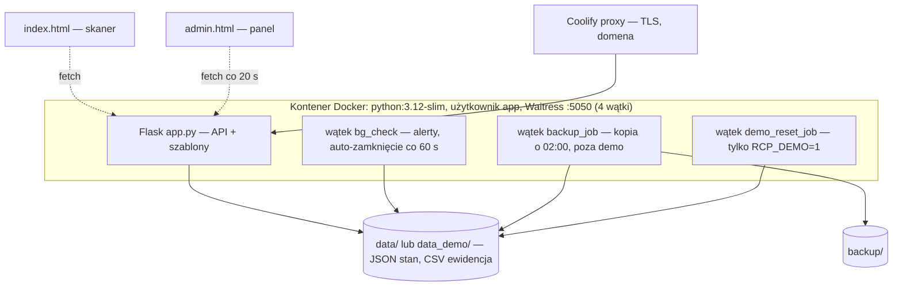

# Architektura

Jeden proces Flask + Waitress, pliki JSON/CSV zamiast bazy (D1), zadania cykliczne jako wątki (D10),
tryb demo w tym samym kodzie (D11). Diagram kontekstu, interfejsy i środowisko uruchomieniowe:
[04-integracje](../04-integracje.md). Model danych: [02-dane](../02-dane/model-danych.md).

## Kontenery (C4 poziom 2)

## Cechy i konsekwencje

| Cecha | Konsekwencja |
|---|---|
| Stan w plikach, `threading.Lock` tylko dla pobytów | poprawne przy jednym procesie; wiele replik = duplikaty alertów i wyścigi (DEV-2, DEV-4) |
| Wątki startują przy imporcie modułu | testy importują `app` z działającymi wątkami; `init_files()` tworzy katalog danych |
| Brak warstwy domenowej | zamykanie pobytu w trzech miejscach (DEV-1) — cel US-005 |
| Tryb demo przez `before_request` | każdy gość jest administratorem; `DEMO_BLOCKED` zamyka słowniki, konta, konfigurację, import |
| Frontend bez builda | zero zależności JS; cały JS inline w szablonach |

## Decyzje

D1–D11 w [05-decyzje-i-ograniczenia](../05-decyzje-i-ograniczenia.md); nowe jako [ADR](adr/README.md).
