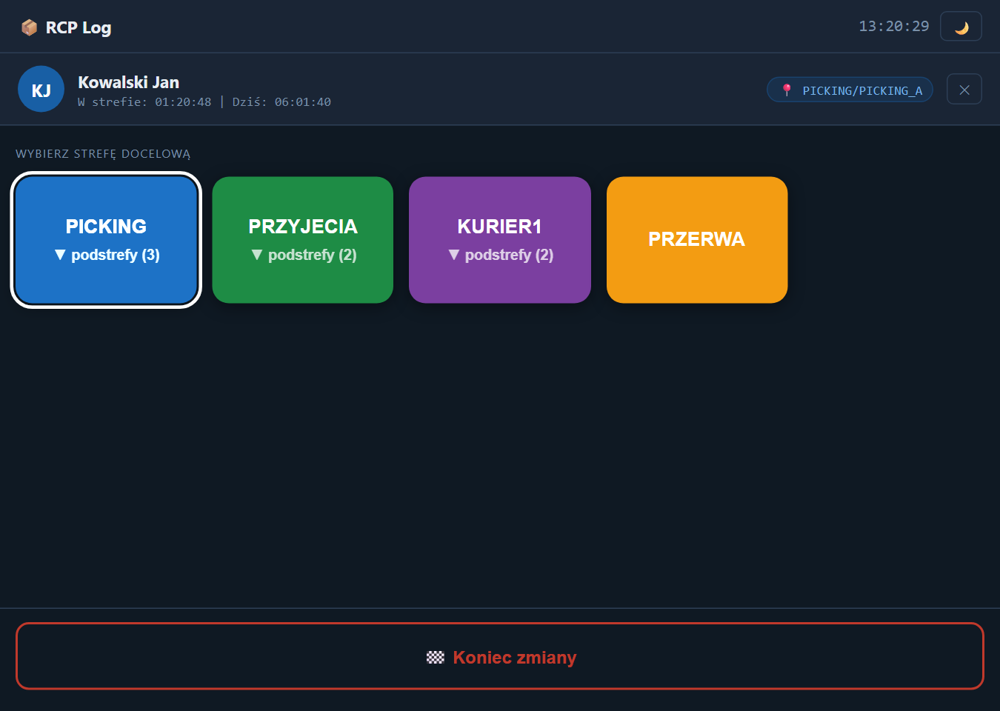
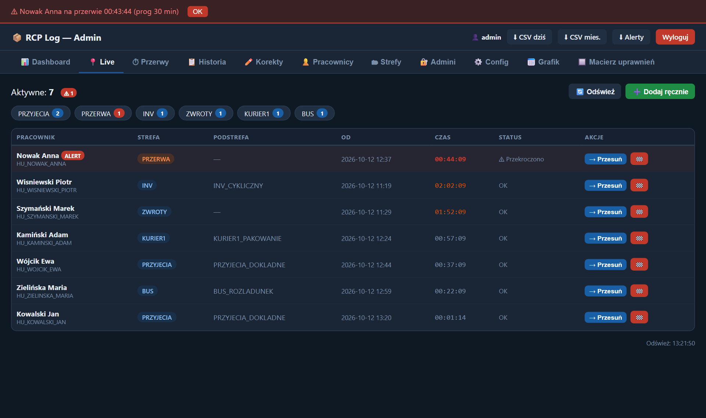
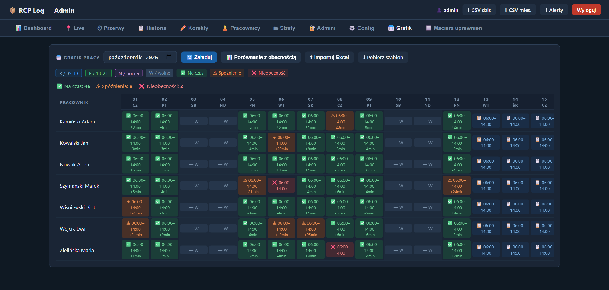

# 03. User flow — mapa ekranów i przejść

Aplikacja ma dwie części:
- **skaner** (`/`, `templates/index.html`) — jedna strona z trzema ekranami przełączanymi bez zmiany adresu i czterema oknami modalnymi; dostępny bez logowania,
- **panel administratora** (`/admin`, `templates/admin.html`) — logowanie, jedna strona z 11 zakładkami i trzema oknami modalnymi.

## Jak to wygląda

| Skaner — ekran pracownika (2) | Panel — Live (5.2) |
|---|---|
|  |  |

Porównanie grafiku z obecnością (5.10):

## Mapa

```mermaid
flowchart LR
    subgraph S1 ["1. Skaner — start"]
        s1a[Pole: Skanuj lub wpisz kod]
        s1b[Link: Zgłoś korektę wpisu]
        s1c[Zegar, przełącznik motywu]
    end
    subgraph S1a ["1a. Modal: Zgłoś korektę"]
        k1[Pole: opis problemu]
        k2[Wyślij zgłoszenie]
        k3[Anuluj]
        k4[Okno przeglądarki: wpisz swój kod]
    end
    subgraph S2 ["2. Skaner — pracownik"]
        s2a[Inicjały, imię, czas w strefie, czas dziś]
        s2b[Znacznik bieżącej strefy]
        s2c[Kafelki dozwolonych stref]
        s2d[Koniec zmiany]
        s2e[X — anuluj]
    end
    subgraph S2a ["2a. Modal: Podstrefy"]
        p1[Przyciski podstref]
        p2[Bez podstrefy]
        p3[Wróć]
    end
    subgraph S2b ["2b. Modal: Potwierdź"]
        c1[Strefa / podstrefa albo Zakończ zmianę]
        c2[Potwierdź]
        c3[Wróć]
    end
    subgraph S2c ["2c. Modal: Ostrzeżenie"]
        w1[Byłeś w X tylko mm:ss]
        w2[Tak, zmień strefę]
        w3[Zostań]
    end
    subgraph S3 ["3. Skaner — zapisano"]
        f1[Imię, nowa strefa, czas dziś]
        f2[Ramka alertu długiej przerwy]
        f3[OK — Gotowe]
    end
    subgraph S4 ["4. Logowanie administratora"]
        l1[Login, hasło]
        l2[Zaloguj się]
        l3[Komunikat błędu]
        l4[Wróć do skanowania]
    end
    subgraph S5 ["5. Panel administratora"]
        a0[Eksport CSV, Wyloguj]
        a1[Baner alertu z dźwiękiem]
        a2[11 zakładek]
    end
    subgraph S5a ["5a. Modal: Przesuń"]
        m1[Strefa, podstrefa]
        m2[Przesuń / Zakończ zmianę / Anuluj]
    end
    subgraph S5b ["5b. Modal: Dodaj ręcznie"]
        r1[Pracownik, strefa, podstrefa]
        r2[Uruchom sesję / Anuluj]
    end
    subgraph S5c ["5c. Modal: Nadwyżka"]
        n1[Lista stref]
        n2[Zapisz / Anuluj]
    end

    S1 -- "skan znanego kodu" --> S2
    S1 -- "nieznany kod: komunikat" --> S1
    S1 -- "Zgłoś korektę" --> S1a
    S1a -- "Wyślij, podaj kod" --> S1
    S1a -- "Anuluj" --> S1
    S2 -- "strefa z podstrefami" --> S2a
    S2 -- "strefa bez podstref lub Koniec zmiany" --> S2b
    S2 -- "X" --> S1
    S2a -- "wybór" --> S2b
    S2a -- "Wróć" --> S2
    S2b -- "Wróć" --> S2
    S2b -- "Potwierdź: zapisano" --> S3
    S2b -- "Potwierdź: poniżej 5 min w strefie" --> S2c
    S2b -- "Potwierdź: błąd, komunikat" --> S2b
    S2c -- "Tak, zmień" --> S3
    S2c -- "Zostań" --> S2b
    S3 -- "OK — Gotowe" --> S1
    S4 -- "poprawne dane" --> S5
    S4 -- "błędne dane" --> S4
    S4 -- "Wróć do skanowania" --> S1
    S5 -- "Wyloguj" --> S4
    S5 -- "Live: Przesuń" --> S5a
    S5 -- "Live: Dodaj ręcznie" --> S5b
    S5 -- "Przerwy: Przypisz strefę" --> S5c
    S5a -- "dowolna akcja" --> S5
    S5b -- "dowolna akcja" --> S5
    S5c -- "dowolna akcja" --> S5
```

## Ekrany

| Nr | Ekran | Elementy | Akcja użytkownika | Prowadzi do |
|---|---|---|---|---|
| 1 | Skaner — start | zegar; przełącznik motywu; pole „Skanuj lub wpisz kod…”; link „Zgłoś korektę wpisu” | skan / wpisanie kodu i Enter (lub automatycznie 0,7 s po wpisaniu ponad 5 znaków) | 2, a przy nieznanym kodzie 1 z komunikatem „Nieznany kod QR. Skontaktuj się z liderem.” |
| | | | „Zgłoś korektę wpisu” | 1a |
| 1a | Modal: Zgłoś korektę | pole opisu; „Wyślij zgłoszenie”; „Anuluj” | Wyślij z pustym opisem | 1a z komunikatem „Opisz problem” |
| | | | Wyślij → okno przeglądarki „Wpisz swój kod (HU_...)” | 1 z komunikatem „Zgłoszenie wysłane” |
| | | | Anuluj / klik w tło | 1 |
| 2 | Skaner — pracownik | inicjały, imię i nazwisko; „W strefie: hh:mm:ss \| Dziś: hh:mm:ss” (licznik na żywo); znacznik bieżącej strefy (pomarańczowy dla przerwy); kafelki dozwolonych stref, bieżąca obwiedziona; „Koniec zmiany”; „✕” | kafelek strefy z podstrefami | 2a |
| | | | kafelek strefy bez podstref | 2b |
| | | | „Koniec zmiany” | 2b w wariancie „Zakończ zmianę” |
| | | | „✕” | 1 |
| 2a | Modal: Podstrefy | kolor i nazwa strefy; przyciski podstref; „— Bez podstrefy —”; „↩ Wróć” | podstrefa lub „bez podstrefy” | 2b |
| | | | Wróć / klik w tło | 2 |
| 2b | Modal: Potwierdź | „Potwierdź przejście do strefy X / Y” albo „Zakończ zmianę”; „↩ Wróć”; „✅ Potwierdź” | Potwierdź — zapis udany | 3 |
| | | | Potwierdź — bieżąca sesja krótsza niż próg | 2c |
| | | | Potwierdź — błąd walidacji | 2b z komunikatem błędu |
| | | | Potwierdź — brak połączenia | 2 z komunikatem „Błąd połączenia” |
| | | | Wróć / klik w tło | 2 |
| 2c | Modal: Ostrzeżenie | „Byłeś w X tylko mm:ss. Na pewno zmieniasz strefę?”; „↩ Zostań”; „Tak, zmień strefę” | Tak, zmień strefę | 3 |
| | | | Zostań | 2b |
| 3 | Skaner — zapisano | ✅ lub 🏁; imię; nowa strefa i podstrefa; „Dziś przepracowano” lub „Łączny czas”; ramka alertu po długiej przerwie; „OK — Gotowe” | OK — Gotowe | 1 |
| 4 | Logowanie administratora | login; hasło; „Zaloguj się”; komunikat „Nieprawidłowy login lub hasło”; „← Wróć do skanowania” | poprawne dane | 5 |
| | | | błędne dane | 4 z komunikatem |
| | | | Wróć do skanowania | 1 |
| 5 | Panel administratora | nazwa zalogowanego; „CSV dziś”, „CSV mies.”, „Alerty”; „Wyloguj”; baner nowego alertu z sygnałem dźwiękowym (sprawdzany co 20 s); 11 zakładek | Wyloguj | 4 |
| | | | eksport | pobranie pliku |
| 5.1 | Dashboard | wybór daty; 4 wskaźniki: aktywne sesje, na przerwie, alerty przerw, wpisy dziś; kafelki stref: osoby teraz i czas dziś | zmiana daty → Pokaż | 5.1 |
| 5.2 | Live | liczba aktywnych; liczba alertów; „Odśwież”; „Dodaj ręcznie”; liczniki per strefa; tabela: pracownik, strefa, podstrefa, od, czas, status, „→ Przesuń”, „🏁”; odświeżanie co 20 s | Przesuń | 5a |
| | | | 🏁 → potwierdzenie przeglądarki | 5.2 z komunikatem |
| | | | Dodaj ręcznie | 5b |
| 5.3 | Przerwy | tabela nadwyżek: pracownik, czas przerwy, nadwyżka, data, przypisana strefa, „Przypisz strefę” | Przypisz strefę | 5c |
| 5.4 | Historia | data od, data do, pracownik, strefa; „Szukaj”; tabela wpisów (maksymalnie 500) | Szukaj | 5.4 |
| 5.5 | Korekty | tabela: data, pracownik, opis, status, ✓ / ✕ | ✓ lub ✕ | 5.5 z komunikatem |
| 5.6 | Pracownicy | kod „HU_NAZWISKO_IMIE”, „Nazwisko Imię”, „+”; lista z „Strefy” i „✕”; edytor uprawnień | dodaj / edytuj uprawnienia / usuń | 5.6 |
| 5.7 | Strefy | nazwa, kolor, „+”; lista z „Podstrefy” i „✕”; edytor podstref | dodaj / edytuj podstrefy / usuń | 5.7 |
| 5.8 | Admini | login, hasło, „+”; lista z „✕” | dodaj / usuń | 5.8 |
| 5.9 | Config | próg przerwy; próg szybkiej zmiany; próg długiego dyżuru; tolerancja grafiku; ścieżka kopii; informacja o zamykaniu sesji o 23:59:59 | Zapisz ustawienia | 5.9 z komunikatem |
| 5.10 | Grafik | miesiąc; „Załaduj”; „Porównanie z obecnością”; „Importuj Excel”; „Pobierz szablon”; legenda; tabela pracownik × dzień | klik w komórkę → okno przeglądarki z kodem zmiany | 5.10 |
| | | | Importuj Excel → wybór pliku | 5.10 z komunikatem; lista nieznanych pracowników |
| 5.11 | Macierz uprawnień | wyszukiwarka; „Zaznacz / Odznacz widocznych”; „Zapisz wszystkie uprawnienia”; tabela pracownik × strefa | zaznaczanie i zapis | 5.11 z komunikatem |
| 5a | Modal: Przesuń | „Przesuń: imię”; „Aktualnie: strefa”; strefa docelowa; podstrefa; „Przesuń”, „Zakończ zmianę”, „Anuluj” | dowolna akcja | 5.2 |
| 5b | Modal: Dodaj ręcznie | pracownik; strefa; podstrefa; „Uruchom sesję”, „Anuluj” | dowolna akcja | 5.2 |
| 5c | Modal: Nadwyżka | „imię — nadwyżka: czas”; lista stref; „Zapisz”, „Anuluj” | dowolna akcja | 5.3 |

## Ścieżki alternatywne

| Ścieżka | Zachowanie |
|---|---|
| Gość a zalogowany | Skaner (1–3) działa bez logowania. Wejście na `/admin` bez sesji przekierowuje do 4. API panelu bez sesji odpowiada kodem 401. |
| Modal a pełny ekran | Skaner: trzy ekrany pełne i cztery modale na jednej stronie. Panel: zakładki, trzy modale oraz natywne okna przeglądarki (potwierdzenie, wpisanie wartości, lista błędów importu). |
| Błąd walidacji | Skaner: czerwony komunikat, użytkownik zostaje na ekranie. Logowanie: komunikat w formularzu. Panel: komunikat — tam, gdzie interfejs sprawdza odpowiedź serwera. |
| Przerwanie procesu | „✕” na ekranie 2, „Wróć” w modalach, klik w tło modala. Przerwanie przed „Potwierdź” niczego nie zapisuje. |

## Ślepe ścieżki i akcje bez informacji zwrotnej

| # | Obserwacja | Gdzie |
|---|---|---|
| U1 | Ekrany 2 i 3 nie wracają same do ekranu startowego. Gdy pracownik odejdzie, kolejna osoba może wybrać strefę w jego imieniu. | `index.html:322-348` |
| U2 | Zgłoszenie korekty zawsze kończy się komunikatem sukcesu, także gdy serwer odrzuci nieznany kod. | `index.html:640-645` |
| U3 | Korektę można zgłosić tylko z ekranu startowego, z ręcznym wpisaniem kodu. | `index.html:306, 610` |
| U4 | Decyzja o korekcie, usunięcie pracownika, strefy lub podstrefy i edycja grafiku nie sprawdzają odpowiedzi serwera. | `admin.html:863-867, 882-886, 929-933, 954-956, 1151-1154` |
| U5 | Po wygaśnięciu sesji administratora zakładki przestają się ładować bez komunikatu. | np. `admin.html:573-576` |
| U6 | Eksport nieistniejącego pliku otwiera stronę z samym tekstem błędu, bez nawigacji. | `app.py:1014-1015` |
| U7 | Brak linku z panelu do skanera i ze skanera do panelu. | `admin.html:171-182`, `index.html:286-292` |
| U8 | Przy ostrzeżeniu o szybkiej zmianie otwierają się jednocześnie modal ostrzeżenia i modal potwierdzenia. | `index.html:584-589` |
| U9 | Macierz uprawnień nie odświeża się po dodaniu pracownika lub strefy — trzeba przeładować stronę. | `admin.html:1197` |
