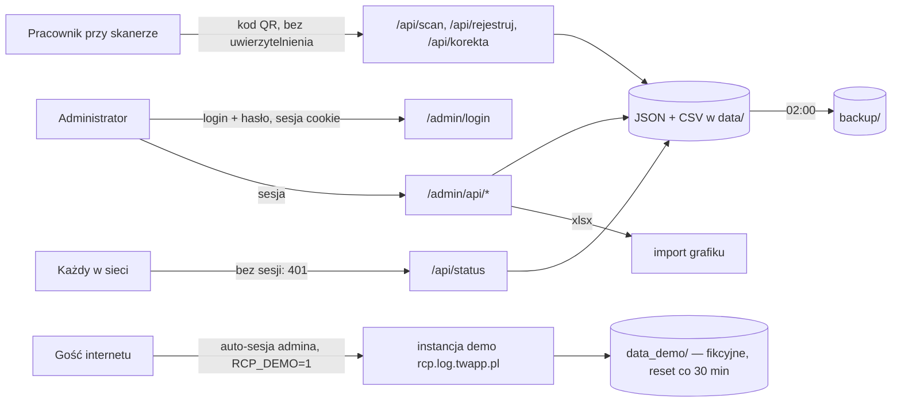

# Threat model — wersja 0.1

STRIDE per przepływ danych. Ryzyka R1–R10 z [AUDYT](../AUDYT.md#sec-najważniejsze-ryzyka-top-10),
problemy B1–B9 z [05](../05-decyzje-i-ograniczenia.md#bezpieczeństwo), rejestr decyzji w [RYZYKA](RYZYKA.md).
Diagram kontekstu i interfejsy I1–I8: [04-integracje](../04-integracje.md).

## Przepływy

## STRIDE

| Przepływ | Zagrożenie | Kategoria | Ryzyko | Zabezpieczenie (stan) |
|---|---|---|---|---|
| Skaner → rejestracja | rejestracja w cudzym imieniu — kod przewidywalny, duplikat karty z tym samym kodem (Z3) | Spoofing | R4 / B5 | brak; *Could* US-008 |
| Skaner → korekta | opis wolnego tekstu bez limitu długości | Tampering / DoS | — | escapowany w panelu; brak limitu (niska) |
| Skaner → alerty.csv | nieznany kod z `=` jako formuła w Excelu | Tampering | R8 (zamknięte) | apostrof przed `= + - @` i tabulatorem w każdym zapisie CSV (US-003) |
| Każdy → /api/status | wyciek obecności z nazwiskami | Information disclosure | R3 (zamknięte) | sesja administratora wymagana, bez niej 401 (US-002) |
| Admin → logowanie | brute force | Spoofing / Elevation | R5 (zamknięte), R12 | hash werkzeug; hasło startowe jednorazowe (US-001); 5 prób / 10 min z adresu → 429 na 15 min (US-003); ograniczenia limitu: R12 |
| Cookie sesji | podrobienie sesji dzięki domyślnemu kluczowi | Spoofing / Elevation | R1 (zamknięte) | klucz wymagany poza demo, ≥ 32 znaki; demo losuje (US-001) |
| Admin → zmiana hasła | CSRF na formularz `/admin/haslo`; przejęcie hasła startowego z logu | Tampering / Spoofing | R6, R11 | min. 12 znaków, powtórzenie; token CSRF (US-003); R11 zaakceptowane |
| Admin → formularze | CSRF (logowanie, import xlsx, wylogowanie GET) | Tampering | R6 (zamknięte) | token CSRF w sesji na formularzach i nagłówku importu; `SameSite=Lax`, `HttpOnly`, `Secure` za proxy (US-003); wylogowanie GET bez tokenu — skutek tylko wylogowanie |
| Admin → import grafiku | spreparowany/duży xlsx | DoS | R9 (zamknięte) | `MAX_CONTENT_LENGTH` 2 MB → 413; tylko `.xlsx`; uszkodzony plik → 400 z wpisem w logu (US-011) |
| Admin → config | dowolne klucze, `backup_path` dowolny katalog | Tampering | R7 (zamknięte) | biała lista kluczy, zakresy, katalog kopii pod `RCP_BACKUP_ROOT` (US-011); w demo zablokowane |
| Admin → operacje wrażliwe | brak dziennika kto co zmienił (poza `korekta_info`) | Repudiation | R10 | częściowo (`ADMIN:<login>`) |
| Gość → instancja demo | każdy jest administratorem: edycja grafiku, przesunięcia, korekty bez limitu — zaśmiecenie lub DoS demo | Tampering / DoS | R9 | `DEMO_BLOCKED`, reset co 30 min, dane fikcyjne; brak limitu żądań |
| Gość → instancja demo | pomylenie demo z produkcją — wpisanie prawdziwych danych | Information disclosure | — | baner demo w szablonach (`demo` w kontekście); osobna instancja produkcyjna (Z16) |
| data/, backup/ | dane osobowe bezterminowo (kopie: retencja 30 dni do zbudowania, Z7) | Information disclosure | R10 | okresy w [RODO.md](RODO.md) (Z29); mechanizm usuwania — US-009 |
| Serwer | HTTP bez TLS w kontenerze; clickjacking, sniffing typu | Information disclosure | R9 (zamknięte), R13 | TLS na proxy Coolify; CSP, `X-Frame-Options: DENY`, `nosniff`, `Referrer-Policy`, HSTS za proxy (US-011) |

## Poza modelem

Fizyczny dostęp do stanowiska skanera i do karty QR — proces organizacyjny (Z1, Z2), nie aplikacja.
